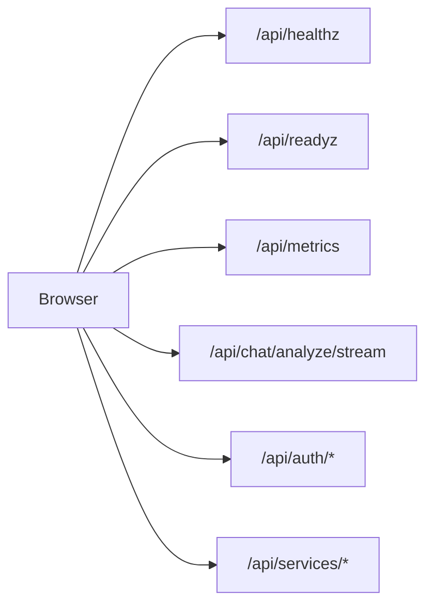

# API Routes

This document explains the API routes exposed by the Web service. These are Next.js API routes that run server-side and handle backend orchestration.

## Overview

The Web service exposes API routes under `/api/`. These routes handle:

- Health checks and monitoring
- AI text analysis
- Backend service health for the UI
- Authentication (via NextAuth)



### Which Routes Need Authentication

Most routes are open, because a probe or a scraper cannot log in first.

| Route | Method | Authentication |
|-------|--------|----------------|
| `/api/healthz` | `GET` | None |
| `/api/readyz` | `GET` | None |
| `/api/metrics` | `GET` | Bearer token, but only when `PROMETHEUS_WEB_SCRAPE_TOKEN` is set |
| `/api/services/analysis/status` | `GET` | None |
| `/api/services/document-parser/status` | `GET` | None |
| `/api/services/payment-gateway/status` | `GET` | None |
| `/api/chat/analyze/stream` | `POST` | A NextAuth session, or the `X-Internal-Key` header |
| `/api/auth/*` | `GET`, `POST` | Managed by NextAuth |

## Health Endpoints

### Liveness Probe — `/api/healthz`

**What it does:** Always returns 200 if the process is alive. Used by Kubernetes to know if the pod should be restarted.

**Request:**

```bash
curl http://localhost:3000/api/healthz
```

**Response:**

```json
{
  "status": "ok"
}
```

**What each field means:**

| Field | Type | Description |
|-------|------|-------------|
| `status` | string | Always `"ok"` if the process is running |

The response also carries `Cache-Control: no-store, private` so a proxy never serves a stale answer.

**Why it's simple:** A liveness probe should never fail unless the process is stuck. It doesn't check dependencies — that's the readiness probe's job.

### Readiness Probe — `/api/readyz`

**What it does:** Checks if the service can handle requests by testing all dependencies.

**Request:**

```bash
curl http://localhost:3000/api/readyz
```

**Response (all healthy):**

```json
{
  "status": "ready",
  "checks": {
    "postgres": { "status": "ok", "latencyMs": 12 },
    "redis": { "status": "ok", "latencyMs": 3 },
    "documentParser": { "status": "ok", "latencyMs": 45 },
    "paymentGateway": { "status": "ok", "latencyMs": 30 },
    "analysis": {
      "status": "ok",
      "checks": {
        "inference": { "status": "ok", "latencyMs": 8 },
        "chatService": { "status": "ok", "latencyMs": 6 }
      }
    }
  }
}
```

**Response (degraded — optional service down):**

```json
{
  "status": "degraded",
  "checks": {
    "postgres": { "status": "ok", "latencyMs": 12 },
    "redis": { "status": "ok", "latencyMs": 3 },
    "documentParser": { "status": "error", "error": "health 503" },
    "paymentGateway": { "status": "ok", "latencyMs": 30 },
    "analysis": { "status": "ok", "checks": { "inference": { "status": "ok", "latencyMs": 8 } } }
  }
}
```

**Response (not ready — required service down):**

```json
{
  "status": "not_ready",
  "checks": {
    "postgres": { "status": "error", "error": "connection refused" },
    "redis": { "status": "ok", "latencyMs": 3 },
    "documentParser": { "status": "ok", "latencyMs": 45 },
    "paymentGateway": { "status": "ok", "latencyMs": 30 },
    "analysis": { "status": "ok", "checks": { "inference": { "status": "ok", "latencyMs": 8 } } }
  }
}
```

The response always contains all five checks, whatever the outcome.

**What each field means:**

| Field | Type | Description |
|-------|------|-------------|
| `status` | string | `"ready"`, `"degraded"` or `"not_ready"` |
| `checks.postgres` | object | The PostgreSQL check |
| `checks.redis` | object | The Redis check |
| `checks.documentParser` | object | The document parser check |
| `checks.paymentGateway` | object | The payment gateway check |
| `checks.analysis` | object | The analysis check, which groups the two gRPC services |
| `checks.analysis.checks` | object | The `inference` and `chatService` checks. Present unless the analysis check itself timed out |

Each individual check is an object with:

| Field | Type | Description |
|-------|------|-------------|
| `status` | string | `"ok"`, `"error"` or `"skipped"` |
| `latencyMs` | number | How long the check took. Only present when the check succeeded |
| `error` | string | Why the check failed. Only present when the check failed |

**HTTP status codes:**

| Status | Meaning |
|--------|---------|
| `200` | The required checks passed. The body says `"ready"` or `"degraded"` |
| `503` | A required check failed. The body says `"not_ready"` |

**Check types:**

| Check | Required | Timeout | What It Tests |
|-------|----------|---------|---------------|
| `postgres` | Yes | 8s | PostgreSQL connection (`SELECT 1`) |
| `redis` | Yes | 8s | Redis connection (`PING`) |
| `documentParser` | No | 2s | Document parser HTTP health |
| `paymentGateway` | No | 2s | Payment gateway HTTP readyz |
| `analysis` | No | 2s | Inference + Chats gRPC health |

Every check is individually bounded, and the whole suite is capped at 20 seconds so a probe can never hang. The optional checks also carry their own 2-second inner deadline, so a slow backend degrades the app quickly.

**Why cached?** The PostgreSQL and Redis results are cached for 10 seconds, because a cold connection to either can take several seconds and a probe runs every few seconds. The three optional checks are **not** cached — they are probed on every request, because they are cheap and you want them to be fresh.

See [Health Checks](../operations/health.md) for the full picture.

### Prometheus Metrics — `/api/metrics`

**What it does:** Exposes Prometheus metrics for scraping.

**Request:**

```bash
curl http://localhost:3000/api/metrics
```

If `PROMETHEUS_WEB_SCRAPE_TOKEN` is set, requires Bearer token:

```bash
curl -H "Authorization: Bearer your-token" http://localhost:3000/api/metrics
```

**Response:** Prometheus text format with all application metrics. Without a token configured, the route is open. With one configured, a wrong or missing token gets a plain-text `401 Unauthorized`.

## AI Analysis Endpoint

### Streaming Analysis — `POST /api/chat/analyze/stream`

**What it does:** Analyzes text for AI-generated content and streams results back as NDJSON (newline-delimited JSON — one JSON object per line).

**Request:**

```bash
curl -X POST http://localhost:3000/api/chat/analyze/stream \
  -H "Content-Type: application/json" \
  -H "Cookie: next-auth.session-token=..." \
  -d '{
    "chatId": "chat-123",
    "content": "The text to analyze for AI detection",
    "model": "spark"
  }'
```

**Request fields:**

| Field | Type | Required | Description |
|-------|------|----------|-------------|
| `chatId` | string | Yes | The chat the analysis belongs to. Must not be empty |
| `content` | string | Yes | The text to analyze. Must not be empty, and must not exceed 50 000 characters |
| `model` | string | Yes | Detection model: `"spark"` or `"flare"`. There is no default — a request without it is rejected |
| `assistantMessageId` | string | No | Client-generated ID for the assistant message, so the optimistic UI and the stored row share an identity |
| `assistantCreatedAt` | string | No | ISO 8601 timestamp for that message |
| `sourceMessageId` | string | No | The user message this analysis belongs to. See the rule below |
| `userMessageId` | string | No | Client-generated ID for the user message |
| `userCreatedAt` | string | No | ISO 8601 timestamp for that message |

**The one cross-field rule:** if you send `sourceMessageId`, you must also send `assistantMessageId` **and** `assistantCreatedAt`. Together they mark the request as a retry of an analysis that already ran, and the service needs all three to reconcile the stored messages.

**Response headers:**

| Header | Value |
|--------|-------|
| `Content-Type` | `application/x-ndjson; charset=utf-8` |
| `Cache-Control` | `no-cache, no-transform` |

**Response (NDJSON stream):**

```
{"type":"accepted","message":{"id":"msg-1","role":"assistant","content":"","analysisStatus":{"state":"running","model":"spark","sourceMessageId":"msg-0"},"createdAt":"2026-04-25T10:00:00.000Z"}}
{"type":"started","totalChars":45,"totalChunks":1}
{"type":"progress","processedChunks":1,"totalChunks":1}
{"type":"final","message":{"id":"msg-1","role":"assistant","content":"","analysis":{"model":"spark","label":"Human","confidence":0.95,"scores":{"ai":0.05,"human":0.95},"highlights":[],"raw":{}},"createdAt":"2026-04-25T10:00:00.000Z"}}
```

**Stream events:**

| Event | Fields | Description |
|-------|--------|-------------|
| `accepted` | `message` | The analysis was accepted and the assistant message was stored in the `running` state |
| `started` | `totalChars`, `totalChunks` | The inference service has begun work |
| `progress` | `processedChunks`, `totalChunks` | A chunk has been processed |
| `final` | `message` | The analysis is complete. The result is at `message.analysis` |
| `error` | `error` | The analysis failed. Only sent for a failure, and only if the client did not cancel the request |

**The `final` event carries a message, not a bare result.** The analysis lives at `message.analysis`, and the message also carries `id`, `role`, `content` and `createdAt`. The `createdAt` value is an ISO 8601 string, not a JavaScript `Date`.

**Error responses:**

| Status | Body | When |
|--------|------|------|
| `400` | `{"error":"Invalid JSON body"}` | The body is not valid JSON |
| `400` | `{"error":"Invalid request payload"}` | The body does not match the schema |
| `400` | `{"error":"Text exceeds maximum length of 50000 characters"}` | The content is over the limit |
| `401` | `{"error":"Unauthorized"}` | No session, and no valid internal key |
| `429` | `{"error":"Too many requests"}` | The abuse limiter refused. Comes with `RateLimit-*` headers |
| `429` | `{"error":"Rate limit exceeded"}` | The daily cap refused. No headers |
| `500` | `{"error":"<message>"}` | Something unexpected went wrong before the stream started |

**A failure after the stream has started is not a 500.** The HTTP status is already 200 by then, so the failure arrives as an `error` event inside the stream.

**Load testing:** Send an `X-Internal-Key` header matching `INTERNAL_API_KEY` to bypass authentication and use a shared load-test user. See [Rate Limiting](rate-limiting.md) for exactly what that header skips.

## Backend Service Status Proxies

These endpoints report the health of one backend service each, for the UI to poll. They are **not** the readiness probe — use `/api/readyz` for that.

### Inference and Chats — `GET /api/services/analysis/status`

```bash
curl http://localhost:3000/api/services/analysis/status
```

**Response:**

```json
{
  "status": "ok",
  "latencyMs": 8,
  "checks": {
    "inference": { "status": "ok", "latencyMs": 8 },
    "chatService": { "status": "ok", "latencyMs": 6 }
  },
  "cachedAt": 1777120800000
}
```

### Document Parser — `GET /api/services/document-parser/status`

```bash
curl http://localhost:3000/api/services/document-parser/status
```

**Response:**

```json
{
  "status": "ok",
  "latencyMs": 45,
  "cachedAt": 1777120800000
}
```

### Payment Gateway — `GET /api/services/payment-gateway/status`

```bash
curl http://localhost:3000/api/services/payment-gateway/status
```

**Response:**

```json
{
  "status": "ok",
  "latencyMs": 30,
  "cachedAt": 1777120800000
}
```

**What each field means:**

| Field | Type | Description |
|-------|------|-------------|
| `status` | string | `"ok"`, `"error"` or `"skipped"` |
| `latencyMs` | number | How long the probe took. On the analysis route it is the slower of the two gRPC services |
| `error` | string | Why the probe failed. Only present when it failed |
| `checks` | object | The individual service checks. Only on the analysis route |
| `cachedAt` | number | When the result was produced, as a Unix timestamp in milliseconds |

**Two things worth knowing:** the result is cached for 15 seconds per replica, so many clients share one set of probes; and the route always answers `200`, even when a service is down. The body tells you what happened, not the status code.

In preview mode all three return `{"status":"skipped","cachedAt":<number>}`.

## Authentication Routes

All NextAuth routes are automatically available under `/api/auth/`:

| Route | Purpose |
|-------|---------|
| `/api/auth/signin` | Sign in page |
| `/api/auth/signout` | Sign out |
| `/api/auth/session` | Get current session |
| `/api/auth/csrf` | Get CSRF token |
| `/api/auth/callback/credentials` | Email/password login |
| `/api/auth/callback/google` | Google OAuth callback |
| `/api/auth/callback/github` | GitHub OAuth callback |

See [Authentication](auth.md) for details.

## Common Patterns

### Server-Side Authentication

All API routes that require authentication use NextAuth's `getServerSession`:

```typescript
import { getServerSession } from "next-auth"
import { authOptions } from "@/lib/config/auth-options"

export async function POST(request: Request) {
  const session = await getServerSession(authOptions)
  if (!session?.user?.id) {
    return NextResponse.json({ error: "Unauthorized" }, { status: 401 })
  }
  // ... handle request
}
```

### Request Validation

Request bodies are validated with Zod schemas:

```typescript
import { ChatAnalyzeRequestSchema } from "@/lib/domain/schemas/chat"

const body = await request.json()
const parsed = ChatAnalyzeRequestSchema.safeParse(body)
if (!parsed.success) {
  return NextResponse.json({ error: "Invalid request payload" }, { status: 400 })
}
```

### Preview Mode

In preview mode the health checks are skipped and mock data is returned:

```typescript
if (isPreviewMode()) {
  // Return mock response
}
```

## Tips

1. **Use `force-dynamic`** — Health and metrics routes use `export const dynamic = "force-dynamic"` to prevent caching
2. **Handle errors gracefully** — Check error codes and return meaningful messages
3. **Use streaming for long operations** — NDJSON keeps users informed during analysis
4. **Read the whole event, not just the status code** — The service status routes always answer 200
5. **Use `INTERNAL_API_KEY` for load tests** — Bypasses auth and both rate limiters for automated testing

## Related Documentation

- [Health Checks](../operations/health.md) - Health probe details
- [Observability](../operations/observability.md) - Metrics and monitoring
- [Rate Limiting](rate-limiting.md) - The limiters that guard the analysis endpoint
- [Request Flows](../concepts/request-flows.md) - How requests move through the system
