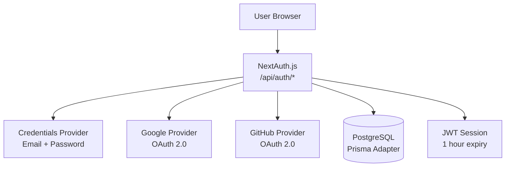
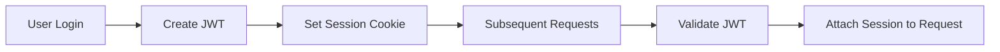
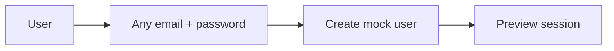

# Authentication

This document explains how authentication works in the Web service. The service uses **NextAuth.js** with multiple providers and a JWT-based session strategy.

## Overview

Authentication is handled by NextAuth.js, which manages:

- User sign-up and sign-in
- Session management (JWT tokens)
- OAuth providers (Google, GitHub)
- Email/password credentials
- Cloudflare Turnstile (bot protection)



## Authentication Providers

### 1. Email/Password (Credentials)

**What it does:** Allows users to sign in with their email and password.

**How it works:**
1. User enters email and password on the login page
2. NextAuth calls the `authorize` function
3. The function validates the credentials with a Zod schema — a valid email and a non-empty password
4. It looks up the user in PostgreSQL by email, including their subscription
5. The password is compared using bcrypt
6. If valid, the user object is returned and a JWT is created

**Security features:**
- Passwords are hashed with bcrypt
- Turnstile CAPTCHA protection on both sign-in and sign-up
- JWT expires after 1 hour

**Preview mode:** Any syntactically valid email/password works. No database lookup.

### 2. Google OAuth

**What it does:** Allows users to sign in with their Google account.

**Configuration required:**
```bash
GOOGLE_ID=your-google-client-id
GOOGLE_SECRET=your-google-client-secret
```

**How it works:**
1. User clicks "Sign in with Google"
2. Browser redirects to Google's OAuth consent screen
3. Google redirects back with an authorization code
4. NextAuth exchanges the code for tokens
5. The user profile is extracted and matched or created in the database
6. A JWT session is created

### 3. GitHub OAuth

**What it does:** Allows users to sign in with their GitHub account.

**Configuration required:**
```bash
GITHUB_ID=your-github-client-id
GITHUB_SECRET=your-github-client-secret
```

**How it works:** Same flow as Google OAuth, but with GitHub's authorization endpoint.

**Both OAuth providers refuse to link accounts by email.** `allowDangerousEmailAccountLinking` is `false` for both, so signing in with Google and then with GitHub using the same address creates two separate users rather than silently merging them.

## Signing Up

**What it does:** Creates a new account. Signing up is a **server action**, not a NextAuth callback — the user is created first, then signed in.

The form is validated with a Zod schema:

```typescript
export const SignupSchema = z.object({
  email: z.string().email({ message: "Please enter a valid email address" }),
  firstName: z.string().min(1, { message: "Please enter your first name" }),
  lastName: z.string().min(1, { message: "Please enter your last name" }),
  password: z.string().min(8, { message: "Password must be at least 8 characters long" }),
  confirmPassword: z.string().min(8, { message: "Password must be at least 8 characters long" }),
}).refine((data) => data.password === data.confirmPassword, {
  message: "Passwords must match",
  path: ["confirmPassword"],
})
```

**The rules that catch people out:**
- A first name and a last name are both **required**. The display name is built from them.
- The password must be at least **8 characters**, and the confirmation must match.
- The password is hashed with bcrypt at cost factor 10 before it is stored.
- The email must not already be registered.
- A Turnstile token is required, and it is verified against Cloudflare before the user is written.

## Session Strategy

The service uses **JWT-based sessions** (not database sessions):



**Session configuration:**
```typescript
session: {
  strategy: "jwt",    // JWT-based (not database sessions)
  maxAge: 60 * 60,    // 1 hour expiry
}
```

**JWT payload contains:**
- `id` — User's database ID
- `name` — User's display name
- `email` — User's email address
- `picture` — Profile image URL
- `isPremium` — Whether user has active subscription
- `iat` — Issued at timestamp
- `_lastPremiumCheck` — When the premium status was last revalidated

NextAuth also manages `sub` and `exp`.

**Why JWT?**
- Stateless — no database lookup on every request
- Fast — validation happens in memory
- Scalable — works across multiple server instances

## JWT Callbacks

### `jwt` callback

Called when a JWT is created or updated:

```typescript
async jwt({ token, user, trigger, session }) {
  // On initial login: copy user data to token
  if (user) {
    token.id = user.id
    token.isPremium = user.isPremium ?? false
    token.name = user.name ?? null
    token.email = user.email ?? null
    token.picture = user.image ?? null
  }

  // On session update: refresh token data and return early
  if (trigger === "update" && session) {
    if (typeof session.name === "string") token.name = session.name
    if (typeof session.picture === "string") token.picture = session.picture
    if (typeof session.isPremium === "boolean") token.isPremium = session.isPremium
    return token
  }

  // Periodic premium check (non-premium users only, 60s throttle)
  if (!isPreviewMode() && trigger !== "update" && token.isPremium === false && token.id) {
    // Revalidate premium status from database
  }

  return token
}
```

**Note the early return on an update.** When the session is explicitly updated, the callback returns straight away and the premium re-check is skipped.

### `session` callback

Called when a session is created or accessed:

```typescript
async session({ session, token }) {
  if (session.user && token) {
    session.user.id = token.id
    session.user.name = token.name
    session.user.email = token.email
    session.user.image = token.picture
    session.user.isPremium = token.isPremium
  }
  return session
}
```

**Why periodic premium check?**
- Users may upgrade their subscription
- JWT is cached for 1 hour; premium status could be stale
- Throttled to 1 check per 60 seconds to avoid database overload

## Protected Routes

### Automatic Redirects

Route protection is handled by `proxy.ts` at the root of the app. Next.js 16 calls this file instead of the older `middleware.ts`.

```typescript
export async function proxy(request: NextRequest) {
  const token = await getToken({ req: request })
  const isAuth = !!token
  const { pathname } = request.nextUrl

  if (isAuth) {
    if (pathname === "/" || pathname.startsWith("/login") || pathname.startsWith("/signup")) {
      response = NextResponse.redirect(new URL("/chat", request.url))
    }
  }

  if (!isAuth) {
    if (pathname.startsWith("/chat") || pathname.startsWith("/profile")) {
      const url = new URL("/login", request.url)
      url.searchParams.set("callbackUrl", pathname)
      response = NextResponse.redirect(url)
    }
  }
  // ...
}
```

**The rules:**

| Who | Path | What happens |
|-----|------|--------------|
| Signed in | `/`, `/login`, `/signup` | Redirected to `/chat` |
| Signed out | `/chat`, `/profile` | Redirected to `/login?callbackUrl=<path>` |
| Anyone | Everything else | Served as normal |

The `callbackUrl` is where the user lands after signing in, so they end up back where they were trying to go.

**These paths skip the proxy entirely**, so they are neither redirected nor logged:

- `/api/auth/*`
- `/api/healthz`, `/api/readyz`, `/api/metrics`
- `/api/services/*/status`
- `/_next/*` and `favicon.ico`

### Server-Side Protection

Use `getServerSession` in API routes and server components:

```typescript
import { getServerSession } from "next-auth"
import { authOptions } from "@/lib/config/auth-options"

export async function GET() {
  const session = await getServerSession(authOptions)
  if (!session?.user?.id) {
    return NextResponse.json({ error: "Unauthorized" }, { status: 401 })
  }
  // ... handle request
}
```

### Client-Side Protection

Use the `useSession` hook to check authentication:

```typescript
import { useSession } from "next-auth/react"

function MyComponent() {
  const { data: session, status } = useSession()

  if (status === "loading") return <Spinner />
  if (status === "unauthenticated") return <Redirect to="/login" />

  return <div>Hello, {session.user.name}</div>
}
```

### Server Actions

Use `getServerSession` in server actions:

```typescript
"use server"
import { getServerSession } from "next-auth"
import { authOptions } from "@/lib/config/auth-options"

export async function saveMessage(content: string) {
  const session = await getServerSession(authOptions)
  if (!session?.user?.id) throw new Error("Unauthorized")
  // ... save message
}
```

## Custom Pages

| Page | Route | Purpose |
|------|-------|---------|
| Sign In | `/login` | Custom login page |
| Sign Up | `/signup` | Custom signup page |
| Error | `/auth/error` | Authentication error page — **not implemented yet** |

NextAuth is configured to send failed sign-ins to `/auth/error`, but no route exists there, so an authentication error currently returns a 404. Signing in and signing up both work.

## Preview Mode

In preview mode (`ENV_TYPE=preview`), authentication is simplified:



**What changes:**
- Any syntactically valid email/password works
- No database lookup
- The user ID is `preview-{email}`
- The Prisma adapter is disabled
- Registering does not create a user — the action returns success without writing anything
- Turnstile verification short-circuits: any non-empty token passes
- The Google and GitHub buttons are disabled
- Tracing is off and the database and Redis clients are replaced by stubs that throw or return nothing

**Premium status is deliberately toggleable in preview mode.** The credentials provider starts every user as non-premium, but the upgrade page can flip the flag on the client and the JWT callback copies that value into the token, so the premium UI can be tried without a payment provider. The choice is stored in `localStorage` under `preview:isPremium[:userId]`.

**Why preview mode?**
- UI development without backend services
- Testing frontend changes quickly
- Demo environments

## Premium Status

The `isPremium` flag indicates whether a user has an active subscription:

**How it's determined:**
1. On login: checked from the database (`subscription.status === ACTIVE`)
2. In the JWT: stored as `token.isPremium`
3. Periodically revalidated: every 60 seconds for non-premium users

**Why revalidate?**
- Users may upgrade after login
- JWT is cached; premium status could be stale
- Throttled to avoid excessive database queries

## Troubleshooting

### "Unauthorized" error

- Check if the user is logged in
- Verify the session cookie is present
- Ensure `NEXTAUTH_SECRET` is set correctly

### OAuth callback errors

- Verify `GOOGLE_ID/SECRET` and `GITHUB_ID/SECRET` are correct
- Check that callback URLs are configured in OAuth provider settings
- Ensure `NEXTAUTH_URL` matches your domain

### Session not persisting

- Check `NEXTAUTH_SECRET` is set and consistent
- Verify cookies are not being blocked
- Ensure `NEXTAUTH_URL` matches your dev server URL

### A signed-in user still lands on `/login`

- The proxy reads the token from the cookie, not from a database session
- In local development the cookie is `next-auth.session-token`; in production over HTTPS it is `__Secure-next-auth.session-token`
- Check that the browser is sending the cookie at all

### Premium status not updating

- The JWT revalidates every 60 seconds for non-premium users
- Force a session update with `update()` from `useSession`
- Check database for correct subscription status

## Related Documentation

- [Configuration](../getting-started/configuration.md) - Auth-related env vars
- [Architecture](../concepts/architecture.md) - How auth fits in the system
- [API Routes](api-routes.md) - Protected API endpoints
