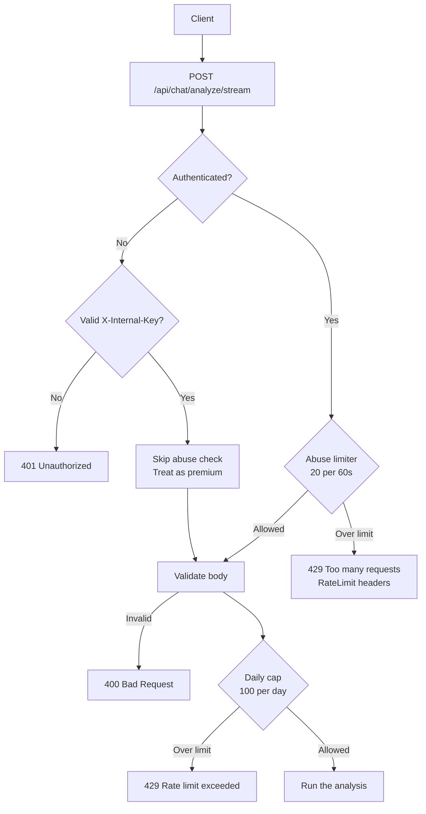

# Rate Limiting

This document explains how the Web service limits how much a user can do. Two limiters stand in front of the AI analysis endpoint, and they answer different questions.

## Overview

The service has **two independent limiters**:

| Limiter | Question it answers | Limit | Window |
|---------|--------------------|-------|--------|
| **Abuse limiter** | "Is this client hammering the endpoint right now?" | 20 requests | 60 seconds |
| **Daily cap** | "Has this user used their free allowance for today?" | 100 analyses | 24 hours (resets at midnight UTC) |

**Why two?** They protect different things. The abuse limiter stops a burst of traffic from a single client — a script, a bot, a runaway retry loop — and it does so in milliseconds. The daily cap is a product rule: free users get 100 analyses a day, and it is checked against a usage counter that is also used for billing. A premium user is exempt from the daily cap but not from the abuse limiter.



**Order matters.** The abuse limiter runs **before** the request body is even parsed. A client that sends a thousand malformed requests is stopped at the door instead of making the service validate a thousand bodies. The daily cap runs **after** validation, because it is a per-user allowance and only meaningful for a request that would actually have consumed an analysis.

## The Abuse Limiter

**What it does:** Counts requests per client over a fixed window and refuses the ones that go past the limit.

### Implementation

Located at `lib/application/abuse-rate-limit.ts`. The service class is `RedisAbuseRateLimitService`:

```typescript
export class RedisAbuseRateLimitService implements IAbuseRateLimitService {
  public async consume(input: AbuseConsumeInput): Promise<AbuseRateLimitResult> {
    const config = getScopeConfig(input.scope)
    // ...
    const key = CacheKeys.abuseFixedWindow(input.scope, keyPart, windowId)
    // ...
    const allowed = count <= config.limit
    if (!allowed) {
      try { metrics.abuseRateLimitHits.inc({ scope: input.scope }) } catch {}
    }
    return { allowed, remaining: Math.max(0, config.limit - count), /* ... */ }
  }
}
```

### Scopes

A **scope** is a named bucket with its own limit and window. The scopes are:

| Scope | Default limit | Default window | Used by |
|-------|---------------|----------------|---------|
| `analyze` | 20 | 60 seconds | The AI analysis endpoint |
| `auth` | 30 | 60 seconds | Reserved — not currently wired to a route |
| `default` | 120 | 60 seconds | Reserved — not currently wired to a route |

### Configuration

Each scope's limit and window can be overridden with environment variables:

```bash
ABUSE_RATE_LIMIT_ANALYZE_MAX=20              # requests allowed per window on /api/chat/analyze/stream
ABUSE_RATE_LIMIT_ANALYZE_WINDOW_MS=60000     # window length in milliseconds
ABUSE_RATE_LIMIT_AUTH_MAX=30                 # reserved for the auth scope
ABUSE_RATE_LIMIT_AUTH_WINDOW_MS=60000        # reserved for the auth scope
ABUSE_RATE_LIMIT_DEFAULT_MAX=120             # reserved for the default scope
ABUSE_RATE_LIMIT_DEFAULT_WINDOW_MS=60000     # reserved for the default scope
```

The window must be between 1 000 and 3 600 000 milliseconds (one second to one hour). A limit must be between 1 and 10 000 (or 100 000 for the default scope). If a value is missing or invalid the built-in default is used.

### How a Client Is Identified

The limiter counts per **identifier**, not per IP address alone:

```typescript
function resolveIdentifier(ip, userId) {
  if (userId) return { keyPart: `u:${userId}`, logPart: userId }
  if (ip) {
    const hashed = hashRateLimitIdentifier(ip)
    return { keyPart: `ip:${hashed}`, logPart: `ip:${hashed}` }
  }
  return { keyPart: "ip:unknown", logPart: "ip:unknown" }
}
```

- A **signed-in user** is counted as `u:{userId}`.
- An **anonymous client** is counted as `ip:{sha256 of the IP}`. The IP is hashed, so the raw address never lands in a Redis key.
- The IP comes from the `x-forwarded-for` header (first entry) or `x-real-ip`.

### The Redis Key

```typescript
abuseFixedWindow: (scope, identifierHash, windowId) =>
  `abuse:${scope}:{identifierHash}:{windowId}`,
```

The `windowId` is the current window number — `Math.floor(now / windowMs)`. Because the key itself contains the window number, the counter expires on its own and a new window starts on a fresh key. No cleanup job is needed.

### Atomicity

The increment and the expiry happen in one Lua script, so two concurrent requests cannot both set the expiry or both read a stale count:

```lua
local current = redis.call('INCR', KEYS[1])
if current == 1 then redis.call('PEXPIRE', KEYS[1], ARGV[1]) end
return current
```

### Response Headers

When the limiter refuses a request, the response carries these headers:

| Header | Meaning |
|--------|---------|
| `RateLimit-Limit` | The limit for the scope |
| `RateLimit-Remaining` | How many requests are left in the current window |
| `Retry-After` | Seconds until the window resets (only on a refusal) |
| `RateLimit-Reset` | The same value as `Retry-After` (only on a refusal) |

`RateLimit-Limit` and `RateLimit-Remaining` are returned on every refusal; `Retry-After` and `RateLimit-Reset` are added only when the request was rejected.

### When Redis Is Down

The limiter does **not** fail open. If Redis is unavailable it falls back to an **in-memory** counter in the same process:

```typescript
} catch (error) {
  try { metrics.abuseRedisErrors.inc({ operation: "incr" }) } catch {}
  logger.warn({ msg: "Abuse Redis unavailable, using in-memory fallback", scope: input.scope, identifier: logPart, error })
  const fallback = consumeMemory(key, config.windowMs, config.limit, now)
```

The in-memory fallback holds at most 5 000 entries and evicts the oldest when it is full. Because it lives in the process, each replica counts separately, so the effective limit is multiplied by the number of running replicas while Redis is down.

### Preview Mode

In preview mode the limiter always allows the request and returns the full limit as the remaining count. There is nothing to protect.

## The Daily Cap

**What it does:** Stops a free user from running more than 100 analyses in a calendar day (UTC).

### Implementation

Located at `lib/application/rate-limit.ts`. The service class is `RedisRateLimitService`:

```typescript
export class RedisRateLimitService implements IRateLimitService {
  private static readonly FREE_TIER_LIMIT = 100
  // ...
  public async checkLimit(userId: string, isPremium: boolean): Promise<{ allowed: boolean; remaining: number }> {
    if (isPremium) {
      return { allowed: true, remaining: -1 }
    }

    try {
      const key = this.getDailyKey(userId)
      const usage = await usageRedis.get(key)
      const currentUsage = this.parseCounter(usage, userId, "get")
      const allowed = currentUsage < RedisRateLimitService.FREE_TIER_LIMIT

      if (!allowed) {
        metrics.rateLimitHits.inc({ tier: 'free' })
      }

      return {
        allowed,
        remaining: Math.max(0, RedisRateLimitService.FREE_TIER_LIMIT - currentUsage),
      }
    } catch (error) {
      try { metrics.usageRedisErrors.inc({ operation: "get" }) } catch {}
      logger.error({ msg: "Rate limit check failed, falling back to DB", userId, error })
      return this.checkLimitFromDB(userId)
    }
  }
}
```

### Premium Users

A premium user (`session.user.isPremium === true`) is always allowed. The `remaining` value is `-1` for them, which means "no limit" rather than "minus one request left".

### The Redis Key

```typescript
dailyUsage: (userId: string, utcDay: string) => `rate_limit:${userId}:daily:${utcDay}`,
```

The `utcDay` is the date part of the ISO timestamp — `2026-04-25`. The counter therefore resets by changing key, not by a reset job.

### When Redis Is Down

The limiter falls back to **PostgreSQL**:

```typescript
private async checkLimitFromDB(userId: string): Promise<{ allowed: boolean; remaining: number }> {
  // ...
  const usage = await prisma.usage.findUnique({ where: { userId } })
  // A stale `lastApiCallReset` from a previous day means today's count is 0.
  const sameDay = this.isSameUTCDay(usage?.lastApiCallReset ?? null, now)
  const currentUsage = sameDay ? (usage?.apiCallCountDaily ?? 0) : 0
  const allowed = currentUsage < RedisRateLimitService.FREE_TIER_LIMIT
```

If the database query *also* fails, the limiter **fails open** and allows the request. That is deliberate: a database outage should not lock every free user out of the product.

### Usage Tracking

The counter is incremented **after** a successful analysis, not when the request is admitted. That way a request that is rejected for a malformed body never consumes allowance.

Tracking does two things at once:

1. **Redis increment** — the counter the next check reads.
2. **RabbitMQ publish** — the usage event the billing worker consumes.

Both run inside `trackUsage`, and the increment is atomic with its expiry:

```lua
local current = redis.call('INCRBY', KEYS[1], ARGV[1])
redis.call('EXPIREAT', KEYS[1], ARGV[2])
return current
```

`EXPIREAT` uses the timestamp of the next midnight in UTC, so the key disappears exactly when the new day's counter starts.

### When the Queue Is Down

If the RabbitMQ publish fails, the usage would be lost — the worker would never learn about it. So the service writes the usage straight to PostgreSQL instead:

```sql
INSERT INTO "Usage" ("id", "userId", "apiCallCountTotal", "apiCallCountDaily", "lastApiCallReset", "updatedAt", "createdAt")
VALUES (gen_random_uuid(), $1, $2, $2, NOW(), NOW(), NOW())
ON CONFLICT ("userId") DO UPDATE SET ...
```

The `reason` label on the `usage_sync_fallback_total` metric records which failure caused this:

| Reason | Meaning |
|--------|---------|
| `queue_down` | Redis worked, the queue publish failed |
| `redis_and_queue_down` | Both Redis and the queue failed |

**Why the queue matters more than Redis?** If Redis fails but the publish succeeds, the event is already in the queue and the worker will flush it to PostgreSQL — so no direct write is needed. It is only when the *publish* fails that the service has to write the row itself.

### Idempotency

Each HTTP attempt generates one UUID, and that same UUID is used for the Redis increment and the queue message. If the broker redelivers the message, the worker recognises the event ID and does not count it twice. A genuine retry from the client — one that runs the inference again — gets a new ID and is counted separately.

## Load Testing Bypass

The analyze endpoint accepts an `X-Internal-Key` header. When it matches `INTERNAL_API_KEY`, the request is treated as a load-test request:

- The abuse limiter is **skipped entirely**.
- The user is the shared `load-test-user-id` and is treated as **premium**, so the daily cap never applies.
- Body validation, the length limit, chat persistence and usage tracking all still run.

Because every load-test request shares one user ID, they all share one usage counter.

## Metrics

| Metric | Labels | Meaning |
|--------|--------|---------|
| `abuse_rate_limit_hits_total` | `scope` | Requests the abuse limiter refused |
| `abuse_redis_errors_total` | `operation` | Abuse-limiter Redis errors |
| `rate_limit_hits_total` | `tier` | Requests the daily cap refused. Only `free` is ever recorded, because premium users short-circuit before the counter is touched |
| `usage_redis_errors_total` | `operation` | Redis errors while tracking usage (`get`, `incr`, `corrupt_value`) |
| `usage_sync_fallback_total` | `reason` | Direct database writes because the queue publish failed |

See [Observability](../operations/observability.md) for how these are exposed.

## Troubleshooting

**"Too many requests" but the user is under the daily cap?**
That is the abuse limiter. Check `abuse_rate_limit_hits_total` for the `scope` and look at the `Retry-After` header to see when the window resets. Raise `ABUSE_RATE_LIMIT_ANALYZE_MAX` if the limit is too tight for real traffic.

**"Rate limit exceeded" with no headers?**
That is the daily cap, not the abuse limiter. The user has used all 100 free analyses for the day. The cap resets at midnight UTC.

**Usage counts look wrong after a Redis restart.**
The Redis counter is gone but the PostgreSQL row is not. The next increment starts from 0 again. The `usage_sync_fallback_total` metric shows whether direct database writes happened.

**The limiter does nothing in development.**
`ENV_TYPE=dev` sets `INTERNAL_API_KEY` to `internal-secret-key` by default. Any request carrying that key skips the abuse limiter, which is why local load tests never trip it.

## Related Documentation

- [API Routes](api-routes.md) - The endpoints the limiters protect
- [Infrastructure](infrastructure.md) - Redis, PostgreSQL and RabbitMQ
- [Request Flows](../concepts/request-flows.md) - Where the limiters sit in the request path
- [Configuration](../getting-started/configuration.md) - The environment variables that tune them
