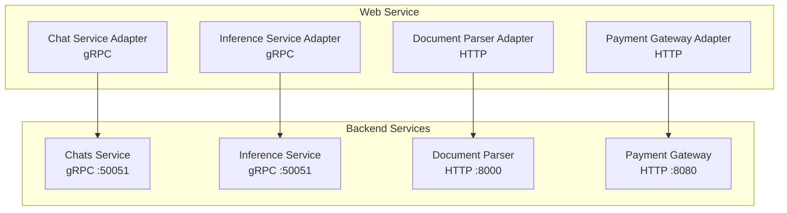
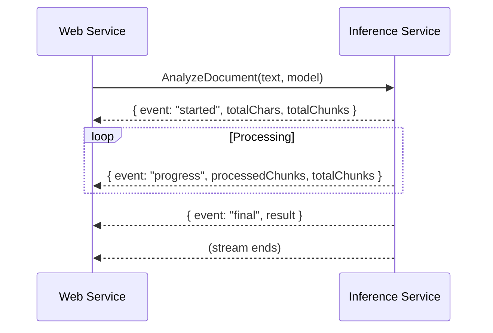
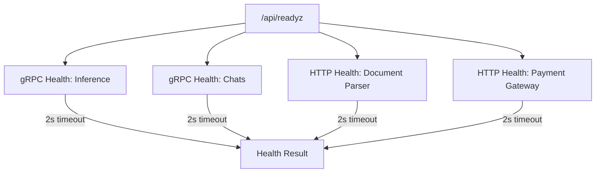

# Backend Services

This document explains how the Web service connects to backend microservices. The web app acts as a **backend-for-frontend (BFF)**, translating between the frontend's needs and the backend services' protocols.

## Overview

The Web service connects to four backend services:



| Service | Protocol | Dev default URL | Purpose |
|---------|----------|-----------------|---------|
| Chats Service | gRPC | `chat-service:50051` | Chat CRUD, message storage |
| Inference Service | gRPC | `ai-service:50051` | AI text detection |
| Document Parser | HTTP | `http://document-parser:8000` | File extraction |
| Payment Gateway | HTTP | `http://payment-gateway:8080` | Subscription cancellation events |

**The URLs depend on how you run the service.** The defaults above are the Docker Compose service names, which is what the full local stack uses. Running `next dev` straight on your machine needs `localhost` instead. See [Configuration](../getting-started/configuration.md) for the full table.

## Chats Service (gRPC)

**What it does:** Manages chat sessions and messages. The web service calls this for creating chats, saving messages, and retrieving history.

### Client Implementation

Located at `features/chat/services/grpc-chat-service.ts`:

```typescript
export class GrpcChatService implements IChatService {
  private get client() {
    return getChatGrpcClient()
  }

  async createChat(initialMessage: string): Promise<ChatSession> {
    const userId = await this.getUserId()
    const title = initialMessage.slice(0, 40) || "New Chat"
    return new Promise((resolve, reject) => {
      this.client.CreateChat({ user_id: userId, title }, buildUserMetadata(userId), (err: any, response: any) => {
        if (err) return reject(err)
        resolve({ id: response.chat_id, title, messages: [], updatedAt: new Date() })
      })
    })
  }
}
```

### Available Operations

| Method | gRPC Call | Description |
|--------|-----------|-------------|
| `createChat` | `CreateChat` | Create a new chat session |
| `getChat` | `GetChat` + `GetChatHistory` | Get chat with messages |
| `getHistory` | `GetUserChats` | List user's chats |
| `sendMessage` | `SaveMessage` + `Detect` + `SaveMessage` | Save the message, analyse it, then save the result |
| `saveUserMessage` | `SaveMessage` | Store the user's message |
| `saveAssistantAnalysis` | `SaveMessage` | Store the analysis as an assistant message |
| `saveAssistantAnalysisMessage` | `SaveMessage` | Store the analysis with its lifecycle state |
| `deleteChat` | `DeleteChat` | Delete a chat |
| `renameChat` | `RenameChat` | Rename a chat |

The last three are what the live analysis path uses. The orchestrator writes the user message, then the assistant message in the `running` state, then the assistant message with the finished analysis — three separate `SaveMessage` calls.

### The `x-user-id` Header

Every call carries the user's identity in the gRPC metadata:

```typescript
export const buildUserMetadata = (userId: string) => {
  const md = new grpc.Metadata()
  md.set("x-user-id", userId)
  return md
}
```

The chat service **requires** this header on the RPCs whose proto has no `user_id` field — `GetChat`, `GetChatHistory`, `RenameChat` and `DeleteChat` — and prefers it everywhere else. It is sent on every call so that new RPCs are authenticated by default.

### Connection Configuration

```bash
CHAT_SERVICE_URL=chat-service:50051   # gRPC endpoint
```

The gRPC client uses:
- `@grpc/grpc-js` for the transport
- `@grpc/proto-loader` for proto file loading
- Keepalive settings for connection reliability

## Inference Service (gRPC)

**What it does:** Analyzes text for AI-generated content. Supports both unary (single request) and streaming (document analysis) calls.

### Client Implementation

Located at `features/chat/services/inference-service.ts`:

```typescript
export const inferenceService = {
  async detect(text: string, model: ModelType): Promise<AnalysisResult> {
    const client = getGrpcClient()
    const metadata = getGrpcMetadata()
    return new Promise((resolve, reject) => {
      client.Detect({ text, model_id: model }, metadata, (err, response) => {
        if (err) reject(new Error("AI Analysis Service Unavailable"))
        else resolve(mapProtoResponseToAnalysis(response, model))
      })
    })
  },

  async streamDocument(text: string, model: ModelType, handlers: { ... }): Promise<void> {
    // Streaming analysis for large documents
  }
}
```

### Available Operations

| Method | gRPC Call | Description |
|--------|-----------|-------------|
| `detect` | `Detect` | Analyze a single text snippet |
| `streamDocument` | `AnalyzeDocument` | Stream analysis for large documents |

The streaming path is what the analysis endpoint uses. `Detect` is the unary call, used by the older `sendMessage` path.

### Analysis Models

| Model | Description |
|-------|-------------|
| `spark` | Fast, general-purpose detection |
| `flare` | Detailed analysis with highlights |

### Connection Configuration

```bash
AI_SERVICE_URL=ai-service:50051    # gRPC endpoint
AI_SERVICE_API_KEY=your-api-key   # API key for authentication
```

The API key travels in the gRPC metadata as `x-api-key`:

```typescript
export const getGrpcMetadata = () => {
  if (isPreviewMode()) return new grpc.Metadata()
  const metadata = new grpc.Metadata()
  metadata.add("x-api-key", env.AI_SERVICE_API_KEY)
  return metadata
}
```

### Streaming Events

When using `streamDocument`, three event types are emitted:



| Event | Fields | Description |
|-------|--------|-------------|
| `started` | `totalChars`, `totalChunks` | Analysis has begun |
| `progress` | `processedChunks`, `totalChunks` | Processing update |
| `final` | `result` | Complete analysis result |

**These are the gRPC-level events.** The HTTP endpoint rewrites them before they reach the browser — the `final` event becomes `{type:"final", message:{…}}` with the analysis at `message.analysis`, and the stream gains an `accepted` event at the front and an `error` event at the end. See [API Routes](api-routes.md) for the HTTP contract.

### Error Handling

| Error | Handling |
|-------|----------|
| Connection failure | Returns `AI Analysis Service Unavailable` |
| Stream cancelled or aborted | Throws `InferenceStreamAbortedError` |
| gRPC `CANCELLED` | Recorded as `cancelled` in the metrics and the message state |

There is no timeout on the inference call. A request that is cancelled by the client aborts the stream and the analysis is recorded as `cancelled`.

## Document Parser (HTTP)

**What it does:** Extracts text content from uploaded files (PDF, DOCX, TXT).

### Configuration

```bash
FILE_EXTRACTOR_API_URL=http://document-parser:8000
```

### Endpoints

| Endpoint | Method | Purpose |
|----------|--------|---------|
| `/api/v1/extract` | `POST` | Extract the text from an uploaded file |
| `/api/v1/health` | `GET` | Health check |

The extraction call posts a `FormData` body and reads `text` from the JSON response. The service maps the parser's error codes to readable messages:

| Status | Message |
|--------|---------|
| `400` | `Invalid file signature.` |
| `413` | `File exceeds maximum allowed size.` |
| `415` | `Unsupported file type. Use PDF, DOCX, or TXT.` |
| `422` | `File is corrupt or unreadable.` |

### Health Check

```bash
curl http://document-parser:8000/api/v1/health
```

The readiness probe (`/api/readyz`) checks this endpoint, with a 2-second timeout.

## Payment Gateway (HTTP)

**What it does:** Forwards subscription lifecycle events to the gateway, which owns the Paddle billing relationship.

### Configuration

```bash
PAYMENT_GATEWAY_URL=http://payment-gateway:8080
```

### Endpoints

| Endpoint | Method | Purpose |
|----------|--------|---------|
| `/internal/events` | `POST` | Report a subscription cancellation |
| `/readyz` | `GET` | Health check |

The web service does **not** create or manage subscriptions through the gateway. Subscription rows are written to PostgreSQL directly, and the gateway is told about cancellations so it can stop billing.

### Health Check

```bash
curl http://payment-gateway:8080/readyz
```

The readiness probe (`/api/readyz`) checks this endpoint, with a 2-second timeout.

## Service Health Checks

The Web service checks backend health from two places: the readiness probe, and the per-service status routes the UI polls.



**gRPC health check:**
- Uses the standard `grpc.health.v1.Health/Check` protocol
- 2-second deadline
- Returns `ok: true` only when the service reports `SERVING`, and an error string such as `health NOT_SERVING` otherwise
- Closes the channel after the call, so a probe never leaks a connection

The two services are probed under their proto package names: `aidetection.AIService` and `chat.ChatService`.

**HTTP health check:**
- A simple GET request to `/api/v1/health` (document parser) or `/readyz` (payment gateway)
- 2-second timeout
- Checks for a 2xx response

See [Health Checks](../operations/health.md) for details.

## Mock Services for Testing

Each service adapter has a corresponding mock for testing:

```
features/chat/services/
├── grpc-chat-service.ts       # Real gRPC implementation
├── mock-chat-service.ts       # Test mock
├── inference-service.ts       # Real inference client
├── analysis-orchestrator.ts   # The live analysis flow
├── file-extraction.service.ts # Document parser client
├── chat-service.interface.ts  # Re-export of lib/domain/chat-service.ts
└── index.ts                   # Picks the mock or the real implementation
```

The factory in `index.ts` is what chooses between them:

```typescript
export const chatService: IChatService = isPreviewMode() ? new MockChatService() : new GrpcChatService()
```

**Why mocks?**
- Unit tests run without external services
- Integration tests can use real or mock services
- Preview mode uses mock implementations

**Only the chat and inference services are mocked in preview mode.** The document parser and the payment gateway are not mocked — they are reported as unavailable and their probes are skipped. The gRPC clients return a proxy that errors with "not available in preview mode", and the analytics publisher returns the event ID without dialing the broker.

## Configuration Reference

| Variable | Dev default | Description |
|----------|-------------|-------------|
| `CHAT_SERVICE_URL` | `chat-service:50051` | Chats service gRPC endpoint |
| `AI_SERVICE_URL` | `ai-service:50051` | Inference service gRPC endpoint |
| `AI_SERVICE_API_KEY` | `dev-secret-key` | API key sent as the `x-api-key` header |
| `FILE_EXTRACTOR_API_URL` | `http://document-parser:8000` | Document parser HTTP endpoint |
| `PAYMENT_GATEWAY_URL` | `http://payment-gateway:8080` | Payment gateway HTTP endpoint |

## Troubleshooting

### "AI Analysis Service Unavailable"

- Check if the inference service is running
- Verify `AI_SERVICE_URL` is correct
- Check network connectivity
- Look at inference service logs

### "gRPC connection refused"

- Ensure the backend service is running
- Check the service URL in configuration
- Verify no firewall is blocking the port

### "Chat service not available in preview mode"

- The service is running with `ENV_TYPE=preview`
- Preview mode mocks the chat and inference services but does not connect to them

### Health check failing

- Check if the service is deployed and healthy
- Verify the health endpoint URL
- Look at service logs for errors

## Related Documentation

- [Configuration](../getting-started/configuration.md) - Service URL settings
- [Health Checks](../operations/health.md) - Health probe details
- [Request Flows](../concepts/request-flows.md) - How requests flow through services
