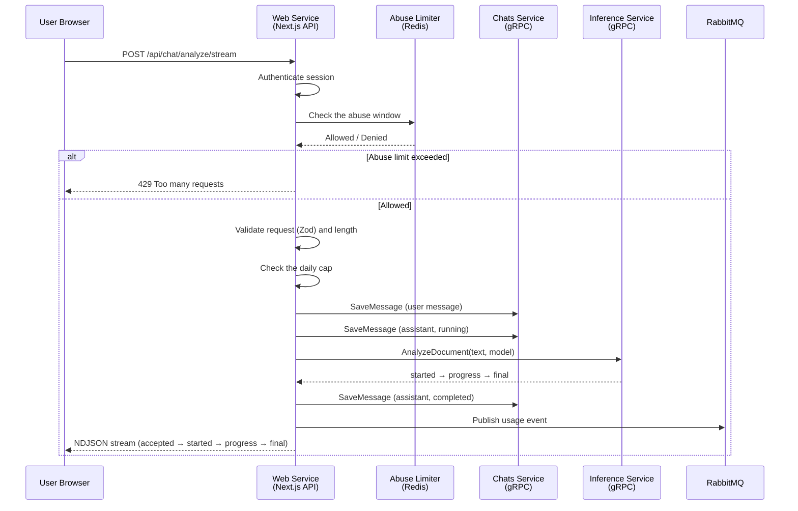
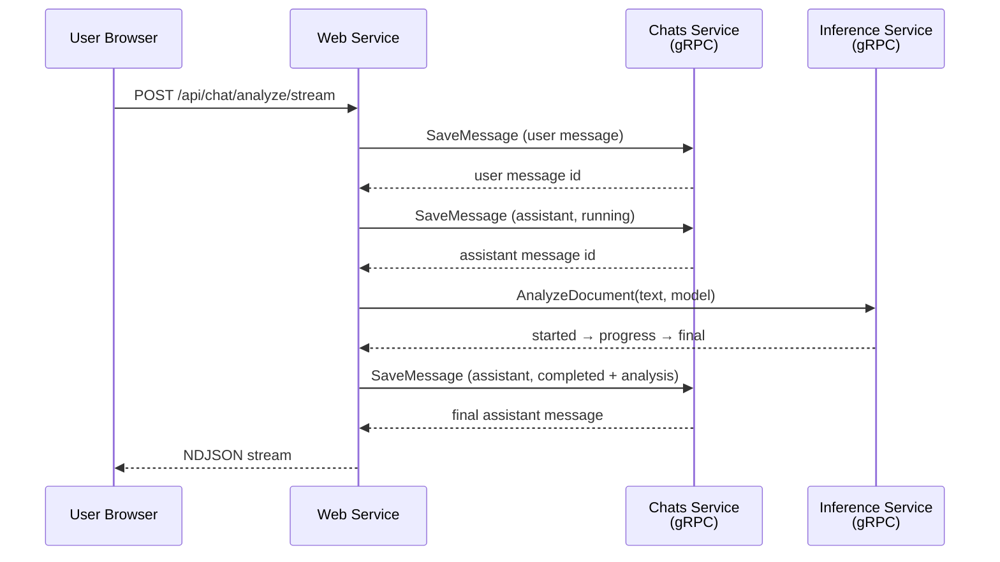
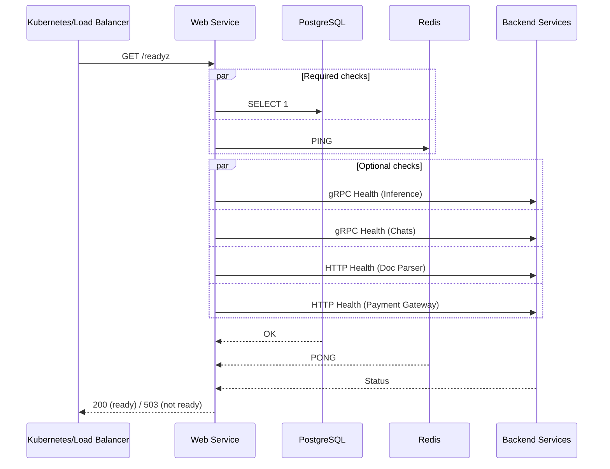
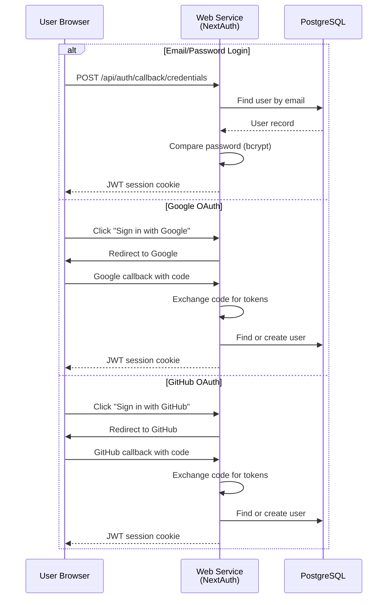
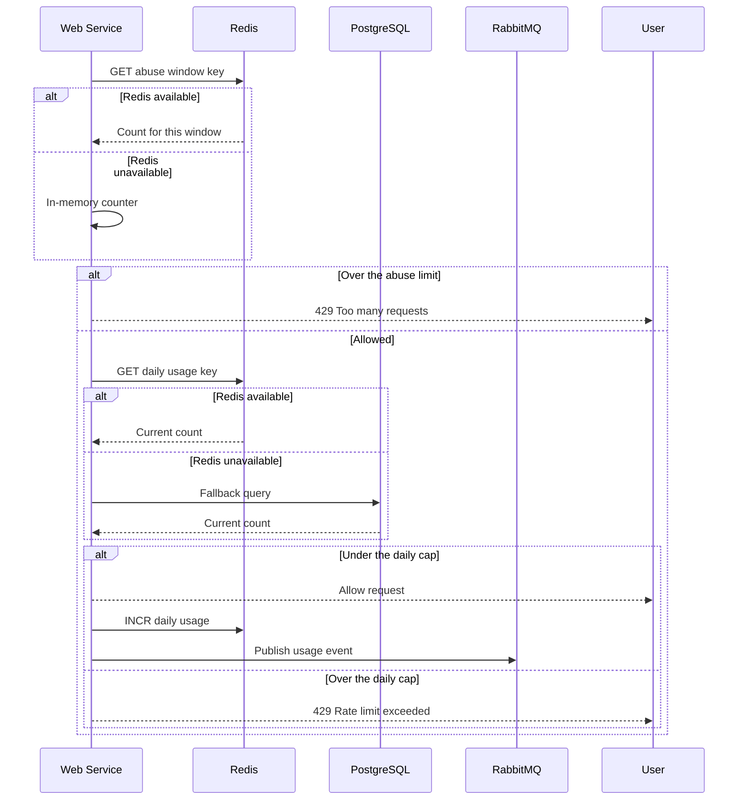

# Request Flows

This document explains how user requests are processed by the Web service. We'll look at each main operation and see what happens step by step.

## AI Text Analysis (Streaming)

When a user submits text for AI detection, the request flows through a streaming pipeline:



**What happens:**
1. The browser sends a POST request to `/api/chat/analyze/stream`
2. The API route authenticates the session (NextAuth JWT), or accepts the `X-Internal-Key` header for load tests
3. The abuse limiter checks the client's request count for the current window
4. The request body is validated with a Zod schema, and the content length is checked
5. The daily cap checks the user's usage count
6. The user message is saved to the Chats service via gRPC
7. An assistant message is saved in the `running` state, so the UI can show it immediately
8. The inference service is called via the server-streaming `AnalyzeDocument` RPC
9. The result is saved to the assistant message in the `completed` state
10. The usage event is published to RabbitMQ for billing, and the Redis counter is incremented
11. The stream is written back to the browser as NDJSON chunks

**Why streaming?**
- The user sees progress immediately (`accepted` → `started` → `progress` → `final`)
- Large documents can take time; streaming keeps the user informed
- NDJSON format allows chunked transfer encoding

**Two things that surprise people:**

- **The response starts before the work does.** The route returns the stream to the browser first, and the analysis runs as the stream is consumed. That is why a failure *during* the analysis arrives as an `error` event inside a `200` response rather than as a `500`.
- **The Chats service is involved three times.** The user message, the assistant message in the `running` state, and the assistant message with the final result. Writing the `running` message first is what lets the UI render the analysis card before the model has answered.

**Preview mode** short-circuits the whole thing: the body is validated, but no limiter runs, no service is called, and a mock stream is returned.

## Chat Message Flow

The live path for a chat message is the orchestrator in `features/chat/services/analysis-orchestrator.ts`. It is **sequential**, not parallel:



**Why is the assistant message written twice?**

The first write creates the message in the `running` state, with the model and the ID of the user message it belongs to. The second write updates the same message with the finished analysis. If the analysis fails, the message is updated to `failed` or `cancelled` instead, with the error attached. The chat history therefore always shows what happened to every analysis, even the ones that did not finish.

**A retry is a different shape.** When the client sends `sourceMessageId` together with `assistantMessageId` and `assistantCreatedAt`, the request is a retry of an analysis that already ran. The orchestrator skips the user message and reuses the assistant message ID, so the optimistic UI and the stored row keep the same identity and the message does not flicker or reorder.

**There is a second, older path.** `IChatService.sendMessage` saves the user message and calls the inference service in parallel, then saves the assistant message:

```typescript
const [userMessage, analysisResult] = await Promise.all([
  this.saveUserMessage(chatId, userId, content),
  inferenceService.detect(content, model),
])
const assistantMessage = await this.saveAssistantAnalysisMessage(chatId, userId, { /* ... */ })
```

It is part of the interface and is covered by tests, but the UI does not call it — the browser talks to the HTTP route, which uses the orchestrator above. Treat `sendMessage` as the simpler, non-streaming shape rather than the production path.

## Health Check Flow

When Kubernetes or a load balancer checks if the service is ready:



**What happens:**
1. Kubernetes calls `/readyz` every few seconds
2. The web service runs all checks in parallel
3. **Required checks**: PostgreSQL and Redis must be healthy
4. **Optional checks**: backend services (inference, chats, doc parser, payments)
5. If required checks pass → 200 OK (`ready`, or `degraded` if an optional check failed)
6. If required checks fail → 503 Not Ready

**Why two types of checks?**
- Required checks ensure the app can serve basic requests
- Optional checks indicate degraded functionality (can still serve UI)
- Prevents one failing backend from blocking all deployments

**Why is only part of it cached?** The PostgreSQL and Redis results are cached for 10 seconds, because a cold connection to either can take several seconds. The four optional checks are probed every time, because they are fast and you want them to be current.

See [Health Checks](../operations/health.md) for the timeouts and the exact response shape.

## Authentication Flow

When a user signs up or logs in:



**What happens:**
1. User enters credentials or clicks an OAuth button
2. NextAuth handles the authentication flow
3. For credentials: the password is compared with bcrypt
4. For OAuth: the code is exchanged for tokens, and the user is found or created
5. A JWT session cookie is set (1 hour expiry)
6. The user is redirected to the app

**Signing up is a separate flow.** Registration is a server action, not a NextAuth callback. It validates the form with a Zod schema, verifies the Turnstile token, hashes the password with bcrypt, and writes the user row. The NextAuth credentials callback then signs that user in.

## Rate Limiting Flow

Two limiters guard the analysis endpoint, and they run at different points:



**What happens:**
1. The abuse limiter reads the request count for the client's current window from Redis
2. If Redis is unavailable, it falls back to an in-memory counter in the same process
3. If the count is over the limit, the request is refused with `429`
4. Otherwise the daily cap reads the user's usage count for today from Redis
5. If Redis is unavailable, the daily cap falls back to PostgreSQL
6. Under the cap: the request is allowed, the counter is incremented and the usage event is published

**Why the fallbacks differ:** the abuse limiter is a fast, local guard, so an in-memory counter is enough when Redis is down. The daily cap is a durable allowance that also feeds billing, so it falls back to the database, which is the source of truth.

**Why the counter is incremented after the analysis, not before:** a request that is rejected for a malformed body never consumes allowance, and a request that fails during inference does not either.

See [Rate Limiting](../components/rate-limiting.md) for the full picture.

## Summary

| Operation | How It Works | Speed |
|-----------|--------------|-------|
| AI Analysis | gRPC to the chats and inference services, streamed back | Fast (streaming) |
| Chat Message | The orchestrator writes the user message, the running assistant message, and the final assistant message | Fast (sequential gRPC calls) |
| Health Check | Parallel probes to all dependencies | Fast (PostgreSQL and Redis cached) |
| Authentication | NextAuth with JWT cookies | Fast (no session lookup per request) |
| Rate Limiting | Redis counters, with a database fallback for the daily cap | Fast (Redis) |

## Next Steps

- [API Routes](../components/api-routes.md) - Complete API reference
- [Rate Limiting](../components/rate-limiting.md) - The two limiters in detail
- [Backend Services](../components/services.md) - How services connect
- [Health Checks](../operations/health.md) - Health probe details
