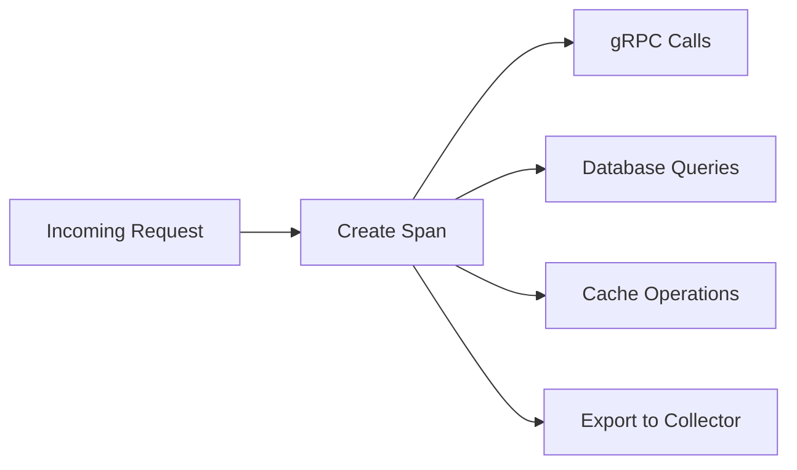

# Observability

This document explains how to monitor the Web service and understand its behavior through logs, metrics, and traces.

## What is Observability?

Observability means being able to understand what's happening inside a system by looking at its outputs. For the Web service, this includes:

- **Logs** — Written records of what happened
- **Metrics** — Numbers that measure performance
- **Traces** — Requests flowing through the system

## Logs

Logs are written to standard output in JSON format using **Pino** (a fast JSON logger). In development, they're pretty-printed with colors.

### What Gets Logged

| Component | What It Logs |
|-----------|--------------|
| API Routes | Request handling, errors |
| Proxy | Every incoming request, with its method, path, status and duration |
| Auth | Login attempts, session creation |
| Services | gRPC calls, HTTP requests |
| Infrastructure | Database queries, cache operations |
| Rate Limiting | Usage checks, limit hits |
| Analytics | Event publishing, failures |

### Example Log Entry

```json
{
  "level": "info",
  "msg": "AI analysis completed",
  "model": "spark",
  "userId": "user123",
  "duration": 1250,
  "traceId": "abc123...",
  "spanId": "def456...",
  "env": "production"
}
```

### Log Levels

`LOG_LEVEL` controls what the console prints:

| Level | When to Use |
|-------|-------------|
| `debug` | Detailed information for debugging |
| `info` | Normal operations |
| `warn` | Something unexpected but not critical |
| `error` | Something failed |

The OTLP export path understands two more levels — `trace` and `fatal` — so a record logged at those levels is exported even though the console configuration cannot select them.

### Configuration

```bash
LOG_LEVEL=info   # debug, info, warn, error
```

### Trace Context Injection

When OpenTelemetry tracing is active, every log entry includes `traceId` and `spanId`:

```typescript
// lib/infrastructure/logger.ts
mixin() {
  return withTraceContext()  // Adds traceId and spanId
}
```

This allows you to correlate logs with traces for debugging.

### Sensitive Data Redaction

The logger automatically redacts sensitive fields:

```typescript
redact: ["password", "token", "secret", "cookie", "authorization"]
```

### Log Export

Logs are also exported over OTLP so they are queryable in New Relic next to
the traces. The exporter is optional: with no `OTEL_EXPORTER_OTLP_ENDPOINT` set
the logs stay on stdout only, and a failing exporter never blocks a request.

```bash
OTEL_EXPORTER_OTLP_ENDPOINT=http://otel-collector:4318   # Empty disables tracing
OTEL_SERVICE_NAME=web
```

The endpoint carries both signals, so the same value is used for
`/v1/traces` and `/v1/logs`. Each record is exported with its level as the
severity, the log message as the body and the remaining fields as attributes,
and it inherits the active span so New Relic can link the log to its trace.

Console output is unchanged either way — the logger writes to stdout and
forwards to the OTLP sink separately.

**If the export breaks, only the export breaks.** A missing or broken logs
exporter logs an "OTEL log export disabled" message and the console output
carries on. The sink itself is wrapped in a try/catch, so a failing exporter
can never take a request down.

## Metrics

Metrics are exposed at `/api/metrics` in Prometheus format. They're collected using **prom-client**.

### Key Metrics

#### HTTP Requests

| Metric | What It Tells You |
|--------|-------------------|
| `http_request_duration_seconds` | How long HTTP requests take |
| Labels: `method`, `route`, `status_code` | Request details |

**Buckets:** 0.1s, 0.3s, 0.5s, 0.7s, 1s, 3s, 5s, 10s

**This histogram is defined but nothing records it.** No code path calls `observe()` on it, so it never appears in the scrape output, and the New Relic board does not read it. Request latency comes from the trace spans instead. Treat it as a placeholder rather than a live signal.

#### Database

| Metric | What It Tells You |
|--------|-------------------|
| `db_query_duration_seconds` | How long database queries take |
| Labels: `model`, `operation`, `status` | Query details |

**Buckets:** 0.01s, 0.05s, 0.1s, 0.5s, 1s, 2s

#### Cache

| Metric | What It Tells You |
|--------|-------------------|
| `cache_operations_total` | Total cache operations |
| Labels: `operation`, `status` | Operation type and result |

#### AI Inference

| Metric | What It Tells You |
|--------|-------------------|
| `ai_inference_duration_seconds` | How long AI analysis takes |
| Labels: `model`, `status` | Model used and result |

**Buckets:** 0.5s, 1s, 2s, 5s, 10s, 20s

This is the one application histogram the New Relic board reads, and it arrives as an OpenTelemetry histogram, so New Relic can take percentiles from it directly. It is split into two panels on the `Service` page — one per model — because Spark and Flare sit an order of magnitude apart in latency and a shared axis would flatten Flare's line.

#### Rate Limiting

| Metric | What It Tells You |
|--------|-------------------|
| `rate_limit_hits_total` | Requests the daily cap refused |
| Labels: `tier` | User tier. Only `free` is ever recorded, because premium users are allowed before the counter is touched |
| `abuse_rate_limit_hits_total` | Requests the abuse limiter refused |
| Labels: `scope` | The limiter scope, currently always `analyze` |

#### Analytics Publishing

| Metric | What It Tells You |
|--------|-------------------|
| `analytics_publish_failures_total` | Failed analytics publishes |
| Labels: `stage` | Failure stage: `connect`, `assertQueue`, `publish` or `dropped` |

#### Usage Tracking

| Metric | What It Tells You |
|--------|-------------------|
| `usage_redis_errors_total` | Redis errors during usage tracking |
| Labels: `operation` | Operation type (get, incr, corrupt_value) |
| `usage_sync_fallback_total` | Fallback to direct DB writes |
| Labels: `reason` | Fallback reason (redis_and_queue_down, queue_down) |
| `abuse_redis_errors_total` | Redis errors in the abuse limiter |
| Labels: `operation` | Operation type (incr) |

#### Default Metrics

`prom-client` automatically collects:
- `process_cpu_seconds_total` — CPU usage
- `process_resident_memory_bytes` — Memory usage
- `nodejs_heap_size_total_bytes` — Heap size
- `nodejs_heap_size_used_bytes` — Heap used
- And more...

### Viewing Metrics

```bash
# View all metrics
curl http://localhost:3000/api/metrics

# With authentication
curl -H "Authorization: Bearer your-token" http://localhost:3000/api/metrics

# Pretty print
curl -s http://localhost:3000/api/metrics | grep ai_inference_duration
```

### Metric Examples

**AI inference duration histogram:**

```
ai_inference_duration_seconds_bucket{model="spark",status="success",le="1"} 45
ai_inference_duration_seconds_bucket{model="spark",status="success",le="2"} 78
ai_inference_duration_seconds_bucket{model="flare",status="success",le="1"} 12
```

**Rate limit hits counter:**

```
rate_limit_hits_total{tier="free"} 156
```

## Distributed Tracing

Traces are exported to an OpenTelemetry collector when configured.

### Configuration

```bash
OTEL_EXPORTER_OTLP_ENDPOINT=https://otel-collector:4318   # Empty disables tracing
OTEL_SERVICE_NAME=web                                       # Service name in traces
```

### How It Works



### Automatic Instrumentation

The service uses `@opentelemetry/auto-instrumentations-node` which automatically instruments:
- HTTP requests
- Database queries
- gRPC calls
- And more...

**Disabled instrumentations:**
- `@opentelemetry/instrumentation-fs` — File system (noisy)
- `@opentelemetry/instrumentation-dns` — DNS (low value)
- `@opentelemetry/instrumentation-net` — Network (low value)

### Trace Context Propagation

Trace context is propagated by the auto-instrumentation, which injects the `traceparent` header into outgoing HTTP and gRPC calls.

The service's own gRPC helpers add **identity**, not trace context:

```typescript
// lib/infrastructure/grpc-client.ts
export const getGrpcMetadata = () => {
  const metadata = new grpc.Metadata()
  metadata.add("x-api-key", env.AI_SERVICE_API_KEY)
  return metadata
}
```

```typescript
// lib/shared/grpc/chat-client.ts
export const buildUserMetadata = (userId: string) => {
  const md = new grpc.Metadata()
  md.set("x-user-id", userId)
  return md
}
```

## Dashboards

Dashboards are published as code from [`infra/observability`](../../../../infra/observability) using Terraform. The web board is `detectai-web (<environment>)`, and it has four pages:

| Page | What it answers |
|---|---|
| `Overview` | Is the app healthy? Request rate, server error share, p95 latency, responses by status code |
| `Service` | What is slow or failing per path? Requests by path, slow requests, per-model inference latency, auth failures, rate limit rejections, cache hits and misses, analytics publish failures |
| `Service Logs` | What went wrong? Error stream, log volume by level, errors by message, slow requests |
| `Infra` | Are the datastores healthy? Event loop lag, heap and resident memory, container CPU, Postgres, Redis and RabbitMQ |

**Request latency percentiles come from spans.** The board takes its HTTP request latency from the trace spans, because `http_request_duration_seconds` is never recorded. The inference panels are the exception — they read `ai_inference_duration_seconds` directly, because that histogram is recorded and arrives in New Relic as an OpenTelemetry histogram.

**Some panels are empty on purpose.** A panel that reads a counter which has never been incremented is showing you that the event has not happened, not that something is broken. The most common ones on the web board are the server error share, the rate limit rejections, the cache hits and misses, and the analytics publish failures.

### Load Test Board

A load run has its own board, `detectai-web (loadtest)`, so it never mixes with production data. See [Testing](../testing/overview.md) for how to start a load run with observability enabled.

## Alerts

Alerts notify you when something needs attention. They are managed in `infra/observability/alerts.tf` at the repository root, under the `detectai-web-<environment>` policy.

### Built-in Alerts

| Alert | Condition | What It Means |
|-------|-----------|---------------|
| **Web 5xx share high** | More than 2% of server spans failed, for 5 minutes | Something is broken |
| **Web p95 latency high** | p95 latency above 2000 ms, for 10 minutes | Performance issue |

Both are computed from server spans, filtered to `service.name = 'web'` and the current deployment environment.

**There are no rate limit or analytics alerts for the web service.** The two counters exist, but nothing pages on them.

## Monitoring Checklist

### Daily

- [ ] Check service health status (`/api/readyz`)
- [ ] Review error logs for anomalies
- [ ] Monitor request rate and latency

### Weekly

- [ ] Review performance trends
- [ ] Check rate limit hits for abuse patterns
- [ ] Validate alert thresholds

### Monthly

- [ ] Review capacity and scaling needs
- [ ] Update alert thresholds if needed
- [ ] Review and clean up old logs

## Troubleshooting with Observability

### Slow Response Times

1. Check the `Service` page's latency panels — are requests taking too long?
2. Check `db_query_duration_seconds` — Database issues?
3. Check `ai_inference_duration_seconds` — AI service slow?
4. Check `cache_operations_total` — Cache not working?

### Rate Limiting Issues

1. Check `abuse_rate_limit_hits_total` — How many clients are hitting the abuse limit?
2. Check `rate_limit_hits_total` — How many users are hitting the daily cap?
3. Check `usage_redis_errors_total` and `abuse_redis_errors_total` — Redis issues?
4. Check `usage_sync_fallback_total` — Fallback to the database?

### Analytics Not Working

1. Check `analytics_publish_failures_total` — Which stage is failing?
2. Check RabbitMQ connectivity
3. Look at logs for "Analytics publish failed"

### High Memory Usage

1. Check `nodejs_heap_size_used_bytes` — Memory growing?
2. Check for memory leaks in logs
3. Consider increasing container memory limits

### Logs Are Not Reaching New Relic

1. Check `OTEL_EXPORTER_OTLP_ENDPOINT` is set and reachable
2. Look for "OTEL log export disabled" in the logs
3. Remember traces go to `/v1/traces` and logs to `/v1/logs` on the same endpoint

## Related Documentation

- [Health](health.md) - Health check details
- [Configuration](../getting-started/configuration.md) - Monitoring settings
- [Infrastructure](../components/infrastructure.md) - Component details
- [Rate Limiting](../components/rate-limiting.md) - The counters behind the limit metrics
