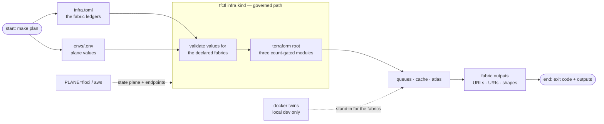

# Infra Documentation

Welcome to the infra documentation. This guide covers how a declared fabric becomes live infrastructure — and how to run the local Docker twins, configure the two input files, and verify a change safely.

**The stack in one sentence:** tfctl's `infra` kind reads `infra.toml` plus a gitignored values file, terraform-drives three optional fabrics (SQS queues, a shared Redis cache, an Atlas Free cluster) onto Floci or real AWS, and exposes endpoint-agnostic connections to the services.

## New to infra?

Start here:

1. **[Quick Start](getting-started/quickstart.md)** — run the offline gate, then land the declared fabrics on Floci
2. **[Architecture](concepts/architecture.md)** — how one `make plan` becomes a governed change
3. **[Fabrics](concepts/fabrics.md)** — the three fabrics and the contracts they carry

## Documentation by Topic

### Getting Started

| Document | What You'll Learn | When to Read |
|----------|-------------------|--------------|
| [Quick Start](getting-started/quickstart.md) | env file, offline gate, first plan and apply | First run, new machine |
| [Configuration](getting-started/configuration.md) | The two input files, every value, the plane flick | Changing a declaration or a key |

### Concepts

| Document | What You'll Learn | When to Read |
|----------|-------------------|--------------|
| [Architecture](concepts/architecture.md) | Component map, verb lifecycle, state and carrier | Understanding the system |
| [Fabrics](concepts/fabrics.md) | Queues, cache, Atlas: resources, flows, contracts | Changing a fabric or debugging one |
| [Docker Twins](concepts/docker-twins.md) | Local ElasticMQ, MongoDB and Redis stand-ins | Running services without a cloud plane |

### Guides

| Guide | What You'll Learn | When to Read |
|-------|-------------------|--------------|
| [Testing](guides/testing.md) | Offline gate, mocked contract tests, integration tier | Verifying a change |

### Reference

| Document | What You'll Learn | When to Read |
|----------|-------------------|--------------|
| [Make Commands](reference/make.md) | Every target with its purpose and plane switch | Any command-line work |
| [Terraform Layout](reference/terraform.md) | Modules, inputs, outputs, providers, validation | Reading or editing the `.tf` files |

## The stack at a glance



The Docker twins never sit on the governed path: they are plain compose stacks for local runs. Everything that writes a plane goes through tfctl.

## Project Structure

```
infra/
├── infra.toml          the declaration: which fabrics exist and their shape
├── envs/.env           the values file (gitignored; .env.example is the template)
├── terraform/          the root tfctl drives
│   ├── main.tf               the three count-gated module calls
│   ├── providers.tf          AWS + aliased Atlas provider, emulator switching
│   ├── variables.tf          inputs, validation, defaults
│   ├── outputs.tf            the contract surface handed back to callers
│   ├── modules/queues/       SQS fabric
│   ├── modules/elasticache/  shared Redis fabric
│   ├── modules/atlas/        MongoDB Atlas Free fabric
│   └── tests/                mocked contract tests, one file per fabric
├── docker/             the local twins: elasticmq, mongo, redis
├── mk/                 make fragments: fabrics.mk (tfctl), tests.mk (offline gate)
└── docs/               this documentation
```

## Quick Reference

```bash
cd infra
make env                       # create envs/.env from the example, never overwrites
make fmt init validate test    # offline gate: no plane, no credentials
make -C .. floci-up            # emulator on :4566 (repo root target)
make plan && make apply        # land the declared fabrics (auto-approved on Floci)
make destroy                   # tear them down (auto-approved on both planes)
```

`make help` lists the raw targets; [Make Commands](reference/make.md) is the annotated version.
