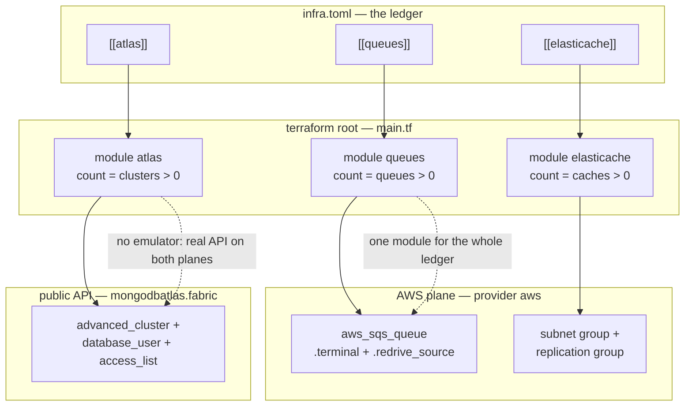
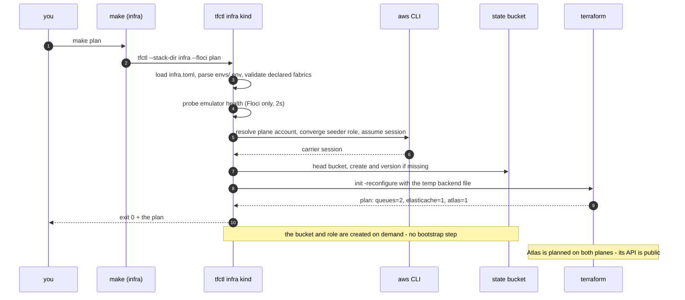
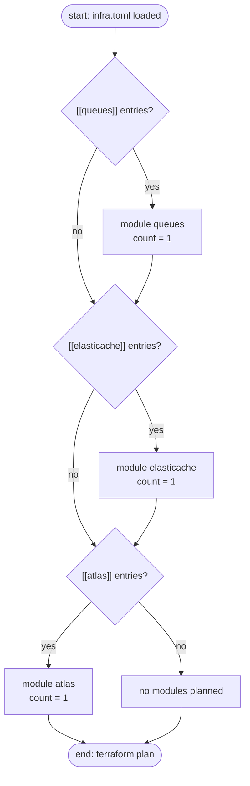

# Architecture

This document explains how one `make plan` becomes a governed change on a plane. Read the [Quick Start](../getting-started/quickstart.md) first if nothing has run yet.

## What this stack is

A declared set of shared fabrics, not a service. `infra.toml` says which fabrics exist, `envs/.env` supplies their plane-specific values, and tfctl's `infra` kind drives one Terraform root that plans each declared fabric. The root is stateless between runs: state lives in an S3 bucket created on demand, and every acting verb rides a converged seeder role. The driver's internals belong to [tfctl's documentation](../../../tools/tfctl/docs/README.md); this page covers the infra side of that seam.

## The component map

Each ledger maps to exactly one module. The `count` gate means an empty ledger plans no module at all — there is no "empty resource" fallback.

## What tfctl contributes

| Step | What happens |
|------|--------------|
| Load | Read `infra.toml` and `envs/.env`; reject unknown sections, bad names, missing values |
| Plane | `--floci` or `--aws`; on Floci, probe `/_localstack/health` within 2 seconds |
| Carrier | Resolve the plane account, converge the `detectai-infra-seeder` role, assume a session |
| State | Head the derived `detectai-infra-tfstate-<account>` bucket; create and version it if missing |
| Backend | Compose the plane's backend file, run `init -reconfigure` with it, then delete the temp file |
| Verb | Run Terraform with the `TF_VAR_*` overlay and the carrier credentials; destroy may purge state and drop the role |

There is no bootstrap command: the first run that needs the bucket or the role creates it.

## One `make plan`, end to end

Apply adds the approval rule: auto on Floci, interactive on real AWS. Destroy auto-approves on both, then optionally purges state and drops the seeder role.

## From declaration to resources

## The two planes

| | Floci (default) | Real AWS |
|---|---|---|
| State | S3 on the emulator | S3 in the caller's account |
| AWS endpoints | `http://localhost:4566` with test credentials | Region defaults |
| Seeder role | Emulated account | Assumed with MFA, cached 12 hours |
| Atlas | Real MongoDB Cloud, state tracked on Floci | Real MongoDB Cloud |
| Apply | Auto-approved | Interactive confirmation |

Services stay endpoint-agnostic: `QUEUE_URL` / `AWS_ENDPOINT_URL_SQS`, `REDIS_ENDPOINT` / `REDIS_AUTH_TOKEN`, and `MONGO_URI` / `MONGO_DATABASE` decide which twin they talk to — the [Docker twins](docker-twins.md) locally, these fabrics on a plane.

## Next Steps

- **[Fabrics](fabrics.md)** — what each module creates and the contracts it emits
- **[Configuration](../getting-started/configuration.md)** — the two input files in full
- **[Terraform Layout](../reference/terraform.md)** — variables, outputs, providers
