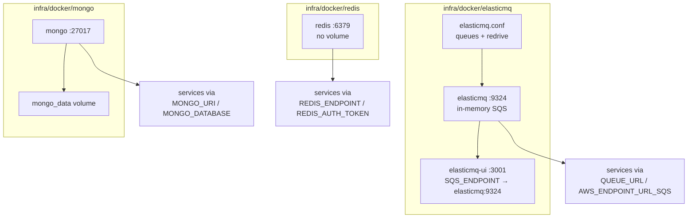
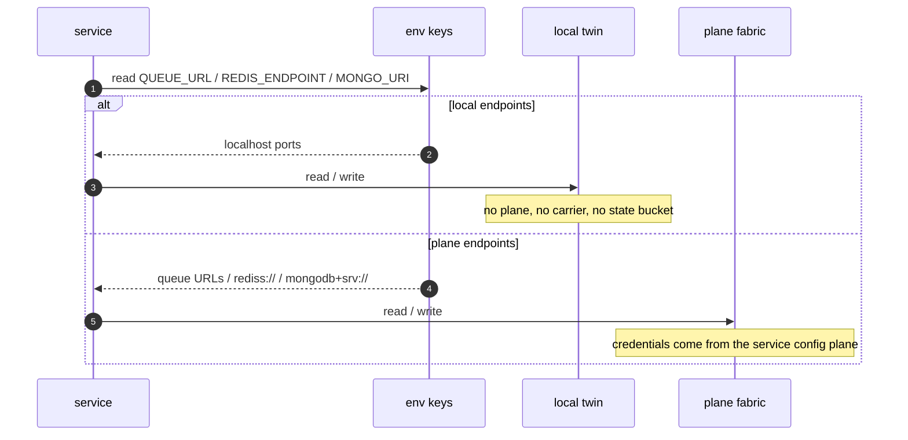
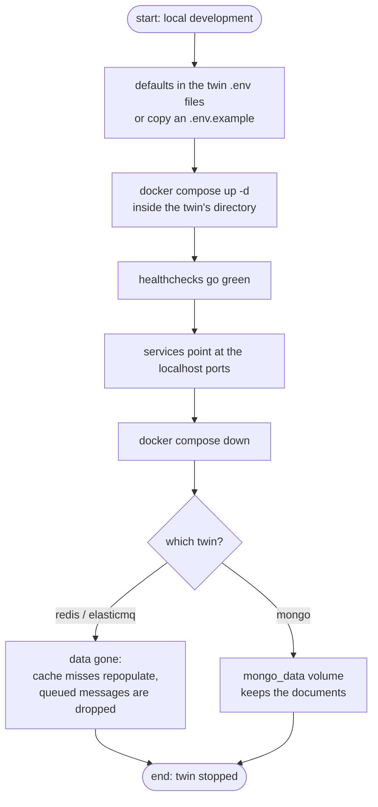

# Docker Twins

Three compose stacks under `infra/docker/` stand in for the fabrics during local development. They are plain containers: the Terraform root never touches them, and they sit outside the tfctl governed path.

## The twins

| Directory | Image | Host port | State | Role |
|-----------|-------|-----------|-------|------|
| `elasticmq/` | `softwaremill/elasticmq-native:1.7.1` | 9324 (UI 3001) | In memory | SQS stand-in, with a web UI |
| `mongo/` | `mongo:8.0` | 27017 | `mongo_data` volume | Durable document store |
| `redis/` | `redis:8-alpine` | 6379 | None | Ephemeral cache |

Each stack has a healthcheck (`wget` on ElasticMQ, `mongosh ping`, `redis-cli ping`) and `restart: unless-stopped`. The compose files declare no networks or container names, so a service can include them in its own compose stack without collisions.

## The local map

The endpoints are environment variables on the service side, so the same binary talks to a twin locally and to a fabric on a plane ([Architecture](architecture.md)).

## One consumer, two destinations

## Up and down

## Differences from the fabrics

The twins mirror the service contracts, not the Terraform resources. Know the gaps before trusting a local run:

- **ElasticMQ keeps `contentBasedDeduplication = true`** in `elasticmq.conf`; the Terraform queue sets it to `false` because producers send an explicit `MessageDeduplicationId`. Local runs do not exercise that rule.
- **ElasticMQ does not set retention** in its config — 14-day retention stays IaC-only. Its queues are in memory, so `down`/`up` drops every message.
- **Local Redis has no AUTH token and no encryption**; the fabric serves `rediss://` with a token. The cache is ephemeral either way.
- **Local MongoDB has no SCRAM user or access list**; it is a plain container with a durable volume.
- **There is no Atlas twin.** Use a real M0 cluster or a MongoDB container from a service's own compose stack.

## Next Steps

- **[Fabrics](fabrics.md)** — what each twin stands in for
- **[Configuration](../getting-started/configuration.md)** — the port keys and the plane switch
- **[Quick Start](../getting-started/quickstart.md)** — the governed path instead
