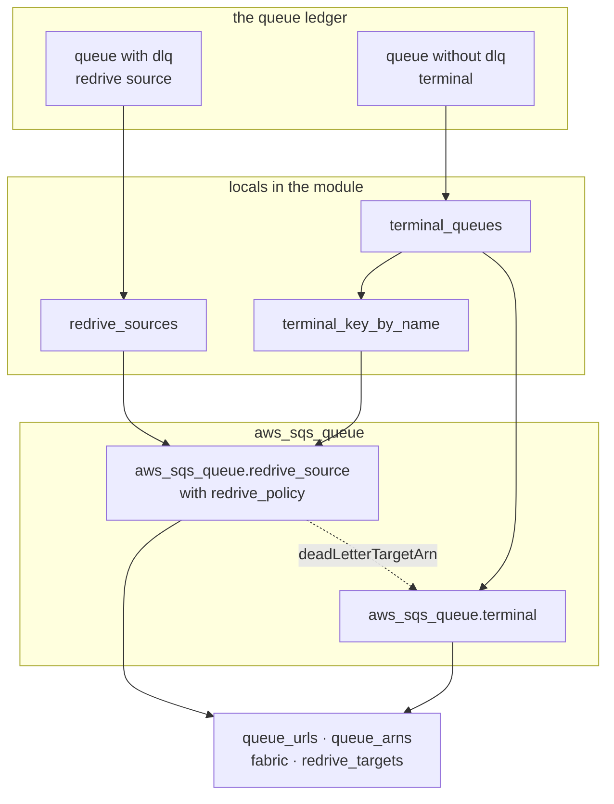
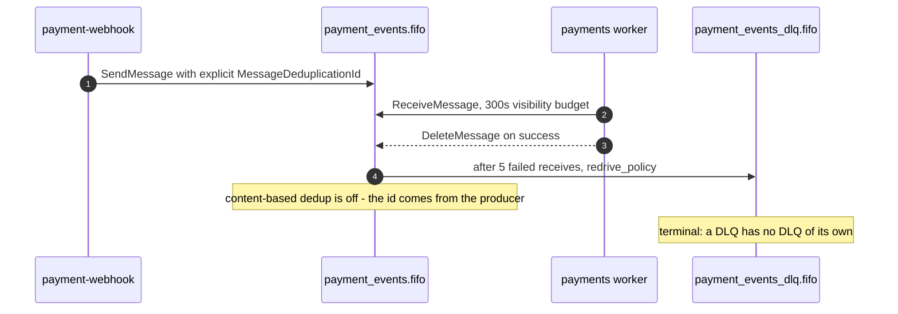
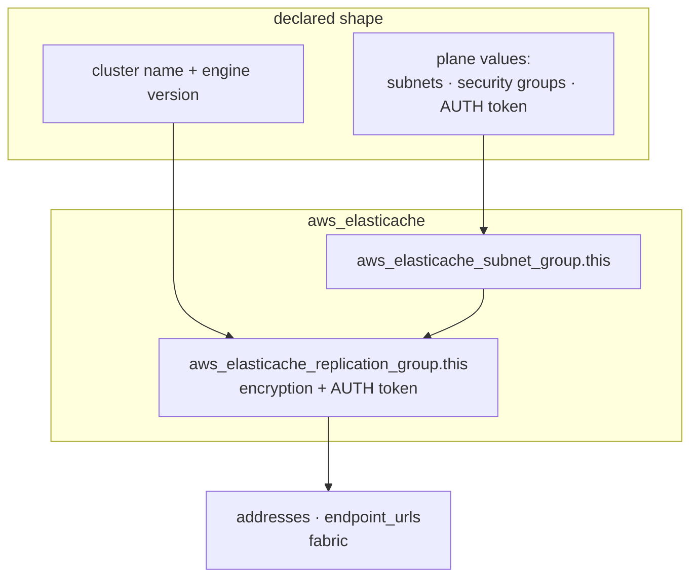
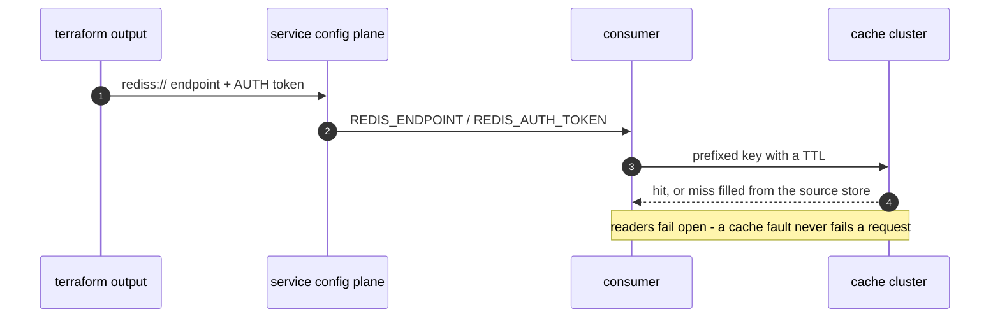
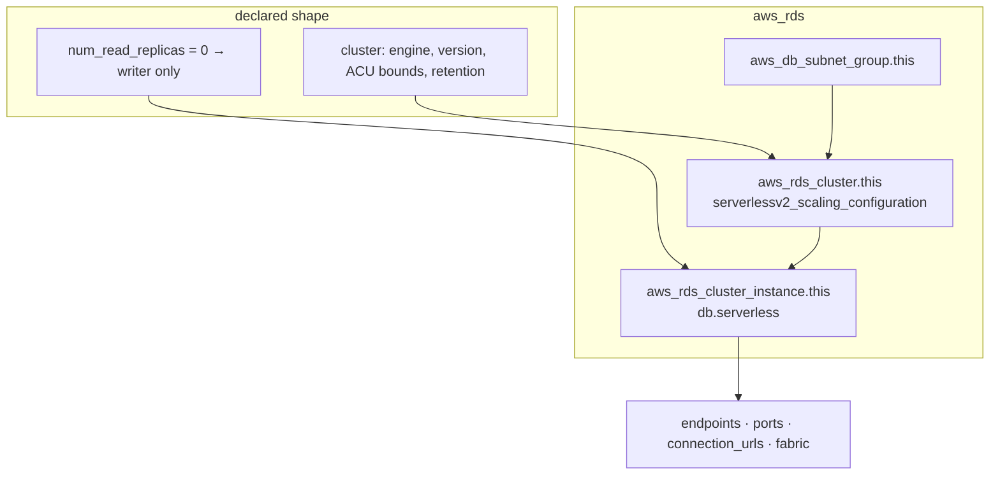
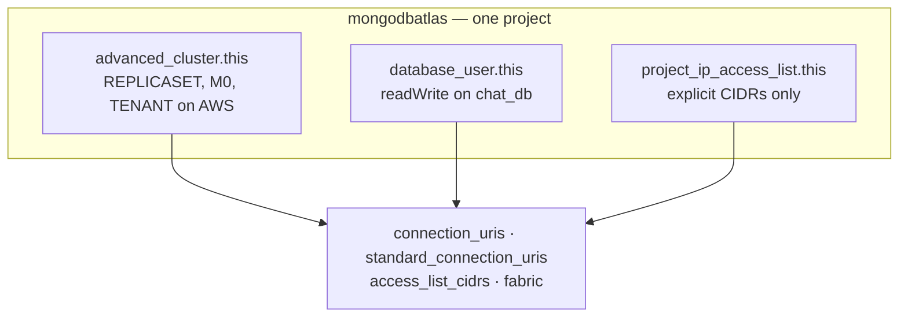
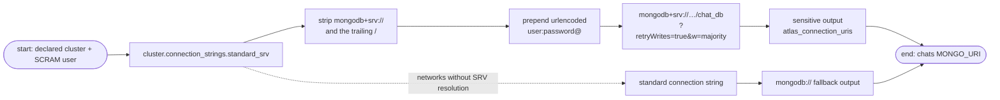

# Fabrics

Four fabrics can be declared in `infra.toml`: SQS queues, a shared Redis cache, an Atlas Free cluster, and an Aurora PostgreSQL Serverless v2 database. Each ledger maps to one Terraform module, and each name is the identity inside its ledger. Read [Architecture](architecture.md) for how a ledger becomes a module call.

| Ledger | Module | Provider | On Floci |
|--------|--------|----------|----------|
| `[[queues]]` | `modules/queues` | `aws` | Emulated |
| `[[elasticache]]` | `modules/elasticache` | `aws` | Emulated |
| `[[atlas]]` | `modules/atlas` | `mongodbatlas.fabric` (aliased) | Real API, state on the emulator |
| `[[aurora]]` | `modules/aurora` | `aws` (RDS endpoint) | Partial emulation; plan only |

## The queue fabric

The ledger splits into two resource classes at plan time. A queue that redrives cannot read its dead-letter queue's ARN from a block of its own, so redrive targets live in a separate `for_each`.

### One event and its redrive

| Contract | Value |
|----------|-------|
| Queue type | FIFO, content-based deduplication off |
| Visibility timeout | 300 seconds per receive attempt |
| Retention | 1,209,600 seconds (14 days), IaC-only |
| Redrive | `max_receive_count` from the ledger; target must be a terminal queue |
| Ledger law | Redrive targets are terminal — DLQ chains are not modeled |

The committed ledger carries the `payment-webhook` contract from `services/payment-webhook/specification/messaging.md`.

## The cache fabric

A replication group is the only ElastiCache resource that accepts an AUTH token in provider 5.x. With one node, cluster mode and failover off, it is a single Redis instance.

### How a consumer connects

| Contract | Value |
|----------|-------|
| Engine | Redis only |
| Topology | One node, cluster mode disabled, no failover |
| Transport | In-transit encryption on; AUTH token required |
| Placement | Subnet IDs from the values file, one subnet group per cluster |
| Consumers | Per-service key prefixes and TTLs, per `services/chats/specification/references/cache.md` |

Cache shape (name, engine, node type, port) is declared here. The token and VPC placement are plane values in `envs/.env`.

## The Aurora fabric

Aurora PostgreSQL Serverless v2 is the shared relational store. The ledger pins the engine to `aurora-postgresql`, the engine version (default `16.4`), the database name and port, and the scaling knobs: `min_acu` / `max_acu` (`0.5`–`1` in the committed declaration, accepted range `0.5`–`128` in `0.5` steps) and `num_read_replicas` (`0` means writer only).

| Contract | Value |
|----------|-------|
| Engine | `aurora-postgresql`, `engine_mode = "provisioned"` |
| Instance class | `db.serverless` for the writer and every reader |
| Scaling | `min_acu` / `max_acu` from the ledger, currently `0.5`–`1` |
| Topology | One writer plus `num_read_replicas`; no proxy resources |
| Placement | Subnet IDs and optional security groups from `envs/.env` |

The instance set is flattened into a `for_each` map because a Terraform resource cannot carry both `for_each` and `count`. New readers are additive; changing the replica count plans only additional instances. Floci's RDS emulation is partial, so this fabric is verified with read-only plans and mocked contract tests.

## The Atlas fabric

Atlas has no emulator, but its API is public and the state plane stores only Terraform state, so a real M0 cluster is planned on every plane. The keys are required on Floci too.

The database user is project-scoped, so one user serves every declared cluster — no `for_each` over clusters.

### How the SRV URI is assembled

| Contract | Value |
|----------|-------|
| Tier | `M0` (Free) only |
| Shape | Single-node replica set, `TENANT` on `AWS`, priority 7 |
| Region | Atlas names, e.g. `AP_SOUTHEAST_2` |
| Access | Explicit IPv4/IPv6 CIDRs; no open default |
| Outputs | Sensitive `mongodb+srv://` URI plus a `mongodb://` fallback |

Atlas is for dev and demo only: the Free tier is shared, about 512 MB, has no backups or private endpoints, and allows one cluster per account.

## The contract surface

Every module emits a `fabric` output: the plan-time shape (names, types, settings) that the mocked contract tests assert. Endpoint outputs carry the sensitive connection strings. The tests live in `terraform/tests/`, one file per fabric — see [Testing](../guides/testing.md).

## Next Steps

- **[Docker Twins](docker-twins.md)** — the local stand-ins for these fabrics
- **[Terraform Layout](../reference/terraform.md)** — every input and output
- **[Configuration](../getting-started/configuration.md)** — the values each fabric requires
