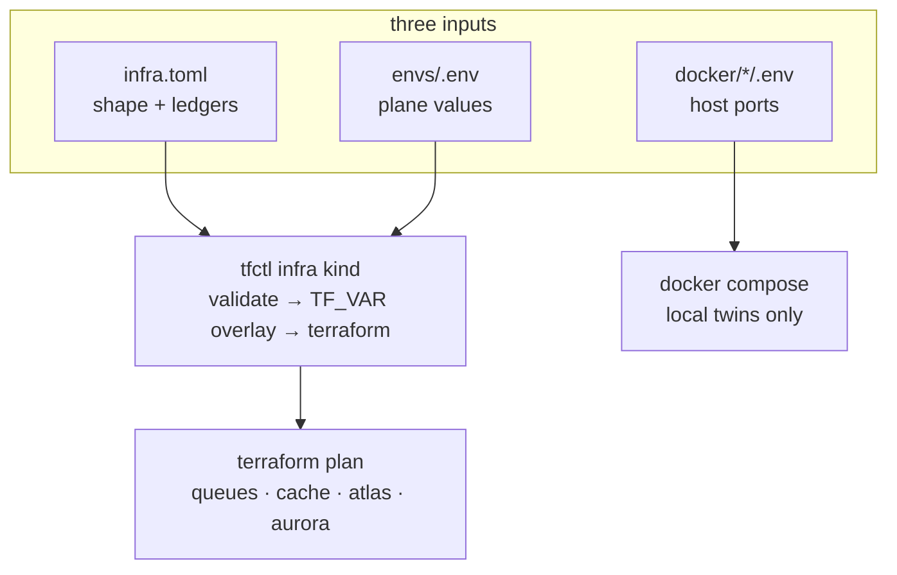
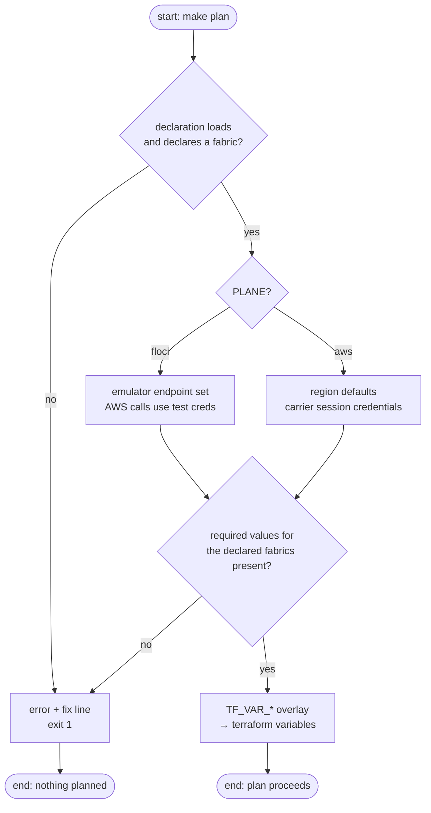

# Configuration

Infra has three inputs and no hidden ones: `infra.toml` declares **what exists**, `envs/.env` holds **plane-specific values and credentials**, and each `docker/*/.env` sets **local port overrides**. Nothing is re-read mid-run.

## The three inputs

| File | Owns | Committed? |
|------|------|------------|
| `infra.toml` | Fabric ledgers, their shape, the region fallback | Yes |
| `envs/.env` | Credentials, placement, explicit CIDRs, region override | No — `.env.example` is the template |
| `docker/*/.env` | Host ports for the local twins | Yes |

## The declaration

`infra.toml` has one `[service]` table and up to four ledger sections — `[[queues]]`, `[[elasticache]]`, `[[atlas]]`, `[[aurora]]`. Each section is optional, but at least one fabric must be declared. The name is the identity within its own ledger; a name may not appear twice.

| Ledger | Fields | Defaults applied when omitted |
|--------|--------|-------------------------------|
| `[[queues]]` | `name`, `dlq`, `max_receive_count` | `dlq = ""`, `max_receive_count = 0` |
| `[[elasticache]]` | `name`, `engine`, `engine_version`, `node_type`, `num_cache_nodes`, `port`, `parameter_group_name` | `redis`, `7.0`, `cache.t3.micro`, `1`, `6379`, matching parameter group |
| `[[atlas]]` | `name`, `region`, `tier` | `tier = "M0"`; region is required |
| `[[aurora]]` | `name`, `engine`, `engine_version`, `database_name`, `port`, `min_acu`, `max_acu`, `num_read_replicas`, `storage_encrypted`, `backup_retention_days`, `deletion_protection`, `skip_final_snapshot` | `aurora-postgresql`, `16.4`, `5432`, `0` replicas, encryption on, `7` days, no deletion protection, final snapshot skipped |

The declaration is exhaustive and checked before any values are read:

- A `dlq` must name a queue declared in the same ledger, and `max_receive_count` (1–1000) is then required.
- Redrive targets are terminal — a DLQ may not have a DLQ of its own, and a queue may not redrive to itself.
- Cache names are lowercase DNS-style; 1–6 nodes; port 1–65535.
- Atlas regions use names like `AP_SOUTHEAST_2`, and `M0` is the only tier.
- Aurora is pinned to `aurora-postgresql`; ACUs are `0.5`–`128` in `0.5` steps with `max_acu >= min_acu`, replica count is non-negative, and backup retention is `1`–`35` days.

See [Fabrics](../concepts/fabrics.md) for what each ledger becomes.

## The values file

Every value is a plain `KEY=value` line. Unknown keys are ignored; values are only required for fabrics the declaration actually contains. With all four ledgers declared, the full set is:

| Key | Used by | Rule |
|-----|---------|------|
| `AWS_REGION` | state bucket + AWS fabrics | Plain region code, e.g. `ap-southeast-2`; overrides the declaration's region |
| `REDIS_AUTH_TOKEN` | cache | At least 16 characters |
| `CACHE_SUBNET_IDS` | cache | Comma-separated subnet IDs; required when a cache is declared |
| `CACHE_SECURITY_GROUP_IDS` | cache | Optional comma-separated security group IDs |
| `DB_MASTER_USERNAME` | Aurora | Non-empty; master user |
| `DB_MASTER_PASSWORD` | Aurora | At least 16 characters |
| `DB_SUBNET_IDS` | Aurora | Comma-separated subnet IDs; required when Aurora is declared (one per AZ) |
| `DB_SECURITY_GROUP_IDS` | Aurora | Optional comma-separated security group IDs |
| `MONGODB_ATLAS_PUBLIC_KEY` | Atlas | At least 8 characters |
| `MONGODB_ATLAS_PRIVATE_KEY` | Atlas | At least 16 characters |
| `MONGODB_ATLAS_PROJECT_ID` | Atlas | 24-character hex string |
| `ATLAS_DB_USERNAME` | Atlas | Non-empty |
| `ATLAS_DB_PASSWORD` | Atlas | At least 16 characters |
| `ATLAS_IP_CIDRS` | Atlas | Comma-separated IPv4/IPv6 CIDRs; required when Atlas is declared |

The queue fabric needs no credentials. Cache, Aurora and Atlas values are checked only for declared fabrics, so removing a ledger section removes its required keys. All of them are passed to Terraform as `TF_VAR_*` entries; secret values never print in a tfctl receipt.

### Values to Terraform variables

| Input | Becomes |
|-------|---------|
| `AWS_REGION` / declaration region | `TF_VAR_aws_region` |
| `[[queues]]` ledger | `TF_VAR_queues` map |
| `[[elasticache]]` ledger | `TF_VAR_cache_clusters` map |
| `[[atlas]]` ledger | `TF_VAR_atlas_clusters` map |
| `[[aurora]]` ledger | `TF_VAR_db_clusters` map |
| `DB_MASTER_*`, `DB_*` | `TF_VAR_db_master_username`, `TF_VAR_db_master_password`, `TF_VAR_db_subnet_ids`, `TF_VAR_db_security_group_ids` |
| `REDIS_AUTH_TOKEN`, `CACHE_*` | `TF_VAR_cache_auth_token`, `TF_VAR_cache_subnet_ids`, `TF_VAR_cache_security_group_ids` |
| `MONGODB_ATLAS_*`, `ATLAS_*` | The `TF_VAR_atlas_*` family |
| Floci plane | `TF_VAR_emulator_endpoint` |

## The plane flick

`PLANE` is the only switch, and it applies to every plane-writing target: `floci` (the default) or `aws`. Anything else stops with an error before tfctl runs.

| Plane | Flag | Endpoints | Apply |
|-------|------|-----------|-------|
| `floci` | `--floci` | `http://localhost:4566` for SQS, ElastiCache and RDS | Auto-approved |
| `aws` | `--aws` | Region defaults | Interactive confirmation |

Atlas is the exception on both planes: it has no emulator, so a declared cluster is always real MongoDB Cloud. Its API keys are required even on Floci.

## The input surfaces at a glance

## How a value resolves

## Local ports

Each twin has its own `.env` in `infra/docker/<name>/`. The compose files declare no networks or container names, so they can be included from a service's own compose stack.

| Twin | File | Port key | Default |
|------|------|----------|---------|
| ElasticMQ | `elasticmq/.env.example` | `ELASTICMQ_PORT` / `ELASTICMQ_UI_PORT` | 9324 / 3001 |
| MongoDB | `mongo/.env` | `MONGO_PORT` | 27017 |
| Redis | `redis/.env` | `REDIS_PORT` | 6379 |

## Next Steps

- **[Quick Start](quickstart.md)** — fill the file, then run the gate
- **[Docker Twins](../concepts/docker-twins.md)** — what the local ports point at
- **[Terraform Layout](../reference/terraform.md)** — where the variables land
