# Quick Start

Get the offline gate green, then land the declared fabrics on Floci. The loop is `make env` → `make fmt init validate test` → `make floci-up` → `make plan` → `make apply`.

## Steps

1. **Create the values file** from `infra/`:

   ```sh
   cd infra
   make env
   ```

   If `envs/.env` exists, this does nothing — it never overwrites.

2. **Fill the values the declaration needs.** The committed `infra.toml` declares all four fabrics, so `envs/.env` needs cache subnets, the Aurora master credentials and subnet IDs, plus the Atlas keys, project ID, SCRAM user and explicit CIDRs. The committed `.env.example` carries shape-valid dummy values for every key:

   ```ini
   CACHE_SUBNET_IDS=subnet-default-ap-southeast-2-a
   DB_MASTER_USERNAME=<aurora-master-user>
   DB_MASTER_PASSWORD=<16-char-minimum-password>
   DB_SUBNET_IDS=subnet-a,subnet-b
   MONGODB_ATLAS_PUBLIC_KEY=<atlas-public-key>
   MONGODB_ATLAS_PRIVATE_KEY=<atlas-private-key>
   MONGODB_ATLAS_PROJECT_ID=<24-hex-project-id>
   ATLAS_DB_USERNAME=<scram-user>
   ATLAS_DB_PASSWORD=<16-char-minimum-password>
   ATLAS_IP_CIDRS=<your-ip>/32
   ```

   Never commit this file. The [configuration page](configuration.md) has every key and its rule.

3. **Run the offline gate** — no plane, no credentials:

   ```sh
   make fmt init validate test
   ```

   `fmt` checks formatting, `init` initializes without a backend, `validate` checks the Terraform, and `test` runs the mocked contract tests. All four must pass before a plane run.

4. **Start the emulator** from the repository root:

   ```sh
   cd ..
   make floci-up    # http://localhost:4566
   cd infra
   ```

   `make plan` probes `/_localstack/health` with a 2-second timeout and fails with a start hint if Floci is down.

5. **Read the plan:**

   ```sh
   make plan
   ```

   The banner names the plane, the carrier, the state bucket and the fabric counts. Nothing is written.

6. **Apply:**

   ```sh
   make apply
   ```

   Apply is auto-approved on Floci. A real-AWS apply (`make PLANE=aws apply`) keeps the interactive confirmation.

7. **Confirm the run was clean:**

   ```sh
   make plan    # no changes left
   ```

## The first-run path

```mermaid
graph LR
    START(["start: fresh clone"]) --> ENV["make env<br/>envs/.env from the example"]
    ENV --> FILL["fill cache placement + Atlas values<br/>placeholders are refused"]
    FILL --> GATE["make fmt init validate test<br/>offline, no plane"]
    GATE --> EMU["make floci-up<br/>repo root, :4566"]
    EMU --> PLAN["make plan<br/>read-only, review the fabrics"]
    PLAN --> APPLY["make apply<br/>auto-approved on Floci"]
    APPLY --> VERIFY["make plan again<br/>no changes left"]
    VERIFY --> END(["end: fabrics landed"])
    PLAN -.->|"Atlas is real MongoDB Cloud on both planes"| APPLY
```



**Read the plan before applying.** Floci emulates the AWS fabrics, but Atlas has no emulator: a declared `[[atlas]]` cluster is real MongoDB Cloud on every plane, and the state plane only stores its Terraform state. Aurora Serverless v2 is only partially modeled by the emulator, so the committed ledger is verified with read-only plans, not applies. For a local-only run, remove the `[[atlas]]` and `[[aurora]]` sections from `infra.toml` before planning.

## Working without a plane

You can run services against the [Docker twins](../concepts/docker-twins.md) instead — ElasticMQ for SQS, a Redis container for the cache, MongoDB for storage. They are plain compose stacks in `infra/docker/` and are never touched by the Terraform root.

## Clean up

```sh
make destroy    # auto-approved on both planes; Terraform-managed resources only
```

`destroy` leaves the state bucket and seeder role in place. They are created on demand by whichever run needs them ([Architecture](../concepts/architecture.md)).

## Next Steps

- **[Configuration](configuration.md)** — every key, its rule, and the plane flick
- **[Architecture](../concepts/architecture.md)** — what happens inside `make plan`
- **[Testing](../guides/testing.md)** — the full verification ladder
