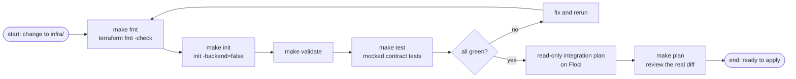

# Testing

Infra is verified in layers: offline checks first, then mocked contract tests, then a read-only plan against a plane. Nothing in the first three layers writes to a cloud account.

## The verification ladder



## The gates

| Command | What it proves | Needs a plane? |
|---------|----------------|----------------|
| `make fmt` | Every `.tf` file is formatted (`fmt -check -recursive -diff`) | No |
| `make init` | Providers resolve; clears the recorded backend first | No |
| `make validate` | The root and all three modules are valid Terraform | No |
| `make test` | Each fabric's declared contract holds under `terraform test` | No |
| Integration suite | A read-only plan succeeds against the shared Floci namespace | Floci |
| `make plan` | The real diff is what you intend | Floci or AWS |

`make init` removes `.terraform/terraform.tfstate` before running `init -backend=false`: a previous plane run leaves an S3 backend record there that a bare offline init would still consult.

## The mocked contract tests

`terraform/tests/` has one file per fabric. Each declares `mock_provider` for both AWS and MongoDB Atlas, feeds a representative ledger through variables, and asserts on plan-time values only — no apply, no network.

| File | Asserts |
|------|---------|
| `queues.tftest.hcl` | FIFO and dedup settings, 300s visibility, 14-day retention, one terminal redrive target with a 5-attempt budget; an empty ledger plans no module |
| `elasticache.tftest.hcl` | Redis 7 serverless cache with 5 GB / 5000 ECPU/s ceilings; queue-less and fabric-less runs |
| `atlas.tftest.hcl` | M0 tier, Atlas region, `REPLICASET`, the SCRAM user, explicit IPv4/IPv6 CIDRs; Atlas still plans on Floci and on an Atlas-only run |

These assertions are the executable version of the [fabric contracts](../concepts/fabrics.md). When a contract changes, change the corresponding test with it.

## The integration tier

The integration suite plans read-only against the shared persistent namespace on Floci:

```sh
poetry -C ../tools/tfctl run pytest -m integration
```

It applies and destroys nothing. Real AWS is reached only by an explicit `make PLANE=aws …`.

## What to run before opening a PR

```sh
cd infra
make fmt init validate test
poetry -C ../tools/tfctl run pytest -m integration
make plan
```

`dev` runs no CI, so this local ladder is the gate.

## Next Steps

- **[Make Commands](../reference/make.md)** — every target used above
- **[Fabrics](../concepts/fabrics.md)** — the contracts the tests assert
- **[Testing in tfctl](../../../tools/tfctl/docs/guides/testing.md)** — the driver's own test tiers
