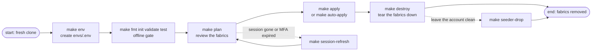

# Make Commands

Every target runs from `infra/`; `make help` prints the raw index. The targets live in two fragments: `mk/tests.mk` (the offline gate) and `mk/fabrics.mk` (the plane verbs). The plane verbs delegate to tfctl via `poetry -C ../tools/tfctl run tfctl`.

## The lifecycle at a glance

## Offline targets — `mk/tests.mk`

| Target | What it does | Reach for it when |
|--------|--------------|-------------------|
| `make env` | Copy `envs/.env.example` → `envs/.env` if missing | First run; never overwrites |
| `make fmt` | `terraform fmt -check -recursive -diff` | Before any commit |
| `make init` | Clear the recorded backend, then `init -backend=false` | Before validate or test |
| `make validate` | `terraform validate` on the root and modules | After a `.tf` edit |
| `make test` | `terraform test` — mocked contract tests | After a shape or contract change |
| `make help` | Print both fragments' target lists | Looking for a verb |

None of these needs a plane or credentials.

## Plane targets — `mk/fabrics.mk`

All five accept `PLANE=floci|aws` (default `floci`). Any other value stops before tfctl runs.

| Target | What it does | Reach for it when |
|--------|--------------|-------------------|
| `make plan` | Read-only Terraform plan; auto-approved input | Reviewing a change |
| `make apply` | Terraform apply — auto on Floci, interactive on real AWS | Landing the declared fabrics |
| `make auto-apply` | Plan then apply in one run, stopping at the first failure | One-shot local runs |
| `make destroy` | Terraform destroy, auto-approved on both planes | Tearing the fabrics down |
| `make seeder-drop` | Detach the seeder policy and delete the role | Leaving an account clean |

## Session targets — `mk/fabrics.mk`

| Target | What it does | Reach for it when |
|--------|--------------|-------------------|
| `make session-clear` | Drop this stack's cached carrier session | A session has gone stale |
| `make session-refresh` | Drop and re-mint the session (MFA on real AWS) | The cached 12-hour window expired |

Other stacks' sessions are untouched. The state bucket and seeder role themselves are created on demand by the first run that needs them.

## Switches and reach

| Switch | Effect |
|--------|--------|
| `PLANE=floci` | `--floci` to tfctl; emulator endpoints, auto-approved apply |
| `PLANE=aws` | `--aws` to tfctl; region defaults, interactive apply, MFA on assume |

The full flag set, dry runs and state flags are documented in [tfctl's CLI reference](../../../tools/tfctl/docs/reference/cli.md); this layer only picks the stack directory and the plane.

## Next Steps

- **[Quick Start](../getting-started/quickstart.md)** — the main line, step by step
- **[Testing](../guides/testing.md)** — what the offline gates assert
- **[Terraform Layout](terraform.md)** — the files those verbs drive
