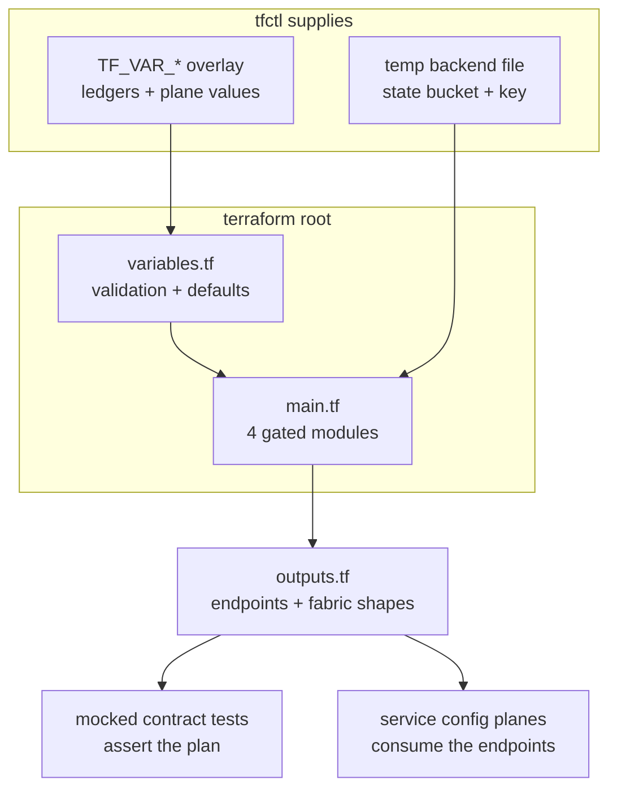

# Terraform Layout

The Terraform root under `infra/terraform/` is driven only by tfctl's `infra` kind. This page is the map of its files, inputs and outputs — the contract that the [fabric tests](../guides/testing.md) assert.

## Root files

| File | Role |
|------|------|
| `versions.tf` | Terraform `~> 1.10`, AWS `~> 5.0`, MongoDB Atlas `~> 2.0`, partial `backend "s3" {}` |
| `providers.tf` | Emulator switching, common tags, the aliased Atlas provider |
| `variables.tf` | All inputs, their validation and defaults |
| `main.tf` | The four count-gated module calls |
| `outputs.tf` | The contract surface handed back to callers |
| `modules/{queues,elasticache,atlas,aurora}/` | One module per fabric: `main.tf`, `variables.tf`, `outputs.tf` |
| `tests/` | Mocked contract tests, one file per fabric |

The backend is intentionally partial: tfctl always passes the plane's backend file at `init`, never a bare init. The root itself never hard-codes a bucket.

## Providers and plane switching

| Provider | Configuration |
|----------|---------------|
| `aws` | Region from `var.aws_region`; on an emulator, test credentials, four skip flags and SQS/ElastiCache/RDS endpoints pointed at `var.emulator_endpoint` |
| `mongodbatlas.fabric` | Aliased, so Floci and queue/cache-only runs never configure it; keys come from variables with an `"unused"` placeholder when the fabric is absent |

`var.emulator_endpoint` is the single switch: a non-empty trimmed URL means emulator, empty or null means real AWS. tfctl sets it only on Floci.

## Inputs

| Variable | Default | Validation |
|----------|---------|------------|
| `aws_region` | `ap-southeast-2` | Plain region code |
| `emulator_endpoint` | `null` | Null, empty, or an `http(s)` URL |
| `queues` | `{}` | FIFO names, unique |
| `visibility_timeout_seconds` | `300` | 0–43200 |
| `message_retention_seconds` | `1209600` | 60–1209600 |
| `cache_clusters` | `{}` | Redis, DNS-style names, 1–6 nodes, port 1–65535 |
| `cache_auth_token` | `""` (sensitive) | Supplied by tfctl when a cache is declared |
| `cache_subnet_ids` | `[]` | Plane-specific, from the values file |
| `cache_security_group_ids` | `[]` | Optional |
| `atlas_clusters` | `{}` | `M0` tier, Atlas-style region names |
| `atlas_public_key` / `atlas_private_key` | `"unused"` (sensitive) | Placeholder kept the provider quiet on unconfigured runs |
| `atlas_project_id` | `""` | Empty or 24-character hex |
| `atlas_db_username` / `atlas_db_password` | `""` (password sensitive) | Supplied by tfctl when Atlas is declared |
| `atlas_ip_cidrs` | `[]` | Valid IPv4/IPv6 CIDRs |
| `db_clusters` | `{}` | `aurora-postgresql`, DNS-style names, ACUs `0.5`–`128` in `0.5` steps, `max >= min`, replicas ≥ 0, port `1`–`65535`, retention `1`–`35` |
| `db_master_username` / `db_master_password` | `""` (password sensitive) | Supplied by tfctl when Aurora is declared |
| `db_subnet_ids` / `db_security_group_ids` | `[]` | Plane-specific, from the values file |

An empty ledger means no module: `main.tf` gates each module on `length(var.<ledger>) > 0`.

## Module contract

| Module | Key inputs | Emitted outputs |
|--------|-----------|-----------------|
| `queues` | Ledger map, visibility, retention | `queue_urls`, `queue_arns`, `fabric`, `redrive_targets` |
| `elasticache` | Cluster map, token, subnets, security groups | `addresses`, `endpoint_urls`, `fabric` |
| `atlas` | Cluster map, project ID, keys, SCRAM user, CIDRs | `connection_uris`, `standard_connection_uris`, `access_list_cidrs`, `fabric` |
| `aurora` | Cluster map, master credentials, subnets, security groups | `endpoints`, `reader_endpoints`, `ports`, `connection_urls`, `instance_identifiers`, `fabric` |

Each `fabric` output is the plan-time shape — names, types and settings — so the contract tests can assert it without applying.

## Root outputs

| Output | Sensitive | Carries |
|--------|-----------|---------|
| `queue_urls` / `queue_arns` | No | Queues by declared key |
| `cache_addresses` | No | `host:port` by cluster name |
| `cache_endpoint_urls` | Yes | `rediss://` URLs with the AUTH token |
| `cache_fabric` | No | Planned cache shape |
| `atlas_connection_uris` | Yes | `mongodb+srv://` URIs with credentials |
| `atlas_standard_connection_uris` | Yes | `mongodb://` fallback URIs |
| `atlas_fabric` | No | Planned Atlas shape |
| `db_endpoints` / `db_reader_endpoints` / `db_ports` | No | Aurora endpoints and ports by cluster name |
| `db_connection_urls` | Yes | `postgresql://` URLs with master credentials |
| `db_fabric` | No | Planned Aurora shape |

All outputs are wrapped in `try(module.<name>[0]...., {})` so an undeclared fabric contributes an empty map instead of failing the plan.

## How the pieces connect

## Next Steps

- **[Fabrics](../concepts/fabrics.md)** — the resources behind each module
- **[Configuration](../getting-started/configuration.md)** — which value maps to which variable
- **[Architecture](../concepts/architecture.md)** — how tfctl arrives at this root
