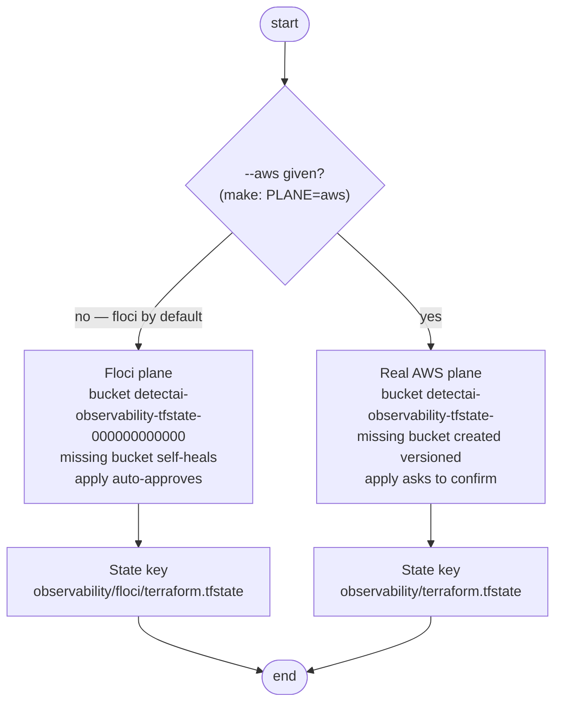

# Configuration

This document explains how `observability` is configured: the `.env` file, what each key feeds, and how the Terraform state plane is chosen.

## The env file

All credentials and plane settings live in `envs/.env` (gitignored). `make env` creates it from `envs/.env.example`; the four keys are:

| Key | Required | Default | Feeds |
|-----|----------|---------|-------|
| `NEW_RELIC_API_KEY` | yes | none | The Terraform variable — a **User API key** (`NRAK-...`), never the ingest license key |
| `NEW_RELIC_ACCOUNT_ID` | no | `123456` (mock) | The account the boards and policies are created in — replace with your real account ID for live runs |
| `NEW_RELIC_REGION` | no | `EU` | The New Relic datacenter (`one.eu.newrelic.com`) |
| `AWS_REGION` | no | `ap-southeast-2` | The **state bucket's** region — not New Relic's |

> **Tip**: `make check` validates this file, previews the plane selection, and resolves the account live — without touching any resource.

## Which state plane am I on?

| | Floci (emulator) | Real AWS |
|---|---|---|
| Selector | default — or `PLANE=floci` | `PLANE=aws` (`--aws`) |
| State bucket | derived (`...-000000000000`), self-heals if missing | derived (`...-<your account>`), created *versioned* if missing |
| Apply | auto-approves | interactive confirm |

## Credential precedence

- **`AWS_REGION`**: a plain region code, shape-checked.
- **New Relic credentials**: a shell export of `NEW_RELIC_API_KEY` overrides the file for one invocation.
- **Two different regions**: `AWS_REGION` is where Terraform state lives; `NEW_RELIC_REGION` is the New Relic datacenter. Same word, unrelated things.

## Who reads this file

`tfctl` is the only brain: it parses `envs/.env`, rejects an ingest-license-shaped API key, and drives every live Terraform command (its observability kind lives in `tools/tfctl`). `make check` additionally resolves the account name over GraphQL to catch a key from the wrong account.

## Also relevant

- `envs/.env.example` — the committed shape of the values file; `make env` copies it to `envs/.env`.
- CI runs the same offline gate as `make fmt init validate test` — see [.github/workflows/observability.yaml](../../../.github/workflows/observability.yaml).
