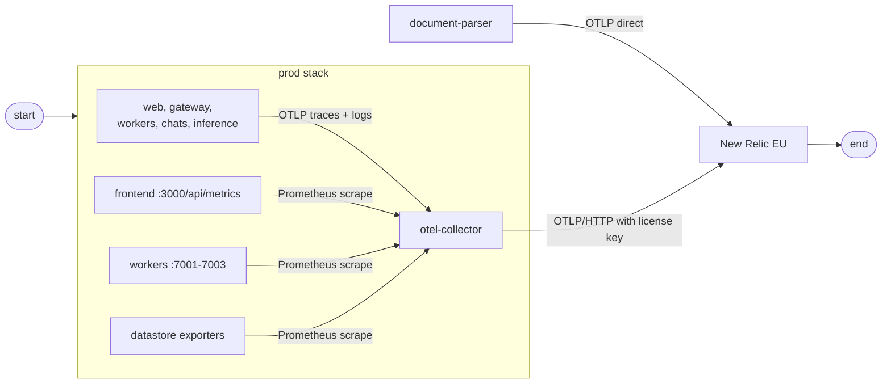
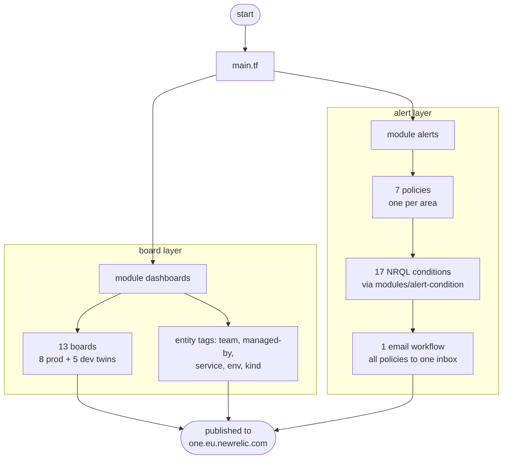

# Architecture

This document explains how the observability root is structured, how telemetry reaches New Relic, and how an alert finds your inbox.

## What this root is

A standalone Terraform root that publishes New Relic boards, policies and notifications. Three deliberate choices:

- **Separate from `infra/terraform`** — a datastore `destroy` must not take the dashboards with it.
- **Pure New Relic** — no AWS provider at all; AWS appears only through the state bucket bootstrap.
- **EU datacenter** — everything lives at `one.eu.newrelic.com`, fed by `https://otlp.eu01.nr-data.net:443`.

## How telemetry reaches New Relic

Apps never talk to New Relic directly, with one exception. The prod stack routes everything through one collector:



- **Push** — every service sets `OTEL_EXPORTER_OTLP_ENDPOINT=http://otel-collector:4318`; traces and logs flow from there to the EU endpoint.
- **Scrape** — the collector also polls Prometheus endpoints (web, all three workers, the datastore exporters) and forwards those metrics in the same stream.
- **The exception** — `document-parser` pushes all three signals straight to the EU endpoint. It is the reference pattern for any service that drops the collector later.

## What Terraform creates

Two layers, wired in `main.tf`:



- `dashboards/` renders one board per service plus the platform pair (`overview`, `datastores`), each call site backed by a JSON template: `web/prod.tftpl`, `web/dev.tftpl`, and so on.
- `alerts/` holds one policy per area and the conditions in per-service files (`web.tf`, `gateway.tf`, `workers.tf`, `inference.tf`, `parser.tf`, `chats.tf`, `pipeline.tf`) — the same split the dashboards use.
- `modules/` keeps the two reusable building blocks: `dashboard` (one board + its tags) and `alert-condition` (one NRQL condition).

## How an alert pages you

The alert anatomy is shared by every condition:

- **Window** — 60-second aggregation windows using `event_flow` with a 120-second delay.
- **Scope** — every condition filters `deployment.environment`, so load-rig runs never page.
- **Escalation** — most conditions carry one critical threshold; some add a warning first (for example, `Parser p95 latency high` warns above 2000 ms and goes critical above 3000 ms).
- **Delivery** — one email destination, channel and workflow in `alerts/notifications.tf` fan **all seven policies** to a single inbox. No Slack or PagerDuty in v1.

Each service page under [services/](../services/web.md) lists exactly what its conditions watch and the thresholds.

## Directory layout

```
observability/terraform/
├── main.tf             wiring: module "dashboards" + module "alerts"
├── variables.tf        account, api key, region, alert email, environment
├── dashboards/         board layer: wiring file + JSON template(s) per board
├── alerts/             alert layer: policies, per-service conditions, email routing
├── modules/            dashboard + alert-condition building blocks
├── envs/               .env templates and prod.tfvars
├── tools/newrelic.py   .env validator + terraform driver
├── mk/                 make fragments (offline tests + New Relic flows)
├── tests/              mocked terraform tests: board counts, twin parity, names
└── docs/               this documentation
```

## Prod and dev boards

| | Prod boards (8) | Dev twins (5) |
|---|---|---|
| Covers | `overview`, `datastores`, and one per service | `web`, `payment-gateway`, `workers`, `document-parser`, `chats` |
| Board JSON | `account_id` + `environment` templated | `prod` values hardcoded to `dev` |
| Wording | plain titles | identical pages, ` (dev)` on every title |
| Prod-only pair | `inference`, `overview`, `datastores` have no twin — the load rigs never run the AI service | — |

Terraform tests enforce the twin contract: same pages, same panel counts, same titles.
