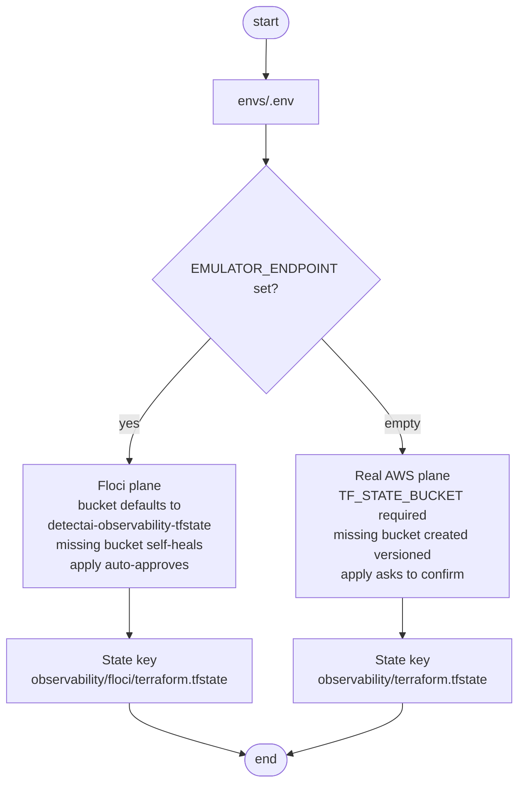

# Configuration

This document explains how `observability/terraform` is configured: the `.env` file, what each key feeds, and how the Terraform state plane is chosen.

## The env file

All credentials and plane settings live in `envs/.env` (gitignored). `make env` creates it from `envs/.env.example`; the six keys are:

| Key | Required | Default | Feeds |
|-----|----------|---------|-------|
| `NEW_RELIC_API_KEY` | yes | none | The Terraform variable — a **User API key** (`NRAK-...`), never the ingest license key |
| `NEW_RELIC_ACCOUNT_ID` | no | `123456` (mock) | The account the boards and policies are created in — replace with your real account ID for live runs |
| `NEW_RELIC_REGION` | no | `EU` | The New Relic datacenter (`one.eu.newrelic.com`) |
| `TF_STATE_BUCKET` | yes on real AWS | `detectai-observability-tfstate` on Floci | S3 bucket that stores Terraform state |
| `EMULATOR_ENDPOINT` | no | empty | An `http(s)` URL selects the Floci plane; empty selects real AWS |
| `AWS_REGION` | no | `ap-south-1` | The **state bucket's** region — not New Relic's |

> **Tip**: `make check` validates this file, previews the plane selection, and resolves the account live — without touching any resource.

## Which state plane am I on?

| | Floci (emulator) | Real AWS |
|---|---|---|
| Selector | `EMULATOR_ENDPOINT` set | left empty |
| State bucket | default, self-heals if missing | required, created *versioned* if missing |
| Apply | auto-approves | interactive confirm |

## Credential precedence

- **State keys** (`TF_STATE_BUCKET`, `EMULATOR_ENDPOINT`, `AWS_REGION`): a conflicting shell export warns and is ignored — `envs/.env` wins, so a plane is reproducible.
- **New Relic credentials**: the opposite — exporting `NEW_RELIC_API_KEY` in the shell overrides the file for one invocation.
- **Two different regions**: `AWS_REGION` is where Terraform state lives; `NEW_RELIC_REGION` is the New Relic datacenter. Same word, unrelated things.

## Who reads this file

`tools/newrelic.py` is the only brain: it parses `envs/.env`, rejects an ingest-license-shaped API key, and drives every live Terraform command. `make check` additionally resolves the account name over GraphQL to catch a key from the wrong account.

## Also relevant

- `envs/prod.tfvars` — environment values for prod applies.
- CI runs the same offline gate as `make fmt init validate test` — see [.github/workflows/observability.yaml](../../../../.github/workflows/observability.yaml).
