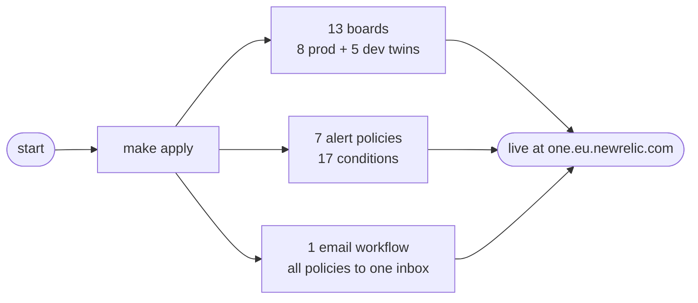

# Quick Start

This guide deploys every New Relic dashboard and alert from a fresh checkout. It takes about ten minutes; most of it is Terraform.

## Prerequisites

- **Terraform 1.9+** — `terraform -version`
- **Python 3** — `tools/newrelic.py` drives every live command
- **AWS CLI** — used only for the S3 state bucket
- **A New Relic User API key** (`NRAK-...`) — from New Relic under *API keys*. The ingest license key that apps send telemetry with is a different credential and will be rejected
- **Floci running** (`make floci-up` in the repo root) — only if you apply against the emulator plane

## Step 1: Create the env file

```bash
cd observability/terraform
make env
```

This copies `envs/.env.example` to `envs/.env` (it never overwrites an existing file). Edit `envs/.env` and put a real key in it:

```bash
NEW_RELIC_API_KEY=NRAK-...
```

Every key in that file is explained in [configuration](configuration.md).

## Step 2: Run the offline gate

```bash
make fmt init validate test
```

All four targets are local: formatting, validation, and the mocked Terraform tests — no key and no network needed. CI runs exactly this on every pull request.

## Step 3: Check your credentials

```bash
make check
```

`tools/newrelic.py` validates `envs/.env`, shows which state plane it selected, and resolves the account name over New Relic's GraphQL. A valid-looking key from the wrong account fails here instead of poisoning a plan.

## Step 4: Bootstrap the state bucket

```bash
make bootstrap
```

Creates the bucket the selected plane needs to store Terraform state. It is idempotent and needs no New Relic key.

## Step 5: Plan and apply

```bash
make plan
make apply
```

> **Tip**: On the Floci (emulator) plane, apply auto-approves; on real AWS, Terraform asks you to confirm. The plane is decided by `EMULATOR_ENDPOINT` in `envs/.env`.

## What you just published



Open `one.eu.newrelic.com` — every board named `detectai-...` is now live. Next, read [the architecture](../concepts/architecture.md) to see where the data comes from, then tour a board in [the web dashboard](../services/web.md).
