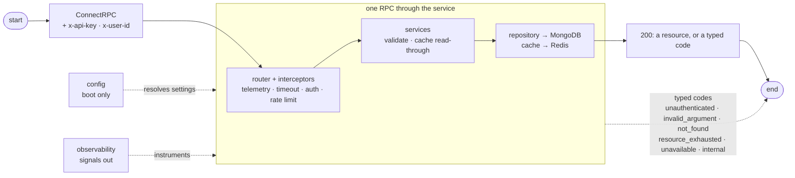

# Chats Documentation

Welcome to the chats documentation. This guide covers how a chat RPC becomes a MongoDB write or a cache-served read — and how to run, configure, test, and observe the service.

**The service in one sentence:** a ConnectRPC chat store that persists chats and messages in MongoDB, keeps hot reads in a Redis overlay, and emits OTel telemetry. Eight RPCs in, a stored resource or a typed code out.

## New to the Chats Service?

Start here:

1. **[Quick Start](getting-started/quickstart.md)** — run the service locally and make your first RPC
2. **[Architecture](concepts/architecture.md)** — how one RPC flows through the components
3. **[RPC API](reference/rpc-api.md)** — the contract every caller gets

## Documentation by Topic

### Getting Started

| Document | What You'll Learn | When to Read |
|----------|-------------------|--------------|
| [Quick Start](getting-started/quickstart.md) | Install, configure, run, first RPC | First run, new machine |
| [Configuration](getting-started/configuration.md) | Config planes, every env key, fail-fast rules | Changing any setting |

### Concepts

| Document | What You'll Learn | When to Read |
|----------|-------------------|--------------|
| [Architecture](concepts/architecture.md) | Component map, request lifecycle, boot + shutdown | Understanding the system |
| [Request Flow](concepts/request-flow.md) | Interceptors, auth, rate limiting, validation, cache read-through | An RPC is refused or slow |
| [Cache](concepts/cache.md) | Key inventory, TTLs, invalidation, fail-open degradation | Stale reads or a Redis outage |
| [Data Model](concepts/data-model.md) | Collections, indexes, keyset cursors, the analysis state machine | Storage questions, pagination bugs |
| [Observability](concepts/observability.md) | The OTel gate, signals, metric inventory | Dashboards or traces look odd |

### Guides

| Guide | What You'll Learn | When to Read |
|-------|-------------------|--------------|
| [Testing](guides/testing.md) | Unit, integration, and load testing with k6 | Verifying changes |
| [Secrets](guides/secrets.md) | How credentials are stored, resolved, and provisioned | Provisioning or rotating credentials |

### Reference

| Document | What You'll Learn | When to Read |
|----------|-------------------|--------------|
| [RPC API](reference/rpc-api.md) | The eight RPCs, headers, codes, pagination, rate limits | Writing or debugging a caller |
| [Make Commands](reference/make.md) | Every make target with its purpose | Any command-line work |

## The Request Path at a Glance



Two of the four layers never serve a request directly: **config** is resolved once at boot and **observability** emits signals around the others.

## Project Structure

```
services/chats/
├── cmd/
│   ├── api/main.go          boot: flick → config → observability → Mongo → repo → cache → service → serve
│   └── healthcheck/main.go  container readiness probe against /api/v1/ready
├── internal/
│   ├── server/              serve until SIGTERM, drain in-flight requests
│   ├── router/              gin engine: probes, grpchealth, reflection, Connect handler
│   ├── handlers/            the Connect face: interceptors, the 8 RPCs, mapping, errors
│   ├── services/            the use cases + validation + cache-aside orchestration
│   ├── repository/          MongoDB data access + the keyset cursor
│   ├── cache/               client · keys · store · entries · limiter · setup
│   ├── db/                  MongoDB connection + retry
│   ├── config/              typed Config, dev/prod planes, fail-fast
│   ├── models/              the shared vocabulary: shapes, enums, errors, limits, cursor
│   └── observability/       the OTel facade: the null build or push to New Relic
├── proto/                   chat_service.proto + generated Go stubs
├── infra/                   .env planes, compose files
├── tests/                   unit + integration + load (k6)
├── specification/           design history for maintainers
└── docs/                    this documentation
```

## Quick Reference

```bash
make env && make db-up cache-up && make run   # local dev
make build && make up                         # docker
make test                                     # full go suite
make load-env && make load-test               # k6 load rig
```

`make help` prints the raw command index; [Make Commands](reference/make.md) is the annotated version.
