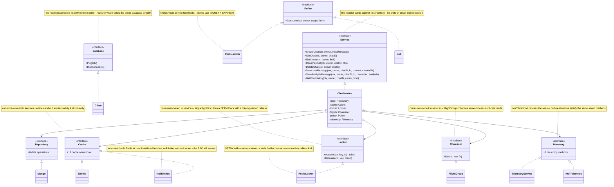
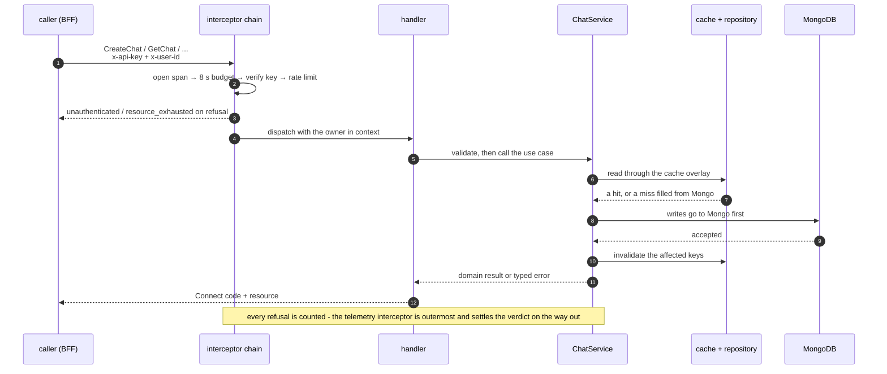
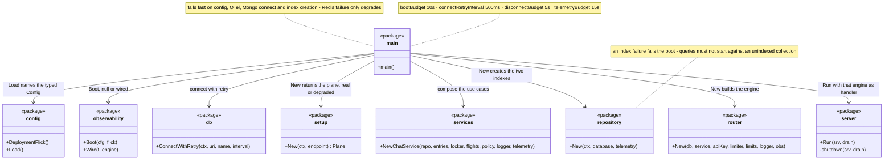
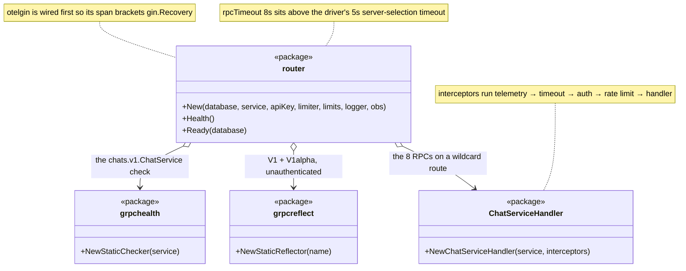
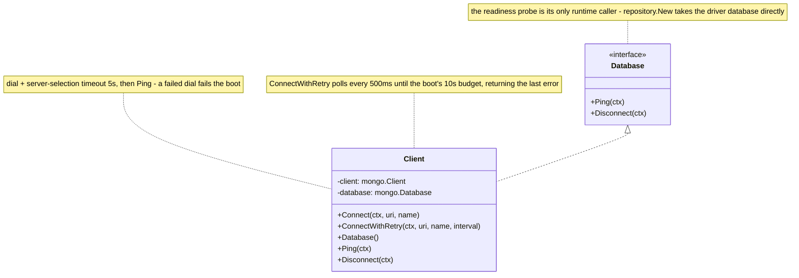

# Architecture

This document explains how one chat RPC becomes a MongoDB write or a cache-served read. Read [Quick Start](../getting-started/quickstart.md) first if nothing is running yet.

## What this service is

A synchronous chat store: eight ConnectRPCs over Gin, MongoDB as the source of truth, Redis as a read-through overlay, and OTel telemetry pushed to New Relic when configured. It is stateful in the sense that it owns data, but stateless in the sense that one instance holds no state another needs — concurrency comes from more replicas, never from threading inside one.

The wire contract lives in [RPC API](../reference/rpc-api.md); this page is about the components behind it.

## The module map

```
cmd/
├── api/main.go            composition root: flick → config → obs → Mongo → repo → cache → service → serve
└── healthcheck/main.go    container probe against /api/v1/ready
internal/
├── server/                serve until SIGINT/SIGTERM, drain in-flight requests
├── router/                gin engine: probes, grpchealth, reflection, the Connect handler
├── handlers/              the Connect face: interceptors, 8 RPCs, proto↔domain mapping, error codes
├── services/              use cases, validation, cache-aside orchestration
├── repository/            MongoDB data access, the keyset cursor, index creation
├── cache/                 client · keys · store · entries · limiter · lock · coalescer · setup
├── db/                    MongoDB connection + retry
├── config/                typed Config, dev/prod planes, fail-fast
├── models/                shared vocabulary: shapes, enums, sentinels, limits, cursor codec
└── observability/         the OTel facade: the null build or push to New Relic
proto/                     chat_service.proto + generated Go stubs
```

The layering is strict and inward-facing: `handlers` speaks the wire, `services` owns the use cases, `repository`/`cache` own the two stores, and `models` is the vocabulary everybody shares. `services` declares its own narrow `Cache`, `Locker` and `Coalescer` interfaces; the cache packages satisfy them structurally, so the concrete fill strategy can be swapped without changing the use cases. Cold fills run through singleflight and a distributed lock before reaching Mongo, and `not_found` answers are cached briefly so a bad chat id cannot spend the read budget on Mongo. `config` and `observability` serve them all. Nothing inside `services` knows about Connect or MongoDB.

## The components at a glance

Two seams carry the dependency structure: the transport-facing `services.Service` and the app-facing `observability.Telemetry`. Each has one real realization and one null at boot; the handler faces the seam, never a driver type.



## What happens on one RPC



The handler never touches a driver: it extracts the owner, validates, delegates to the service, and maps the typed error onto a code. The full guard sequence is in [Request Flow](request-flow.md).

Questions the map answers, page by page:

- **Who may call, and what can fail?** → [RPC API](../reference/rpc-api.md)
- **What happens inside the chain?** → [Request Flow](request-flow.md)
- **What is cached, and when is it dropped?** → [Cache](cache.md)
- **How is data shaped and paged?** → [Data Model](data-model.md)
- **Where do signals go?** → [Observability](observability.md)

## The boot's components

Composition happens once, top to bottom, before anything serves. The handler arrives through the router, not `main`.



## The route face



## The Mongo connection



## The runtime model: synchronous, deliberately

There is **no worker pool, no executor, and no queue anywhere**. Every RPC is a direct call chain: guard → validate → cache read → Mongo access → invalidate → answer. Concurrency exists outside the process — more replicas — never inside it.

- **H2C + HTTP/1.1 on one port.** Connect negotiates gRPC, gRPC-Web, and Connect over JSON on the same handler. Reflection is the one HTTP/2-only surface (it is a bidirectional stream); an HTTP/1.1 client gets `505`. Both protocols stay enabled — the container healthcheck drives HTTP/1.1 and the load rig drives native gRPC over H2C.
- **The 8 s RPC budget** sits above the driver's 5 s server-selection timeout, so an unreachable Mongo answers `unavailable` before the deadline.
- **Idempotent writes.** A duplicate user-message id returns the stored message; an analysis re-send with the same id replays; a re-delete succeeds. The BFF orchestrates inference and retries, so these writes must be safe to repeat ([Data Model](data-model.md)).

## The boot and shutdown lifecycle

```mermaid
graph LR
    START(["start: cmd/api"]) --> FLICK["resolve ENV_TYPE flick"]
    FLICK --> LOAD["config.Load — the typed Config"]
    LOAD --> FAIL["boot fails fast:<br/>named ConfigError"]
    LOAD --> OBS["boot observability<br/>null or wired"]
    OBS --> MONGO["Mongo connect + retry<br/>within the 10 s budget"]
    MONGO --> IDX["create the two indexes"]
    IDX --> CACHE["setup.New<br/>unreachable Redis degrades to nulls"]
    CACHE --> WIRE["build repo → service → router"]
    WIRE --> SERVE["server.Run on :PORT"]
    SERVE --> SIG["SIGINT / SIGTERM"]
    SIG --> DRAIN["drain in-flight within DRAIN_TIMEOUT"]
    DRAIN --> SHUT["telemetry 15 s, then Mongo + Redis 5 s"]
    SHUT --> END(["end: exit, teardown errors logged"])
    FAIL --> END
```



Nothing is re-resolved per request. On SIGTERM the server stops accepting and drains in-flight requests within `DRAIN_TIMEOUT` (default 10 s); teardown errors are logged, never fatal.

## Canned probes

| Path | Healthy answer |
|------|----------------|
| `GET /api/v1/health` | 200 `{"status":"ok"}` — static |
| `GET /api/v1/ready` | 200 `{"status":"ready"}` — pings MongoDB within 2 s; 503 on failure |

Both are open endpoints. The container runs a separate `healthcheck` binary against `/api/v1/ready` every 30 s with a 3 s client timeout.
