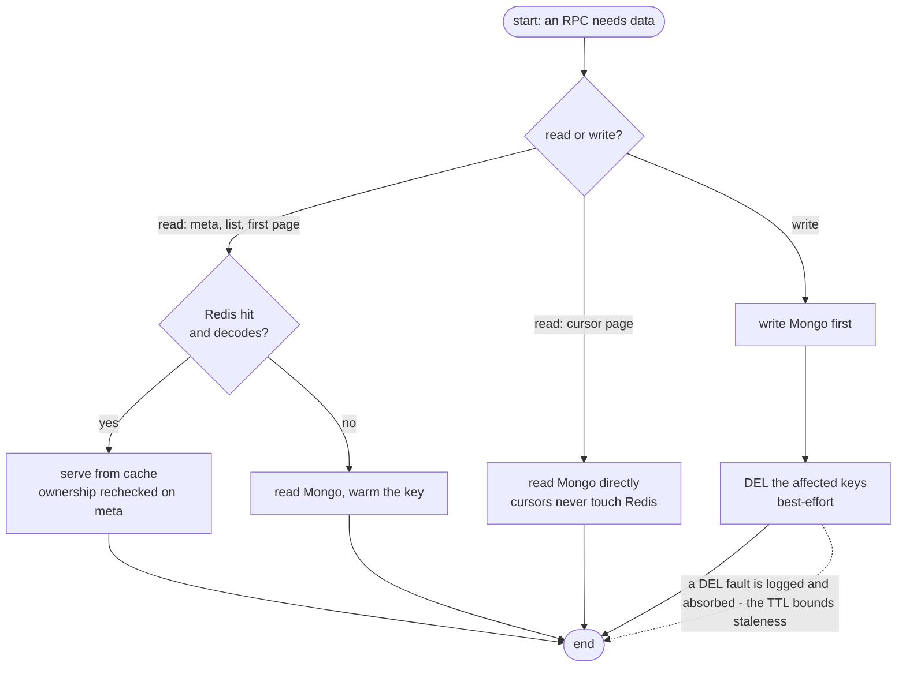
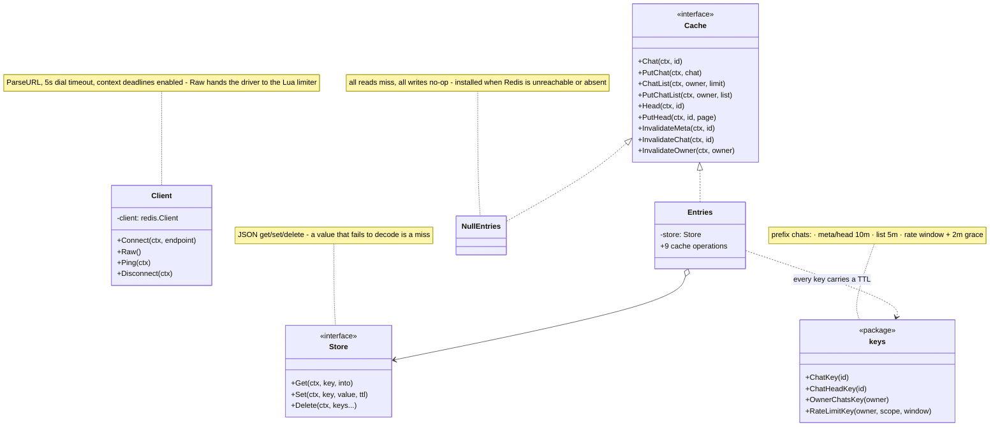
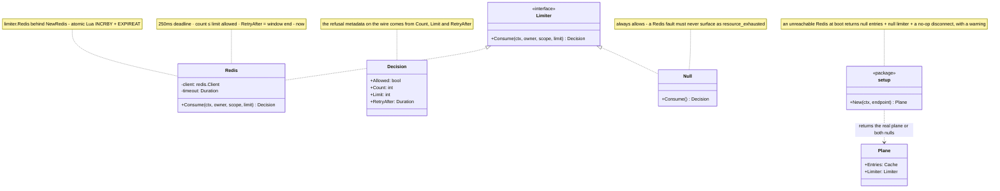

# Cache

Redis is a read-through overlay on MongoDB, never the source of truth. Chats keys live behind a `chats:` prefix on a shared instance, every key carries a TTL, and no cache fault can fail an RPC.

## The keys

| Key pattern | Value | TTL | Serves | Invalidated by |
|-------------|-------|-----|--------|----------------|
| `chats:chat:<id>` | chat meta (owner, title, updated_at) | 10m | ownership check + `GetChat` | append, analysis, rename, delete |
| `chats:chat:<id>:head` | first ~50 messages + next cursor | 10m | first page of history | append, analysis, delete |
| `chats:user:<id>:chats` | sidebar summaries, newest-first | 5m | `ListChats` | create, append, analysis, rename, delete |
| `chats:rate_limit:<id>:<scope>:<window>` | burst counter | window end + 2m grace | rate limiter | TTL only |

Rate-limit counters use the same fixed window as the web BFF: an atomic Lua `INCRBY` + `EXPIREAT`, a one-minute window keyed by epoch minute, and a 250 ms call deadline. They fail open — see [Request Flow](request-flow.md).

## The read and write paths

Every value is decoded defensively: a JSON value that fails to unmarshal is treated as a miss, re-read from Mongo, and overwritten. That is why there are no version segments in the keys, and why the shared instance is never flushed.

## The cache plane

The prefix lives in `internal/cache/keys`, never in the Redis client: client-level `keyPrefix` silently misses keys inside Lua `EVAL` scripts, and the limiter is exactly such a script. The cache surface is split by responsibility the way the users service splits its cache — `client`, `keys`, `store`, `entries`, `limiter` and `setup` — so a singleflight or locking layer can be added as another package without rewriting the callers.

## The limiter and the null builds

## Failure semantics

- **At boot:** `setup.New` pings Redis. An unreachable endpoint installs null entries and a null limiter and the boot continues — Mongo and the RPCs are unaffected.
- **At runtime:** every cache fault is absorbed — a warning log and a metric, never a failed RPC. A limiter fault fails open. The 250 ms deadline keeps a fault from costing the driver's socket timeout.
- **No singleflight:** at chat-UI concurrency a cold head key produces a handful of concurrent Mongo reads, which the compound index serves without ceremony.

## Next Steps

- **[Data Model](data-model.md)** — the documents behind the cached shapes
- **[Request Flow](request-flow.md)** — where the limiter sits in the interceptor chain
- **[Observability](observability.md)** — the cache counter that makes a degrading Redis visible
