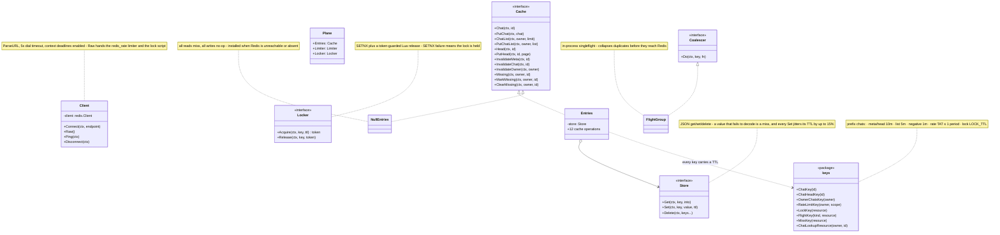

# Cache

Redis is a read-through overlay on MongoDB, never the source of truth. Chats keys live behind a `chats:` prefix on a shared instance — the GCRA limiter's keys are prefixed `rate:` by `redis_rate` — every key carries a TTL, and no cache fault can fail an RPC.

## The keys

| Key pattern | Value | TTL | Serves | Invalidated by |
|-------------|-------|-----|--------|----------------|
| `chats:chat:<id>` | chat meta (owner, title, updated_at) | 10m | ownership check + `GetChat` | append, analysis, rename, delete |
| `chats:chat:<id>:head` | first ~50 messages + next cursor | 10m | first page of history | append, analysis, delete |
| `chats:user:<id>:chats` | sidebar summaries, newest-first | 5m | `ListChats` | create, append, analysis, rename, delete |
| `rate:chats:rate_limit:<id>:<scope>` | GCRA arrival time | up to one period | rate limiter | TTL only |
| `chats:lock:<resource>` | fill lock token | `LOCK_TTL` (10s) | stampede protection | token-guarded `DEL` on release |
| `chats:nf:user:<owner>:chat:<id>` | not-found marker | 1m | skip Mongo for an unknown chat | any successful write to that chat, or TTL |

Rate limiting uses `redis_rate`, a GCRA (leaky bucket) limiter backed by one atomic Lua script. Each scope holds a single theoretical-arrival-time value: capacity equals the configured per-minute budget, refilling continuously at `budget / minute`. There is no window edge to double-spend and no epoch-minute key churn. `budget` calls are allowed back-to-back; the next one waits one emission interval. The call carries a 250 ms deadline and fails open — see [Request Flow](request-flow.md).

Every `store.Set` adds up to 15% random jitter to the TTL, the same avalanche guard the users service uses: keys written together do not expire in one instant. That covers chat meta, head pages, sidebar lists and negative markers. The limiter's TTL is set by `redis_rate` to the time until the bucket resets (at most one period) and fill locks keep exact TTLs — the latter must stay predictably longer than a source read.

A cold read is protected in two layers, the same way the users service protects its repository reads. An in-process `singleflight` group collapses duplicate calls for one resource before they reach Redis; the survivor takes the distributed lock, re-reads the cache, and only then fetches from Mongo. Other replicas contend on the lock with jittered backoff, then re-read the filled cache. A locker fault or exhausted retries falls through to the unprotected path, so Redis still never fails an RPC. Lock keys are distinct for chat meta, the head page, and an owner's list.

A chat lookup that ends in `not_found` writes a marker with a one-minute TTL. Both the pre-lock read and the double-check consult it, so repeated requests for a missing or foreign chat stop spending Mongo reads. The marker is keyed by **owner and chat id**: ownership is part of the query, so a foreign owner's miss must never hide the chat from its owner. Successful writes clear the marker; a marker fault is absorbed and the lookup falls through to Mongo. Empty sidebar lists and head pages need no marker — they are already cached as empty values — and cursor history pages stay uncached by design.

## The read and write paths

Every value is decoded defensively: a JSON value that fails to unmarshal is treated as a miss, re-read from Mongo, and overwritten. That is why there are no version segments in the keys, and why the shared instance is never flushed.

## The cache plane

The prefix lives in `internal/cache/keys`, never in the Redis client: client-level `keyPrefix` silently misses keys inside Lua `EVAL` scripts, and the limiter and locker are exactly such scripts. The cache surface is split by responsibility the way the users service splits its cache — `client`, `keys`, `store`, `entries`, `limiter`, `lock`, `coalescer` and `setup` — so each layer can be swapped without rewriting the callers.

## The limiter and the null builds

```mermaid
classDiagram
    class Limiter {
        <<interface>>
        +Consume(ctx, owner, scope, limit) Decision
    }
    class Redis {
        -rate: redis_rate.Limiter
        -timeout: Duration
        +Consume(ctx, owner, scope, limit) Decision
    }
    class Decision {
        +Allowed: bool
        +Limit: int
        +Remaining: int
        +RetryAfter: Duration
        +ResetAfter: Duration
    }
    class Null {
        +Consume() Decision
    }
    class RedisLocker
    class NullLocker
    class Plane {
        +Entries: Cache
        +Limiter: Limiter
        +Locker: Locker
    }
    class setup {
        <<package>>
        +New(ctx, endpoint) Plane
    }
    Limiter <|.. Redis
    Limiter <|.. Null
    Locker <|.. RedisLocker
    Locker <|.. NullLocker
    setup ..> Plane : returns the real plane or all nulls
    note for Redis "limiter.Redis wraps redis_rate - GCRA with Redis TIME and burst = limit"
    note for Redis "250ms deadline · PerMinute(limit) · Redis failures surface as errors and fail open"
    note for Decision "RetryAfter is the wait for the next call; ResetAfter gates refusal logs until the bucket recovers"
    note for Null "always allows - a Redis fault must never surface as resource_exhausted"
    note for RedisLocker "SETNX with a random token - release only deletes the key when the token still matches"
    note for NullLocker "always acquires - a cache fault never blocks a read"
    note for setup "an unreachable Redis at boot returns null entries, null limiter and null locker plus a no-op disconnect, with a warning"
```

## Failure semantics

- **At boot:** `setup.New` pings Redis. An unreachable endpoint installs null entries, a null limiter and a null locker, and the boot continues — Mongo and the RPCs are unaffected.
- **At runtime:** every cache fault is absorbed — a warning log and a metric, never a failed RPC. A limiter fault fails open. The 250 ms deadline keeps a fault from costing the driver's socket timeout.
- **No singleflight:** at chat-UI concurrency a cold head key produces a handful of concurrent Mongo reads, which the compound index serves without ceremony.

## Next Steps

- **[Data Model](data-model.md)** — the documents behind the cached shapes
- **[Request Flow](request-flow.md)** — where the limiter sits in the interceptor chain
- **[Observability](observability.md)** — the cache counter that makes a degrading Redis visible
