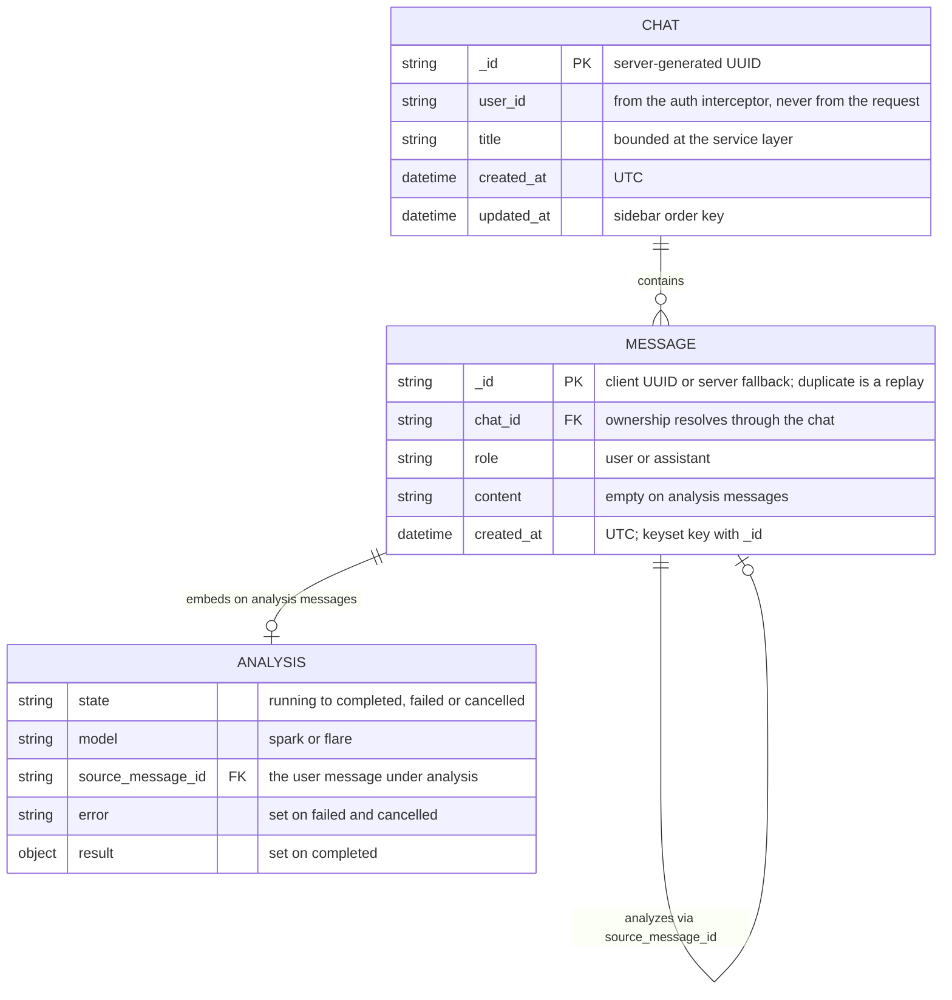
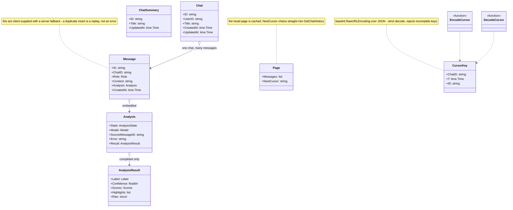
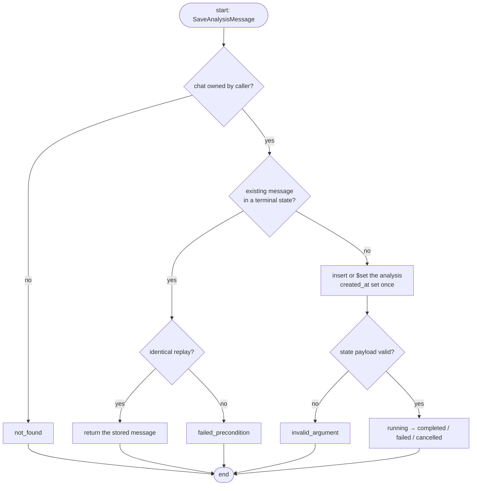
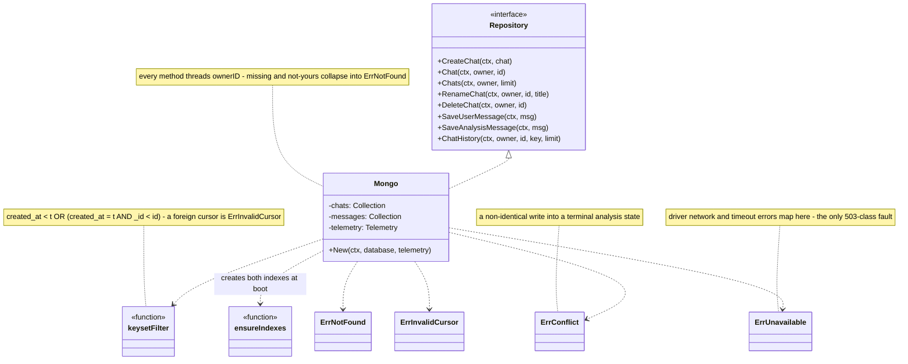

# Data Model

MongoDB is the source of truth: two collections, two indexes, and an analysis state machine embedded in the message document. Redis holds disposable read shapes — see [Cache](cache.md).

## Entities

## Collections and indexes

| Collection | Fields | Index | Serves |
|------------|--------|-------|--------|
| `chats` | `_id`, `user_id`, `title`, `created_at`, `updated_at` | `{user_id: 1, updated_at: -1}` | sidebar list, newest-first |
| `messages` | `_id`, `chat_id`, `role`, `content?`, `analysis?`, `created_at` | `{chat_id: 1, created_at: -1, _id: -1}` | keyset history pages |

Both indexes are created at boot by `repository.New`; an index failure fails the boot. Timestamps are stored UTC, truncated to milliseconds. The embedded `analysis` subdoc carries `state`, `model`, `source_message_id`, `error?`, and `result?`; `result` holds `label`, `confidence`, `scores{ai, human}`, `highlights[]`, and `raw`.

## The shared vocabulary

## Keyset pagination

History is keyset-paged on `(created_at, _id)`, descending — matching the messages index. Empty cursor means first page; every later call passes `next_cursor` back verbatim; an empty `next_cursor` means end of history.

The cursor is opaque base64 over `{chat_id, t, i}`. The chat id is embedded, so a cursor from another chat is `invalid_argument`; strict decoding rejects a malformed one the same way. The server fetches `limit + 1` to decide the next cursor — the client never counts.

| Call (limit 3, messages m1…m10) | Returns |
|---------------------------------|---------|
| `GetChatHistory(chat1)` | m10, m9, m8 + `cursor_C1` |
| `GetChatHistory(chat1, C1)` | m7, m6, m5 + `cursor_C2` |
| `GetChatHistory(chat1, C2)` | m4, m3, m2 + `cursor_C3` |
| `GetChatHistory(chat1, C3)` | m1 + empty cursor |

Concurrent appends are harmless: new messages appear above the first page, and the keyset tuple makes an in-flight page neither skip nor duplicate.

## The analysis state machine

`running` is the only non-terminal state; the other three are terminal. A terminal state accepts only an identical replay of itself — any different write is `failed_precondition`.

`SaveAnalysisMessage` retries the read–insert race up to three times, sets `created_at` once, and re-homes nothing: an id bound to a different chat is `not_found`.

## Idempotency at a glance

| Write | Repeat behavior |
|-------|-----------------|
| `CreateChat` | new UUID each call; no client id |
| `SaveUserMessage` | duplicate id returns the stored message, no overwrite |
| `SaveAnalysisMessage` | same id replays / advances the state machine; a different write into a terminal state is refused |
| `DeleteChat` | chat document first, then messages; a re-delete succeeds, another owner's chat is `not_found` |

Delete has no transaction. The worst case is orphaned messages that no query can reach, which avoids requiring replica-set transactions in local compose.

## The data access

## Next Steps

- **[Cache](cache.md)** — the disposable read shapes over these documents
- **[Request Flow](request-flow.md)** — where validation and ownership checks happen
- **[RPC API](../reference/rpc-api.md)** — the types these documents map onto
