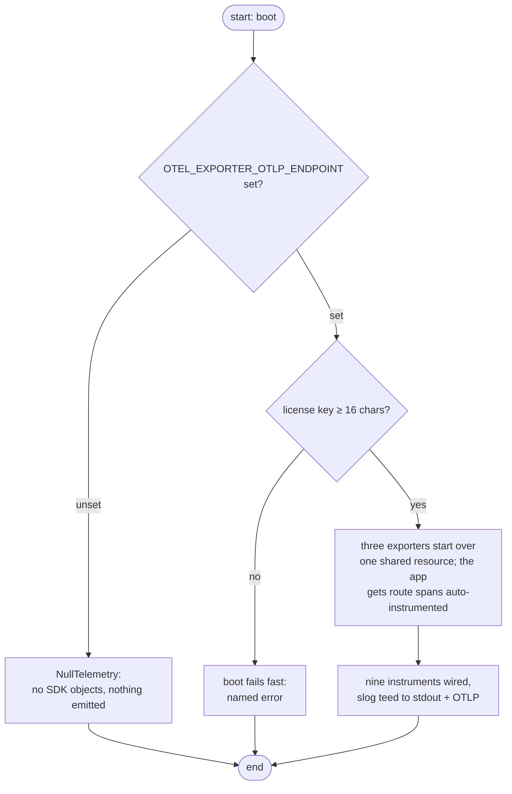
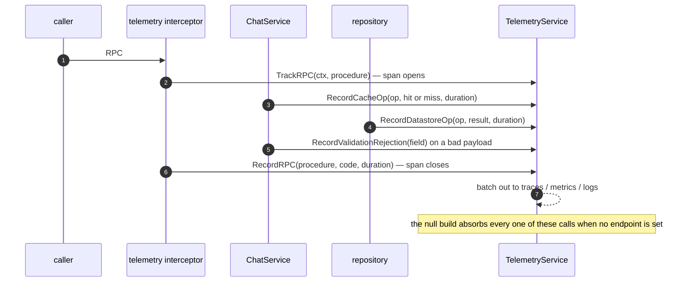
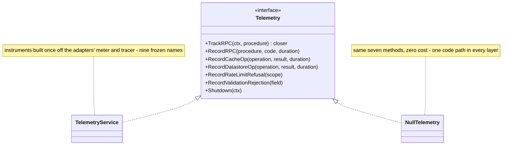
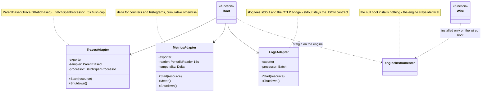

# Observability

The service exports logs, traces, and metrics — or nothing at all. There is no metrics endpoint and no partial state in between: the whole build is switched by one env var, `OTEL_EXPORTER_OTLP_ENDPOINT`.

## The gate

| Endpoint setting | What boots |
|------------------|------------|
| unset | `NullTelemetry` — no SDK objects, every call a no-op |
| set | the full OTel pipeline; requires `NEW_RELIC_LICENSE_KEY` (≥16 chars) or **the boot fails** |

Unset is a legitimate configuration, not a degraded one — every layer keeps exactly one code path because the null build implements the same seam as the wired one.

## Push, not pull

One pipeline, three signals: traces, metrics, and logs go straight to New Relic's native OTLP endpoint, authenticated with the ingest license key in the `api-key` header — never a user API key. HTTP/protobuf with gzip, 15 s metric cadence, delta temporality for counters and histograms, parent-based sampling at `OTEL_TRACE_SAMPLE_RATIO`.

The service owns its resource labels (`service.name`, `service.version`, `deployment.environment` from `ENV_TYPE`) because it is not in the collector path. Export is fire-and-forget from the request path: a failed batch never becomes a 5xx.

## The metric inventory

Names are a contract — a rename is a dashboard migration, not an edit.

| Instrument | Type | Attributes | Counts |
|------------|------|------------|--------|
| `chats_rpc_requests_total` | Counter | `procedure`, `code` | every RPC answered, ok or failed |
| `chats_rpc_errors_total` | Counter | `procedure`, `code` | every non-ok code |
| `chats_rpc_duration_seconds` | Histogram | `procedure` | RPC wall time |
| `chats_cache_operations_total` | Counter | `operation`, `result` | cache reads, writes, invalidations |
| `chats_cache_operation_duration_seconds` | Histogram | `operation` | cache operation cost |

Negative-marker lookups and writes are recorded under the `negative`, `put_negative` and `clear_negative` operation values — additive labels on the existing metric, so dashboards keep working.
| `chats_datastore_operations_total` | Counter | `operation`, `result` | one per repository call |
| `chats_datastore_operation_duration_seconds` | Histogram | `operation` | Mongo call cost |
| `chats_rate_limit_refusals_total` | Counter | `scope` | exhausted burst budgets |
| `chats_validation_rejections_total` | Counter | `field` | rejected payload fields |

The last three earn their keep: a cache fault is absorbed, so the RPC code stays `ok`; the RPC code says `resource_exhausted` or `invalid_argument` but not which scope or field was responsible.

## Where each record is taken

Each layer records the facts it owns.

| Layer | Site | Records |
|-------|------|---------|
| RPC | `internal/handlers/telemetry.go` | the procedure span, the answer's code |
| Rate limit | `internal/handlers/ratelimit.go` | one counter per refusal |
| Validation | `internal/services/chat.go` | the rejected field |
| Cache | `internal/services/cache.go` | hit, miss, absorbed fault, and cost |
| Datastore | `internal/repository/*.go` | the outcome's class and the cost |

The telemetry interceptor runs **outermost**, so refusals from auth and the limiter are counted too. It settles the verdict on the way out, so a panic still closes the span and counts as `internal` before the panic is re-raised for `gin.Recovery`.

## One RPC, as signals

## The seam

`internal/observability` is one facade the whole service mounts. No OTel type crosses it — every layer calls the `Telemetry` interface, and the service packages hold that interface so they never import the SDK.

## The adapters up close

## Traces and logs

`otelgin` frames the HTTP route span; it is registered before `gin.Recovery` so a panic is bracketed. It cannot split procedures apart — the Connect handler sits on one wildcard route — so `http.route` reads `/chats.v1.ChatService/*any`. The procedure's own span comes from the interceptor and carries `rpc.system=connect_rpc`, `rpc.service`, `rpc.method`, and the code on failed spans.

The boot registers the global `TraceContext` propagator; without it every request starts an orphan trace and parent-based sampling has no parent to honour. The global tracer provider is set to the one it started, so anything reaching for `otel.Tracer` lands in this pipeline. The global meter provider stays unset on purpose — otelgin would emit its own `http.server.*` metrics and break the nine-instrument inventory.

`log/slog` stays the stdout logger: JSON, unchanged. The boot tees every record to stdout **and** the OTLP bridge, with the request context attached, so each line is a link into the trace that produced it rather than a line beside it.

## Next Steps

- **[Configuration](../getting-started/configuration.md)** — the OTel key table
- **[Testing](../guides/testing.md)** — how the gate and the recordings are tested
