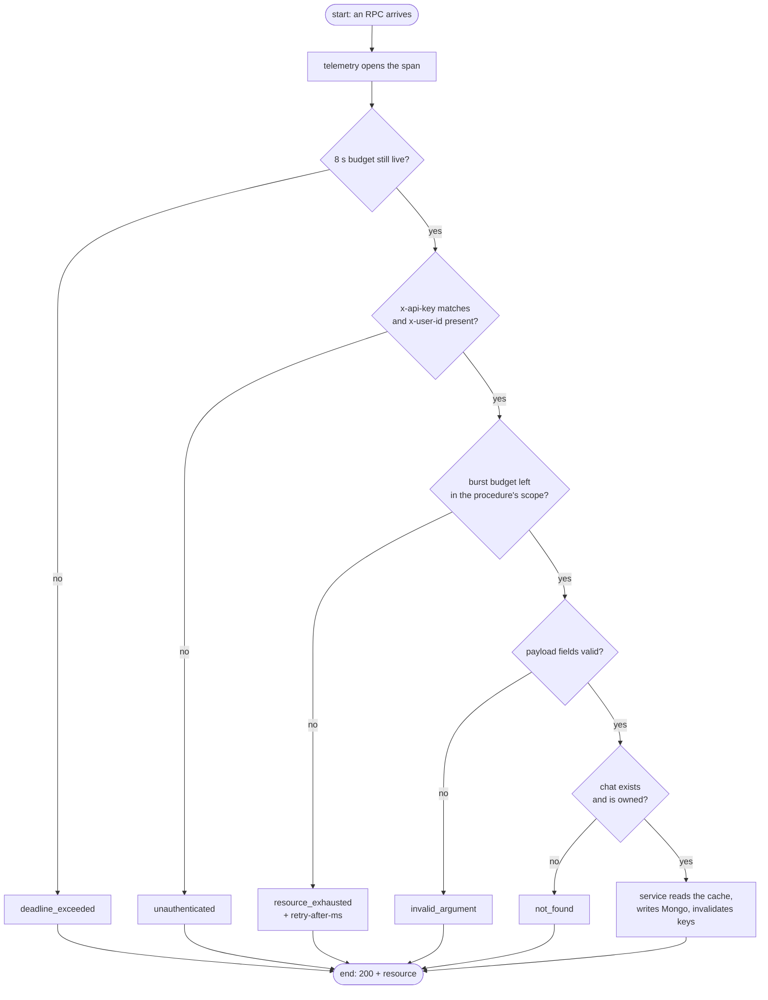
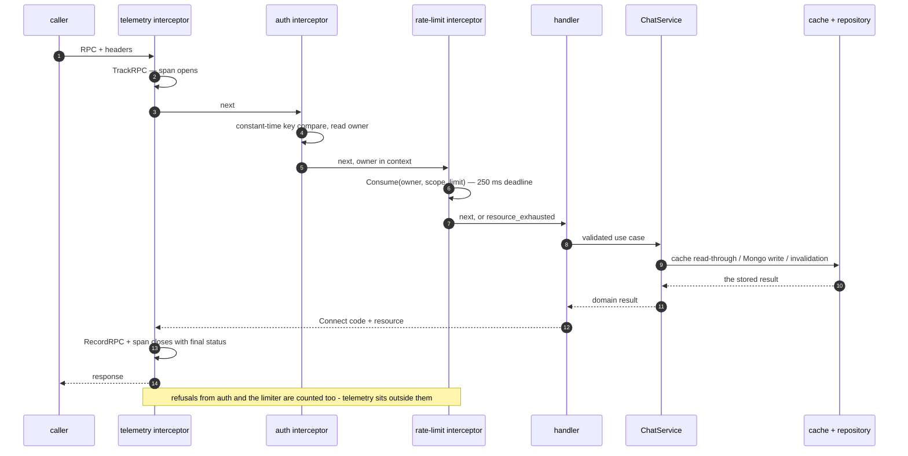
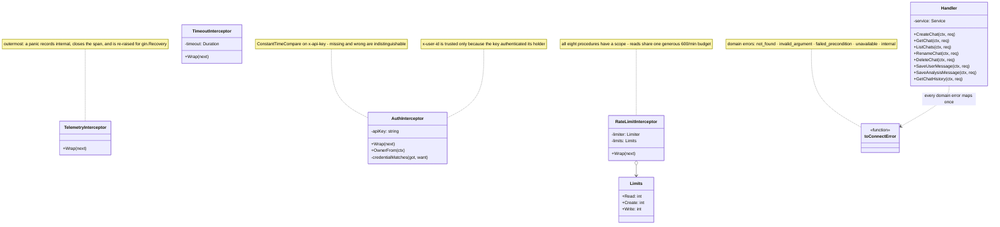
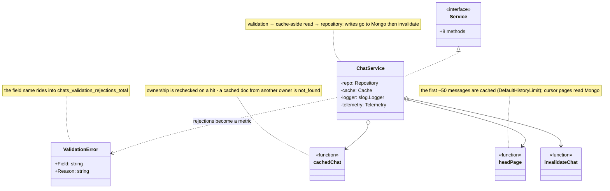

# Request Flow

This is the path from a ConnectRPC frame to a stored resource. It is the same path for all eight RPCs — the procedure name changes what runs in the middle, not the guard rails at the edges.

## The chain, in order

Gin registers three things before the Connect handler: `otelgin` (wired only when telemetry is on), `gin.Logger()`, and `gin.Recovery()`. The trace middleware is first on purpose — its span brackets a panic the recovery absorbs, so a crash is not left as an open span.

Inside the Connect handler, four interceptors wrap every RPC. The first is outermost: it acts first on the way in and last on the way out.

| Order | Interceptor | Job | Refusal |
|-------|-------------|-----|---------|
| 1 | telemetry | opens the procedure span, counts the answer on the way out — even on panic | never refuses |
| 2 | timeout | `context.WithTimeout` for 8 s | `deadline_exceeded` |
| 3 | auth | `x-api-key` constant-time compare, then `x-user-id` | `unauthenticated` |
| 4 | rate limit | `read` / `create` / `write` scopes, all eight procedures | `resource_exhausted` + retry metadata |

The handler runs last: it re-reads the owner from the context, validates, calls the service, and maps the domain error onto a Connect code. On a cache miss the service collapses same-process duplicates, takes a Redis fill lock, re-reads the cache (including a short-lived `not_found` marker), and only then queries Mongo — see [Cache](cache.md).

## The admission flow

Two refusals are deliberately not hard failures: a Redis fault makes the rate-limit check **fail open** (the RPC proceeds, the fault is counted), and a cache fault never fails an RPC — see [Cache](cache.md).

## The admission conversation

## The Connect face

The wire layer owns statuses, not business logic. Every RPC method calls `OwnerFrom(ctx)` first; the private context key the auth interceptor wrote is the only source of identity.

The handler also owns the proto↔domain mapping (one function per shape) and the refusal metadata: an over-limit answer carries `retry-after-ms`, `x-ratelimit-limit`, and `x-ratelimit-remaining=0`. Refusals are logged once per exhausted window, and owner ids are hashed before logging.

## The use cases

## Validation and bounds

Validation is pure and lives at the service boundary; no driver or wire type reaches it.

| Rule | Limit / condition |
|------|-------------------|
| Title | non-blank, ≤ 200 runes; derived from the initial message on create |
| Chat id | non-blank |
| Message content | non-blank, ≤ 100,000 runes |
| Role | `user` on user messages, `assistant` on analysis messages |
| Analysis | required on analysis messages; `source_message_id` non-blank; state one of four; model `spark` or `flare` |
| State payload | `COMPLETED` requires `analysis`; `FAILED` requires `error` |
| Page limits | history default 50 / cap 200; chat list default 50 / cap 200 |

A rejected field answers `invalid_argument` naming the field, and increments `chats_validation_rejections_total`. A malformed or foreign-chat cursor is also `invalid_argument`, but through `ErrInvalidCursor` — [Data Model](data-model.md) covers the codec.

## Next Steps

- **[RPC API](../reference/rpc-api.md)** — the full code table and rate-limit scopes
- **[Cache](cache.md)** — the read-through and failure semantics this path relies on
- **[Observability](observability.md)** — where each step's record is taken
