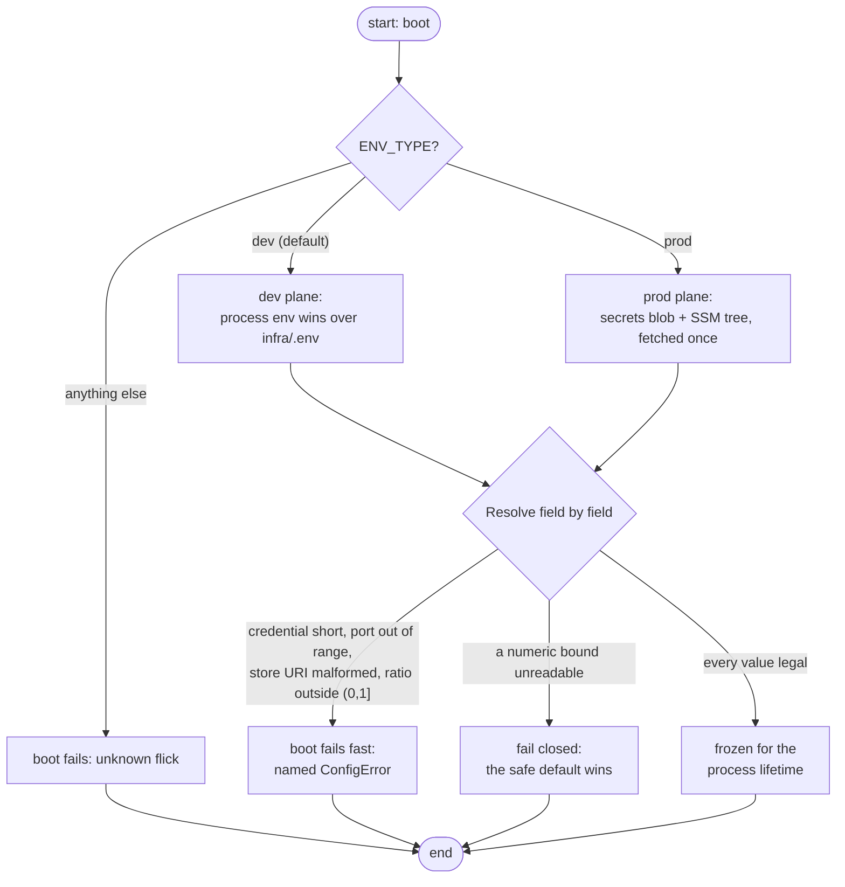
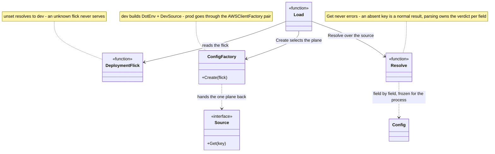
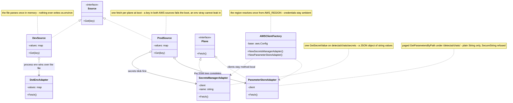
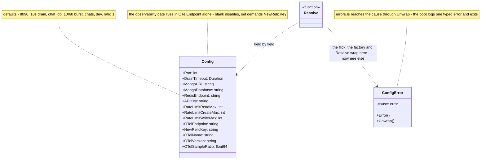

# Configuration

Every setting the service has is resolved **once at boot** from one place — a config plane — and is then frozen for the process lifetime. No request ever re-reads config, and no change takes effect until a restart.

## The plane flick

One env var decides which plane the boot reads — a two-position flick:

| `ENV_TYPE` | Plane |
|------------|-------|
| `dev` (default) | Developer plane |
| `prod` | Prod plane |
| anything else | **boot fails** — an unknown flick never serves |

## Developer plane

`DevSource` merges two sources, process environment winning over `infra/.env`:

- `infra/.env` — created by `make env` from the committed template; the compose stack feeds it to containers the same way (`env_file`)
- the process environment — so a container or a test run needs no file at all

A missing file at the default location is an empty plane (values then come from the environment); a malformed line fails the boot. Blank `KEY=` entries are dropped — an empty value can never win over a default. The `OTEL_EXPORTER_OTLP_ENDPOINT` line ships commented out, so telemetry is off by default in dev.

## Prod plane

`ProdSource` fetches two disjoint AWS sources once, at boot:

- **Secrets Manager** — the JSON blob `detectai/chats/secrets` (the license key, Mongo URI, Redis token, api key)
- **SSM parameters** — plain settings under `/detectai/chats/`

Process env and dotenv never reach this path, so a stray variable cannot leak a value in. A key found in **both** AWS sources fails the boot loudly — they are disjoint by seeding contract. `AWS_REGION` is the one bootstrap variable: the SDK default chain builds every client against it, and credentials stay ambient, never config fields.

Binary compatibility instead of re-source: a key seeded after boot stays invisible until restart. The split is declared in [secrets.toml](../../secrets.toml) and provisioned through [Secrets](../guides/secrets.md).

## Every key

Field names are the env keys. Unknown keys are ignored (consume-first), so typos in unused keys degrade harmlessly. The credentials and the two store endpoints are the only keys with no safe default — their absence stops the boot.

| Key | What it controls | Default | Bad value behavior |
|-----|------------------|---------|--------------------|
| `ENV_TYPE` | plane selection | `dev` | **boot fails** |
| `PORT` | listen port | 8090 | **boot fails** outside 1–65535 |
| `DRAIN_TIMEOUT` | graceful drain on SIGTERM | 10s | falls back to default |
| `MONGO_URI` | MongoDB connection string | — | **boot fails** unless `mongodb://` or `mongodb+srv://` |
| `MONGO_DATABASE` | database name | `chat_db` | falls back to default |
| `REDIS_ENDPOINT` | Redis address | — | **boot fails** unless `redis://` or `rediss://`; `rediss://` needs no token |
| `API_KEY` | the service credential every RPC carries | — | **boot fails** unless trimmed value ≥16 chars |
| `RATE_LIMIT_READ_MAX` | `GetChat` + `ListChats` + `GetChatHistory` shared budget | 600 | **boot fails** on ≤0 or non-integer |
| `RATE_LIMIT_CREATE_MAX` | `CreateChat` burst budget | 10 | **boot fails** on ≤0 or non-integer |
| `RATE_LIMIT_WRITE_MAX` | `RenameChat` + `DeleteChat` + `SaveUserMessage` + `SaveAnalysisMessage` shared budget | 60 | **boot fails** on ≤0 or non-integer |
| `OTEL_EXPORTER_OTLP_ENDPOINT` | the observability gate | unset → nothing emitted | set without a ≥16-char license key → **boot fails** |
| `NEW_RELIC_LICENSE_KEY` | ingest key, sent as `api-key` | unset | demanded only when the endpoint is set |
| `OTEL_SERVICE_NAME` | resource name on all signals | `chats` | falls back to default |
| `OTEL_SERVICE_VERSION` | resource version | `dev` | falls back to default |
| `OTEL_TRACE_SAMPLE_RATIO` | fraction of traces sampled, `(0, 1]` | 1.0 | **boot fails** (NaN rejected) |

The split that matters: **identity fields, the port, the OTel gate, and the three rate-limit bounds fail the boot** (a half-configured instance never serves) — **optional durations and names fall back to defaults** (a malformed `DRAIN_TIMEOUT`, a blank database or service name). Redis itself is special: an unreachable Redis endpoint does **not** fail the boot — see [Cache](../concepts/cache.md).

## How a boot resolves

## The config shapes, small to large

Four views over the same shapes. `Load`, `DeploymentFlick`, and `Resolve` are package-level functions — the `<<function>>` boxes — everything else is a real type.

### The composition root

### The planes and their adapters

### The typed fields and the one error

## Bootstrap variables (config owns none of them)

| Key | Role |
|-----|------|
| `AWS_REGION` | the one region every AWS composition builds against |
| `AWS_ACCESS_KEY_ID` / `AWS_SECRET_ACCESS_KEY` / `AWS_SESSION_TOKEN` | the credential trio, riding the SDK default chain |
| `AWS_ENDPOINT_URL_SECRETS_MANAGER` / `AWS_ENDPOINT_URL_SSM` | SDK-native endpoint overrides — point at floci locally, unset resolves the region default |

These variables are consumed by the AWS SDK, not by `Resolve`. They ship in the template so `set -a` sourcing and compose `env_file` carry them into whichever plane needs them.

## Next Steps

- **[Secrets guide](../guides/secrets.md)** — provisioning the credentials this page reads
- **[Quick Start](quickstart.md)** — get a working local boot first
