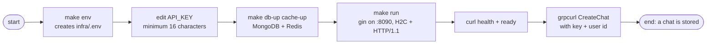

# Quick Start

Get the service running locally, then make your first RPC. The whole loop is `make env` → `make db-up cache-up` → `make run`.

## Steps

1. **Create the env file** — copies `infra/.env.example` to `infra/.env` if missing:

   ```sh
   make env
   ```

2. **Set a real API key** by editing `infra/.env` — the boot enforces one rule: the value must be at least 16 characters (the example placeholder passes that floor, so replace it before anything real listens):

   ```ini
   API_KEY=my-secret-key-16-chars-min
   ```

   The [secrets guide](../guides/secrets.md) covers where credentials live properly.

3. **Start the local datastores** — MongoDB and Redis, with ports from `infra/docker/*/.env`:

   ```sh
   make db-up cache-up
   ```

   Both targets leave an already-running instance untouched. `make run` repaints the `host.docker.internal` hosts in `infra/.env` to `localhost` for the host process, so the same env file drives host runs and containers.

4. **Run the service:**

   ```sh
   make run
   ```

   It listens on `:8090` with HTTP/1.1 and unencrypted HTTP/2 (H2C) enabled, so gRPC tools work alongside Connect over JSON.

5. **Verify with the probes** (no credentials needed):

   ```sh
   curl http://localhost:8090/api/v1/health
   # {"status":"ok"}
   curl http://localhost:8090/api/v1/ready
   # {"status":"ready"}
   ```

   `ready` pings MongoDB with a 2 s budget; an unreachable database answers 503 `{"status":"database unreachable"}`.

6. **Make your first RPC.** Reflection is mounted, so `grpcurl` needs no schema file:

   ```sh
   grpcurl -plaintext \
     -H "x-api-key: local-dev-api-key-16-chars" \
     -H "x-user-id: user-1" \
     -d '{"initial_message":"hello"}' \
     localhost:8090 chats.v1.ChatService/CreateChat
   ```

   Or speak Connect over JSON on HTTP/1.1:

   ```sh
   curl -X POST http://localhost:8090/chats.v1.ChatService/CreateChat \
     -H "Content-Type: application/json" \
     -H "Connect-Protocol-Version: 1" \
     -H "x-api-key: local-dev-api-key-16-chars" \
     -H "x-user-id: user-1" \
     -d '{"initial_message":"hello"}'
   ```

   Both answer a `Chat` with a server-generated id and a title derived from the initial message. `x-user-id` is the owner every RPC speaks for; the api key is what makes it trustworthy ([RPC API](../reference/rpc-api.md)).

## The first-run path



## Docker instead

```sh
make build
make up     # db-up, cache-up, then compose up detached
curl http://localhost:8090/api/v1/health
make down
```

The compose stack reads `infra/.env` wholesale, so the same config drives both ways of running.

## Next Steps

- **[Configuration](configuration.md)** — what every key does and what happens when one is wrong
- **[Architecture](../concepts/architecture.md)** — how one RPC flows through the components
- **[RPC API](../reference/rpc-api.md)** — the full request/response contract

| Command | What it does |
|---------|--------------|
| `make help` | the full command index |
| `make test` | the full go suite |
| `make logs` | follow docker logs |
| `make down` | stop the docker stack |
