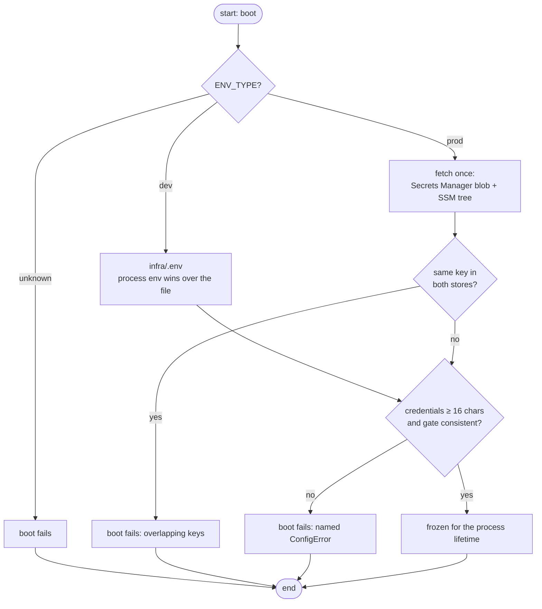

# Secrets

Four credentials and one dependent key. Where they live depends on the plane; how the boot reads them is always the same — see [Configuration](../getting-started/configuration.md).

## The split

`secrets.toml` declares which keys go where. Secrets Manager holds the JSON blob `detectai/chats/secrets`; SSM holds plain parameters under `/detectai/chats/`.

| Store | Keys | Rule |
|-------|------|------|
| Secrets Manager | `API_KEY`, `MONGO_URI`, `NEW_RELIC_LICENSE_KEY` | each ≥ 16 chars; never echoed |
| SSM parameters | `PORT`, `DRAIN_TIMEOUT`, `MONGO_DATABASE`, `REDIS_ENDPOINT`, `OTEL_EXPORTER_OTLP_ENDPOINT`, `OTEL_SERVICE_NAME`, `OTEL_SERVICE_VERSION`, `OTEL_TRACE_SAMPLE_RATIO`, `RATE_LIMIT_CREATE_MAX`, `RATE_LIMIT_WRITE_MAX` | plain `String` only; `SecureString` refused |

`OTEL_EXPORTER_OTLP_ENDPOINT` lives in SSM but *requires* the license key: setting it without a ≥16-char `NEW_RELIC_LICENSE_KEY` fails the boot. That dependency is declared in `secrets.toml` under `[requires]`.

A key seeded into **both** stores fails the boot — the two sources are disjoint by contract, and an overlap is a provisioning bug, not a preference.

## How a boot reads them

## Local development

`infra/.env` ships placeholders for all four credentials. Replace them before anything real listens; `make env` never overwrites an existing file. `MONGO_URI` and `REDIS_ENDPOINT` are written container-shaped (`host.docker.internal`) and repainted to `localhost` by `make run` for host runs. The AWS endpoint overrides point at floci (`:4566`) so the prod plane can be exercised locally.

## Provisioning

Every secret target delegates to `poetry -C ../../tools/tfctl run tfctl --service chats`, so this service's plane follows the same kind-driven flow as the others. `PLANE=floci|aws` selects the target (default `floci`); `DRY_RUN=1` previews any verb.

| Target | What it does |
|--------|--------------|
| `make secrets-check` | validate `infra/.env`, preview the plane and vars — no terraform |
| `make secrets-plan` | terraform plan against the selected plane |
| `make secrets-apply` | apply — auto on floci, interactive confirm on real AWS |
| `make secrets-auto-apply` | check → plan → apply → verify, stopping at the first failure |
| `make secrets-verify` | read the live plane and compare by length and fingerprint only |
| `make secrets-drop-seeder` | detach the seeder policy and delete the role |
| `make secrets-clean` | destroy the seeded resources, keep the state bucket and ledger |
| `make secrets-destroy` | full teardown: resources, state bucket, seeder role |
| `make secrets-session-clear` | drop this service's cached seeder session |
| `make secrets-session-clear-all` / `-refresh-all` | clear or mint sessions across ready services with one MFA code |
| `make secrets-test` | run the tfctl engine test suite |

`FORCE=1` applies to session-refresh-all; `FORCE_DELETE=1` to destroy. Values are never printed — verification reports lengths and fingerprints.

## Next Steps

- **[Configuration](../getting-started/configuration.md)** — every key and its default
- **[Make Commands](../reference/make.md)** — the full target index
