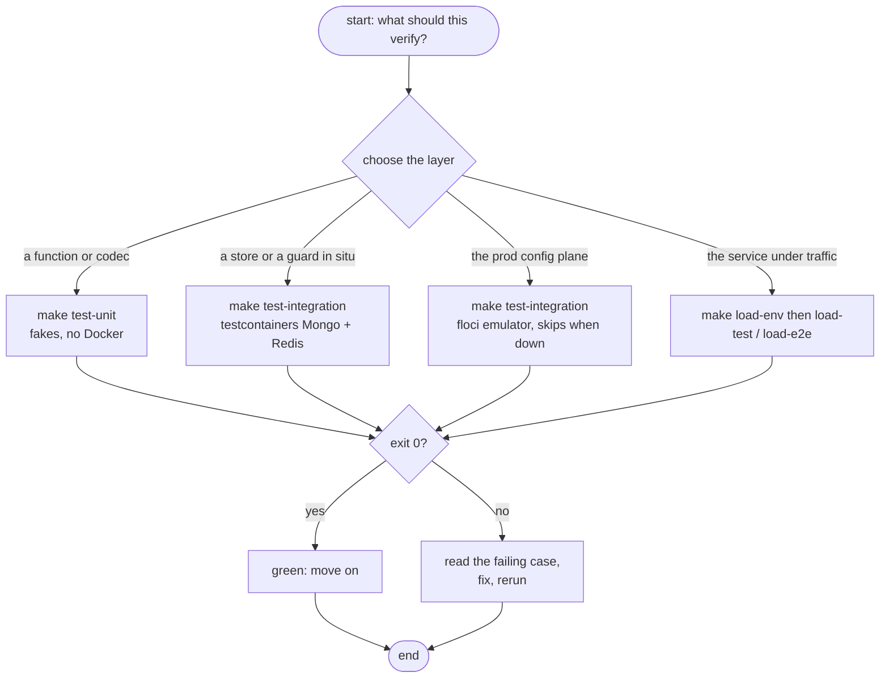

# Testing

Three layers, each answering a different question. The rule that keeps them honest: **unit tests hold pure logic with fakes; integration tests drive real datastores; the load rig sends real traffic** — three trees with a hard boundary between them.

| Question | Layer | Command |
|----------|-------|---------|
| Does this function or codec do the right math? | unit | `make test-unit` |
| Does the Mongo/Redis path really work? | integration | `make test-integration` |
| Does the prod config plane read what seeding writes? | integration | `make test-integration` |
| How does the service behave under traffic? | load | `make load-test` / `make load-e2e` |

`make test` runs the whole Go suite module-wide. Green means exit 0 — `go test` and k6 alike propagate failures to the shell.



## Unit — fast and faked

One folder per component, black-box over the exported API. The suite pins the semantics the integration and load layers build on: cursor strictness, the bounds, the analysis state machine, the validation fields, the interceptor chain, cache-null degradation, and the OTel boot against an in-process receiver.

| Folder | Covers |
|--------|--------|
| `tests/unit/models/` | the cursor codec — strict decode, foreign chat id |
| `tests/unit/config/` | dotenv grammar, env-over-file, both planes through fakes, fail-fast and fail-closed |
| `tests/unit/db/` | connect + retry timing |
| `tests/unit/cache/` | key builders, TTLs, limiter decision, null builds |
| `tests/unit/handlers/` | the status matrix, auth, rate-limit scopes, refusal metadata, telemetry |
| `tests/unit/router/` | mounting, interceptor order, probe behavior |
| `tests/unit/services/` | use cases, validation, degraded cache |
| `tests/unit/observability/` | null vs wired boot, resource identity, instruments |

## Integration — real containers

`make test-integration` is serialized (`-p 1`) so one container set is alive at a time. `tests/integration/support` starts shared `mongo:8.0` and `redis:8-alpine` testcontainers (2 min start budget), skips when Docker is unreachable, and offers per-test fixtures whose `Stop()` kills the container for the real outage cases — Mongo outage and degraded cache.

| Folder | Covers |
|--------|--------|
| `tests/integration/config/` | the prod plane against floci; skips when the emulator is down |
| `tests/integration/db/`, `cache/`, `repository/` | the real drivers, indexes, keyset paging, the analysis state machine |
| `tests/integration/services/` | cache hit/miss, Mongo outage, degraded cache |
| `tests/integration/router/` | RPCs through the real chain against real stores |

A green `make test` needs no running stack: both the Docker probe and the floci probe skip rather than fail.

## Coverage

`make coverage` runs unit + integration with `-coverpkg=./internal/...` and prints the total. `make coverage-unit` needs no Docker. `make coverage-check` fails under **95%**, and `make coverage-html` writes the browsable report. The gate is a local convention — `dev` runs no CI.

## Load — traffic, not tests

k6 suites under `tests/load/`. One `infra/.env.load` configures everything, the file's `SCENARIO` line included (`smoke` or `load`) — there are no CLI overrides. The [full rig manual](../../tests/load/README.md) lives beside the scenarios; this page is the map.

```sh
make load-env        # create infra/.env.load from the example
make load-test       # container rig: chats + k6 on an isolated network
make load-e2e        # k6 alone against API_URL
make load-down
```

`PROTOCOL` picks `http` (Connect over JSON) or `grpc` (native gRPC over H2C using reflection). Both probes stay HTTP.

| Scenario | Shape | Pass criteria |
|----------|-------|---------------|
| `smoke` | 1 VU, 1 iteration: health, a full lifecycle, the rejection matrix, a forced burst refusal | every request asserts its exact answer |
| `load` | `ramping-arrival-rate` from `STAGES`; each arrival creates a chat, runs a weighted workflow, deletes it | `p95 < 250ms`, `p99 < 500ms`, success ≥ 99% |

The smoke matrix maps the guards one to one: missing/wrong key and missing user id (`unauthenticated`), empty/oversized content and invalid cursor (`invalid_argument`), analysis without state (`invalid_argument`), unknown/foreign chat (`not_found`), and a burst-budget refusal. The owner pool (`CHATS_LOAD_OWNERS=4096`) keeps traffic off the limiter; exhausting it yields `chats_load_rate_limited` and fails the run.

Every arrival samples `/api/v1/ready` on a cadence; a 503 there is recorded as backpressure, not a failure. k6's exit code survives the teardown, so a green run is exit 0.

## Next Steps

- **[RPC API](../reference/rpc-api.md)** — every code the suites assert, in one table
- **[Configuration](../getting-started/configuration.md)** — the keys the different boots move
- **[Make Commands](../reference/make.md)** — the annotated target index
