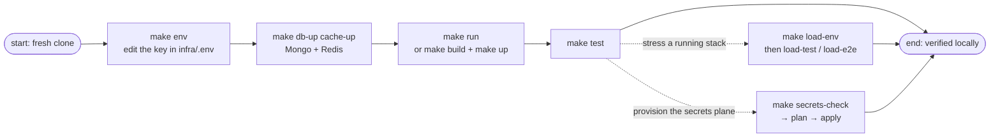

# Make Commands

Every verb of this service is a make target run from `services/chats`; `make help` prints the raw index, and this page is that index plus a purpose for each row. Targets live in five files under `mk/`, and the sections below follow a working day — set up, run, verify, then the deeper orbits.

## The lifecycle at a glance

The [Quick Start](../getting-started/quickstart.md) walks the main line step by step.

## Local — `mk/local.mk`

| Target | What it does | Reach for it when |
|--------|--------------|-------------------|
| `make run` | sources `infra/.env`, repaints `host.docker.internal` to `localhost` for Mongo/Redis/AWS, runs the API | everyday development |
| `make env` | copies `infra/.env.example` → `infra/.env` **if missing** | first run; never overwrites an existing file |
| `make tidy` | resolves and updates `go.mod`/`go.sum` | after pulling dependency changes |
| `make vet` | `go vet ./...` | before pushing anything |

## Docker — `mk/docker.mk`

| Target | What it does | Reach for it when |
|--------|--------------|-------------------|
| `make build` | builds the image (`detectai-chats`) | before `up`, or to test the Dockerfile |
| `make up` | `db-up` + `cache-up`, then compose up detached | same behavior as `make run`, no hot reload |
| `make down` | compose down; the datastores keep running under their own verbs | done with the stack |
| `make logs` | compose logs `-f` (chats) | a running stack misbehaves |
| `make ps` | compose `ps` | is it even up? |
| `make db-up` / `db-down` | start/stop local MongoDB (port from `infra/docker/mongo/.env`); a running instance is left untouched; `down` keeps the data volume | local runs that need Mongo |
| `make cache-up` / `cache-down` | start/stop local Redis; a running instance is left untouched; the cache is ephemeral | local runs that need Redis |
| `make clean` | down + db-down + cache-down + drop the Mongo volume | odd failures, or a clean slate |

## Tests — `mk/tests.mk`

| Target | What it does | Reach for it when |
|--------|--------------|-------------------|
| `make test` | the full Go suite, module-wide | before pushing anything |
| `make test-unit` | the black-box unit tree (`tests/unit`), no Docker | iterating on one codec, guard, or seam |
| `make test-integration` | the container-backed tree and prod config plane (`-p 1`); skips without Docker or floci | changing a store path or config plane |
| `make coverage` | unit + integration coverage of `./internal/...` (needs Docker) | reading the number |
| `make coverage-unit` | unit-only coverage, no Docker required | a quick local check |
| `make coverage-html` | write `coverage.html` from the combined run | browsing uncovered lines |
| `make coverage-check` | fail when combined coverage is below 95% | the local quality gate |

## Secrets — `mk/secrets.mk`

Every target delegates to the tfctl driver (`poetry -C ../../tools/tfctl run tfctl --service chats`). Switches: `PLANE=floci|aws` (default `floci`), `DRY_RUN=0|1`, `FORCE=0|1` (session-refresh-all), `FORCE_DELETE=0|1` (destroy).

| Target | What it does | Reach for it when |
|--------|--------------|-------------------|
| `make secrets-check` | validate `infra/.env`, preview the plane and vars — no terraform | before anything else, always |
| `make secrets-plan` | terraform plan against the selected plane | reading what would change |
| `make secrets-apply` | terraform apply — auto on floci, interactive confirm on real AWS | making it real |
| `make secrets-auto-apply` | check → plan → apply → verify, stopping at the first failure | one-shot seeding |
| `make secrets-verify` | read the live plane and match it against `infra/.env` (fingerprints only) | after apply, or when "is the seed right?" nags |
| `make secrets-drop-seeder` | detach the seeder policy and delete the role | leaving an account clean |
| `make secrets-clean` | destroy the secrets blob, keep the state bucket and ledger | wiping resources, keeping your place |
| `make secrets-destroy` | destroy, purge the state bucket, drop the seeder role | leaving no trace |
| `make secrets-session-clear` | drop the cached seeder session for this service | after a stale/failed MFA window |
| `make secrets-session-clear-all` · `-refresh-all` | drop (or mint fresh) seeder sessions across ready services | juggling several services per MFA code |
| `make secrets-test` | run the tfctl engine test suite | the driver changed |

Where the values go and how they rotate is the [Secrets guide](../guides/secrets.md)'s subject — this page only lists the levers.

## Load — `mk/load.mk`

One `infra/.env.load` configures everything, the file's `SCENARIO` line included (`smoke` or `load`) — there are no CLI overrides, so: edit the file, rerun.

| Target | What it does | Reach for it when |
|--------|--------------|-------------------|
| `make load-env` | creates `infra/.env.load` from the example if missing | first run; the file is then the single lever for every knob |
| `make load-test` | container rig: chats + k6 on an isolated network; Mongo and Redis are the running local stacks; k6's exit code survives teardown | throughput, on your own private rig |
| `make load-e2e` | k6 alone, against whatever the file's `API_URL` names | a specific target — `make run`, a docker stack, prod |
| `make load-down` | removes the rig and any e2e-run leftovers | cleaning up after either run |

## Targets make calls for you

`load-check` rejects a missing `infra/.env.load`, a missing `infra/.env`, or an unknown `SCENARIO` before compose runs. `db-up` and `cache-up` are order-only prerequisites of `load-test`, and `load-down` delegates to `load-down-remote` first. None of these need to be invoked by hand — they are listed so the index matches `mk/` completely.

## Next Steps

- **[Quick Start](../getting-started/quickstart.md)** — the main line, step by step
- **[Testing](../guides/testing.md)** — what the test targets run and why
- **[Secrets](../guides/secrets.md)** — behind the secrets targets
