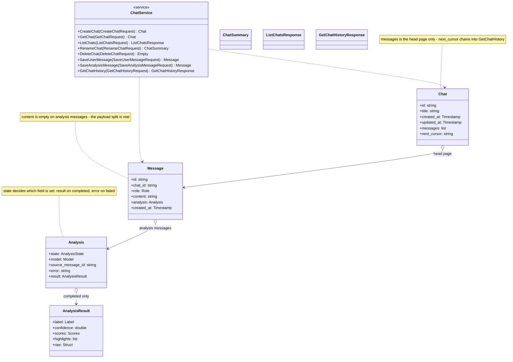
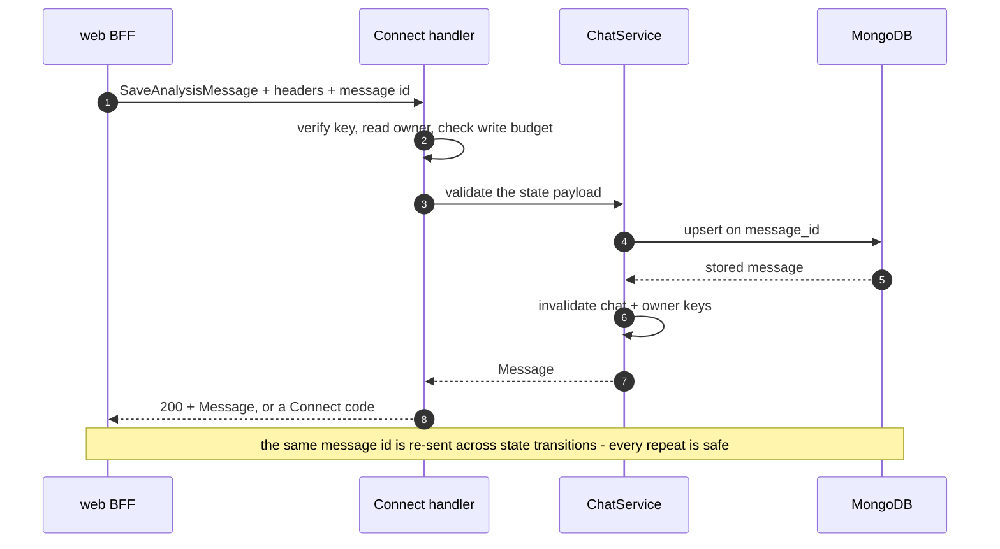

# RPC API

The wire contract for every caller. The service speaks ConnectRPC on `chats.v1.ChatService`, mounted on the Gin engine on port 8090. One handler negotiates gRPC, gRPC-Web, and Connect over JSON; both HTTP/1.1 and unencrypted HTTP/2 (H2C) are enabled.

## Authentication

Two headers, both set by the web BFF:

| Header | Role |
|--------|------|
| `x-api-key` | the service credential, constant-time compared against `API_KEY`; missing or wrong both answer `unauthenticated` with the same message |
| `x-user-id` | the owner every RPC speaks for; missing answers `unauthenticated` |

The api key authenticates the caller, which is what makes the asserted `x-user-id` trustworthy. The request body carries no `user_id` — the header is the only channel. Probes, grpchealth, and reflection stay unauthenticated.

Every RPC is ownership-checked: any `chat_id` not owned by the caller answers `not_found` — one code for "missing" and "not yours".

## The surface

| RPC | Returns | Purpose |
|-----|---------|---------|
| `CreateChat` | `Chat` | new chat; title derived from the initial message |
| `GetChat` | `Chat` | meta + head page of messages + `next_cursor` |
| `ListChats` | `ListChatsResponse` | sidebar summaries, newest-first, server-capped |
| `RenameChat` | `ChatSummary` | title change; bumps `updated_at` |
| `DeleteChat` | `google.protobuf.Empty` | chat first, then messages; idempotent |
| `SaveUserMessage` | `Message` | insert-only, idempotent on id |
| `SaveAnalysisMessage` | `Message` | upsert keyed on id; the analysis state machine |
| `GetChatHistory` | `GetChatHistoryResponse` | keyset cursor pages of history |

## The wire shapes



Enums: `Role` (user/assistant), `Model` (spark/flare), `AnalysisState` (running/completed/failed/cancelled), `Label` (ai/human). The BFF derives its three web views from the one `Analysis`: `analysisStatus` = the subdoc minus `result`, `analysis` = `result`, `analysisLink` = the state/model/source triplet.

## One call, end to end



## Pagination

Keyset on `(created_at, _id)`, descending — matching the messages index. Empty cursor = first page; pass `next_cursor` back verbatim; empty `next_cursor` = end. The cursor is opaque base64 over `{chat_id, t, i}`; a malformed or foreign-chat cursor is `invalid_argument`. There is no `has_more` boolean — two sources of truth for one fact invite drift.

| Call (limit 3, messages m1…m10) | Returns |
|---------------------------------|---------|
| `GetChatHistory(chat1)` | m10, m9, m8 + `cursor_C1` |
| `GetChatHistory(chat1, C1)` | m7, m6, m5 + `cursor_C2` |
| `GetChatHistory(chat1, C2)` | m4, m3, m2 + `cursor_C3` |
| `GetChatHistory(chat1, C3)` | m1 + empty cursor |

## Rate limiting

Per-user burst limits on three write procedures, enforced by an interceptor beside the auth interceptor.

| Scope | Procedures | Default budget |
|-------|-----------|----------------|
| `create` | `CreateChat` | 10 per minute |
| `write` | `SaveUserMessage`, `SaveAnalysisMessage` (one shared budget) | 60 per minute |

Reads are not limited in v1. Business quotas (daily usage) stay at the web BFF — chats does only operational burst protection. The window is a fixed minute (`chats:rate_limit:{user}:{scope}:{epochMinute}`), limits come from config, and Redis loss fails open. An over-limit answer carries `retry-after-ms`, `x-ratelimit-limit`, and `x-ratelimit-remaining=0` as error metadata.

The interceptor order matters: telemetry is outermost and auth precedes rate limiting, so an unauthenticated call never reaches a counter and a refusal is still counted.

## Errors

| Condition | Connect code |
|-----------|--------------|
| Identity missing or invalid | `unauthenticated` |
| Validation: empty/oversize content or title, missing `source_message_id`, bad state/model, malformed or foreign cursor | `invalid_argument` |
| Chat missing or not owned; message id bound to another chat | `not_found` |
| Analysis write into a terminal state that is not an identical replay | `failed_precondition` |
| Mongo unavailable | `unavailable` |
| Per-user burst limit exceeded | `resource_exhausted` + retry metadata |
| RPC exceeds the 8 s budget | `deadline_exceeded` |
| Anything unexpected, including a recovered panic | `internal` |

Redis never fails an RPC: reads degrade to Mongo, invalidations are absorbed, and the limiter fails open. Only Mongo faults map to `unavailable`.

## Probes and reflection

| Path | Auth | Answer |
|------|------|--------|
| `GET /api/v1/health` | open | 200 `{"status":"ok"}` |
| `GET /api/v1/ready` | open | 200 `{"status":"ready"}`, or 503 if Mongo does not answer within 2 s |
| `/grpc.health.v1.Health/` | open | grpchealth checker for `chats.v1.ChatService` |
| `/grpc.reflection.v1*/ServerReflection/` | open | schema only, never data; HTTP/2 only (HTTP/1.1 gets 505) |

Reflection lets a debugging tool discover the contract without a schema file:

```sh
grpcurl -plaintext localhost:8090 list
```

## Next Steps

- **[Request Flow](../concepts/request-flow.md)** — the interceptor chain behind each code
- **[Data Model](../concepts/data-model.md)** — the documents these types map onto
