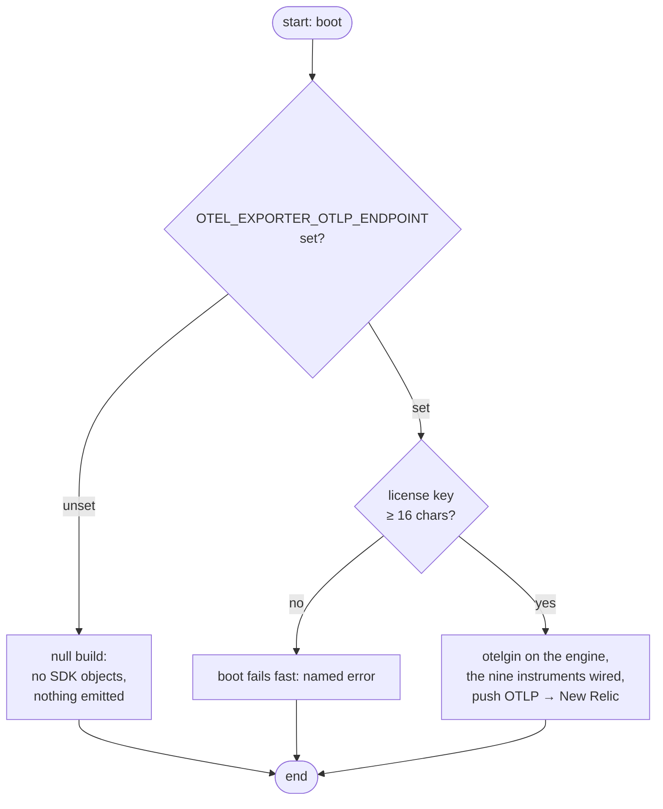

# Chats — Observability

The telemetry build for the chats service: the gate that switches it on, the push path to New Relic EU, the metric inventory, and where each record is taken. The RPC contract the instruments describe lives in [contract.md](contract.md); the cache rules the cache instruments ride on live in [references/cache.md](references/cache.md). Usage-level docs: [Observability](../docs/concepts/observability.md).

The service exports logs, traces, and metrics — or nothing at all. There is no metrics endpoint and no partial state in between: the whole build is switched by one env var, `OTEL_EXPORTER_OTLP_ENDPOINT`.

## The gate

| Endpoint setting | What boots |
|------------------|------------|
| unset | the null build — no SDK objects created, every call a no-op |
| set | the full OTel pipeline; requires `NEW_RELIC_LICENSE_KEY` (≥ 16 chars) or **the boot fails** |

Unset is a *legitimate* configuration, not a degraded one. A disabled boot costs nothing, and every layer keeps exactly one code path because the null build implements the same `Telemetry` seam as the wired one. `config.Resolve` owns the credential floor; `observability.Boot` only reads what the config resolved.



## Push, not pull

One pipeline, three signals, zero hops: the SDK exports traces, metrics, and logs directly to New Relic's native OTLP endpoint (`otlp.eu01.nr-data.net` for the EU account), authenticated with the **ingest license key** in the `api-key` header — never a user API key. HTTP/protobuf with gzip, 15 s metric cadence, delta temporality, parent-based sampling at `OTEL_TRACE_SAMPLE_RATIO`.

The service is not in the prod stack's collector path, so it owns the resource labels the collector would otherwise upsert (`service.name`, `service.version`, `deployment.environment` from `ENV_TYPE`). Push is fire-and-forget from the request path: an export failure costs a batch, never a 5xx.

Dev may point the endpoint at any OTLP/HTTP receiver instead — a local collector on 4318 works on the same code path, and a throwaway value for the license key is legitimate there; the boot demands only that a set endpoint arrive with a key.

## The metric inventory

Nine instruments, all landed. Names are a contract — dashboards and alerts query them by name, so a rename is a migration, not an edit.

| Instrument | Type | Attributes | Counts |
|------------|------|------------|--------|
| `chats_rpc_requests_total` | Counter | `procedure`, `code` | every RPC answered, ok or failed |
| `chats_rpc_errors_total` | Counter | `procedure`, `code` | every RPC answered with a non-ok code |
| `chats_rpc_duration_seconds` | Histogram | `procedure` | RPC wall time |
| `chats_cache_operations_total` | Counter | `operation`, `result` | cache reads, writes and invalidations |
| `chats_cache_operation_duration_seconds` | Histogram | `operation` | cache operation cost |
| `chats_datastore_operations_total` | Counter | `operation`, `result` | one entry per repository call |
| `chats_datastore_operation_duration_seconds` | Histogram | `operation` | Mongo call cost |
| `chats_rate_limit_refusals_total` | Counter | `scope` | exhausted burst budgets |
| `chats_validation_rejections_total` | Counter | `field` | rejected payload fields |

The cache counter earns its keep: a cache fault is *absorbed* — the read degrades to Mongo and the RPC still answers ok — so without it a degrading Redis is invisible in the RPC numbers. The rate-limit and validation counters earn theirs the same way: the RPC code says `resource_exhausted` or `invalid_argument`, but not which scope was exhausted or which field was rejected.

### The vocabularies

| Attribute | Values |
|-----------|--------|
| `procedure` | the eight RPC method names |
| `code` | the Connect code: `ok` plus the standard code set |
| `operation` (cache) | `chat`, `chat_list`, `head`, `put_chat`, `put_chat_list`, `put_head`, `invalidate_meta`, `invalidate_chat`, `invalidate_owner` |
| `result` (cache) | `hit`, `miss` for reads; `ok`, `error` for writes and invalidations |
| `operation` (datastore) | `create_chat`, `chat`, `chats`, `rename_chat`, `delete_chat`, `save_user_message`, `save_analysis_message`, `chat_history` |
| `result` (datastore) | `ok`, `not_found`, `conflict`, `invalid_cursor`, `unavailable`, `error` |
| `scope` | `create`, `write` |
| `field` | `title`, `chat_id`, `content`, `role`, `analysis`, `source_message_id`, `state`, `model`, `result`, `error` |

## Where each record is taken

Each layer records the facts it owns. The transport sees the answer, the service sees the cache's hit and miss, the repository sees the driver's cost and fault class.

| Layer | Site | Records |
|-------|------|---------|
| RPC | `internal/handlers/telemetry.go` | the procedure's span and the answer's code |
| Rate limit | `internal/handlers/ratelimit.go` | one counter per refusal |
| Validation | `internal/services/chat.go` | the rejected field |
| Cache | `internal/services/cache.go` | hit, miss or absorbed fault, and the cost |
| Datastore | `internal/repository/*.go` | the outcome's class and the cost |

The RPC interceptor runs **outermost** in the connect chain, so the refusals of the inner interceptors — the credential check and the rate limiter — are counted too. It settles the verdict on the way out, so a panic still closes the span and counts the call: the crash lands as `internal` and the panic is re-raised for the server's recovery to handle.

## The seam

`internal/observability` is one facade the whole service mounts. No OTel type crosses it: the layers call the `Telemetry` interface and never see a span, a meter, or a provider.

```go
type Telemetry interface {
	TrackRPC(ctx context.Context, procedure string) (context.Context, func(RPCStatus))
	RecordRPC(procedure string, code RPCStatus, duration time.Duration)
	RecordCacheOp(operation string, result CacheResult, duration time.Duration)
	RecordDatastoreOp(operation string, result DatastoreResult, duration time.Duration)
	RecordRateLimitRefusal(scope string)
	RecordValidationRejection(field string)
	Shutdown(ctx context.Context) error
}
```

Two realizations sit behind it: `TelemetryService` on the started SDK providers, and `NullTelemetry` — the same seven methods, zero cost, no endpoint branches anywhere. The service packages hold the `Telemetry` interface, so the layer that depends on it never imports the SDK. The boot reads a small `observability.Config` — endpoint, license key, service name, version, sample ratio — and nothing else.

## The traces

`otelgin` frames the HTTP route span, registered before the recovery middleware so its span brackets a panic the recovery absorbs. It cannot split the procedures apart: the connect handler is mounted on one wildcard route, so `http.route` reads `/chats.v1.ChatService/*any`. The procedure's own span comes from the connect interceptor and carries `rpc.system=connect_rpc`, `rpc.service`, `rpc.method`, and `rpc.connect_rpc.error_code` on a failed span.

The SDK's global text-map propagator is a no-op until one is registered, so the boot registers `propagation.TraceContext{}`. Without it every request starts an orphan trace and the parent-based sampler has no parent to honour. The boot also sets the global tracer provider to the one it started; the global meter provider stays unset on purpose, so otelgin's own `http.server.*` metrics cannot break the nine-instrument inventory.

## The logs

`log/slog` is the service's logger and stays the one on stdout: JSON, unchanged. The boot tees every record to stdout **and** to the OTLP bridge, so one `slog.Info` call reaches New Relic without a second logging call at the call site. Every record is emitted with the request's context, so the OTel logs SDK stamps the trace and span ids onto it — a log line is a link into the trace that produced it.

## The deployment label

`deployment.environment` is stamped by the app from `ENV_TYPE`, which the config plane accepts as exactly `dev` or `prod`. `OTEL_RESOURCE_ATTRIBUTES` may add labels to the resource, but it cannot relabel the app's own: the SDK merges the environment's attributes under the resource the provider is given.

## Decisions

- **One facade, two realizations** — the null build implements the same seam, so no layer carries an "is telemetry on" branch.
- **The seam carries no OTel type** — service packages depend on an interface, never the SDK; the SDK stays behind `internal/observability`.
- **An in-house connect interceptor** — no OpenTelemetry contrib module exists for ConnectRPC, and a third-party one would own the attribute names the dashboards facet on.
- **The interceptor runs outermost** — an unauthenticated or rate-limited call is a signal, not a gap.
- **One procedure attribute, derived from the wire** — the method name comes from `req.Spec().Procedure`, so it cannot drift from the proto.
- **Each layer records what it owns** — the repository times the driver call, the service reads the cache's hit and miss.
- **Absorbed faults get their own counter** — a cache fault never changes the RPC code, so it needs an instrument of its own.
- **Push direct to New Relic EU** — the service is outside the collector's reach, and it owns the resource labels the collector would upsert.
- **A panic is a telemetry event** — the interceptor settles the verdict on the way out, so a crash closes its span and counts as `internal`.
- **The boot registers the trace-context propagator** — the SDK's global propagator is a no-op by default, and an unregistered one drops the caller's trace.
- **Log records carry the request context** — the trace id is only on a record when the context handed to the handler carries the span.
- **Datastore spans: deliberately not built.** The repository stays at counters and histograms; the RPC span carries the latency. Instrumenting the driver per query is a future decision, not an open one.
- **Cache hit-ratio target: deferred.** The board rewrite needs a threshold; the cache is an overlay, so the floor is a product decision, not a technical one.
- **Known gap:** the `detectai-chats` board still describes the retired build (`chat-service`/`chat-worker`, `chat_*` metrics). It stays dark until rewritten against this inventory.
