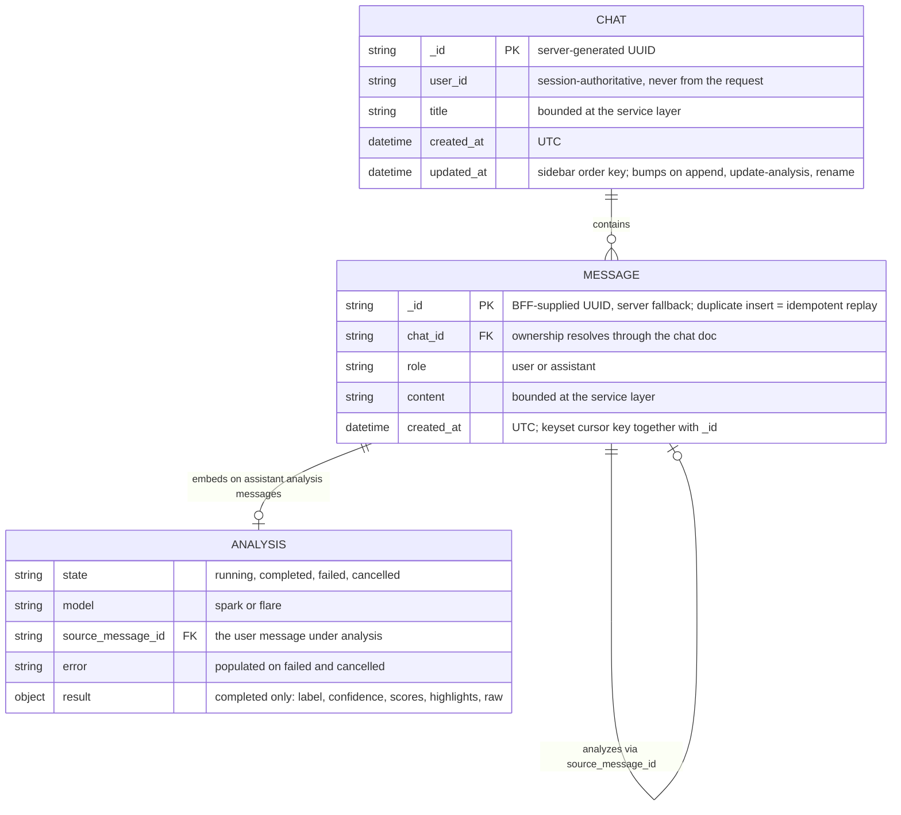
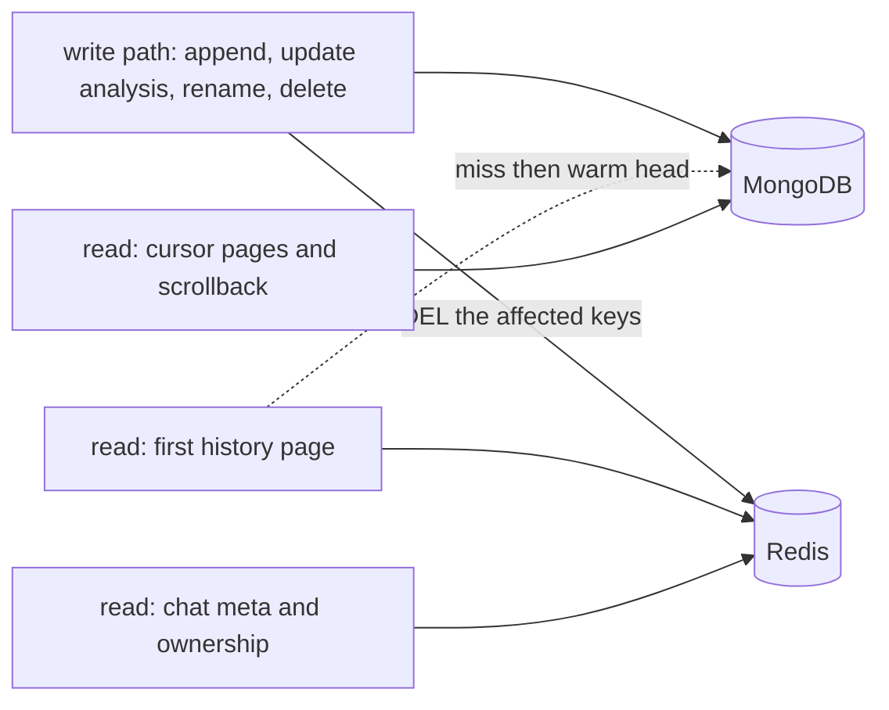

# Chats — Data Model (LLD)

MongoDB documents, indexes, and the Redis overlay for the chats service. The consumer shape is fixed by the web BFF's domain types (`apps/web/lib/domain/chat.ts`); this doc maps those types onto storage and records the choices the pre-rebuild build-out got wrong.

The async worker path is dropped — the analysis flow is synchronous CRUD (BFF → chats RPC), so there is no queue payload, no bulk upsert, no consumer here.

## Entities

Two collections:

- **`chats`** — one document per chat session. Owns identity (`user_id`), display (`title`), and ordering (`updated_at`).
- **`messages`** — one flat document per message. Assistant analysis messages embed their analysis payload inline; the analysis state machine lives on the embedded document.

## ER diagram

## Collections

### `chats`

| Field | Type | Notes |
|-------|------|-------|
| `_id` | string | Server-generated UUID |
| `user_id` | string | From the auth interceptor; never accepted from the request |
| `title` | string | Bounded; validated at the service layer |
| `created_at` | datetime | UTC |
| `updated_at` | datetime | Sidebar order key — bumps on message append, analysis state change, rename |

### `messages`

| Field | Type | Notes |
|-------|------|-------|
| `_id` | string | BFF-supplied UUID, server-generated fallback. Duplicate-key insert = idempotent replay |
| `chat_id` | string | FK to `chats._id`; ownership resolves through the chat doc |
| `role` | string | `user` or `assistant` |
| `content` | string | Bounded; validated at the service layer |
| `created_at` | datetime | UTC; keyset cursor key together with `_id` |
| `analysis` | object | Optional, assistant analysis messages only — see below |

Embedded `analysis` object:

| Field | Type | Notes |
|-------|------|-------|
| `state` | string | `running` → `completed` / `failed` / `cancelled` |
| `model` | string | `spark` or `flare` |
| `source_message_id` | string | The user message this analysis belongs to |
| `error` | string | Optional, set on `failed` and `cancelled` |
| `result` | object | Set once `completed`: `label`, `confidence`, `scores{ai, human}`, `highlights[]`, `raw` (capped) |

## Indexes

| Collection | Index | Serves |
|------------|-------|--------|
| `chats` | `{ user_id: 1, updated_at: -1 }` | Sidebar list — newest-first chats for one user |
| `messages` | `{ chat_id: 1, created_at: -1, _id: -1 }` | Chat history — keyset pagination, newest-first, `_id` as timestamp tiebreaker |

Two indexes beyond the defaults is the whole story. Cursor = `(created_at, _id)` of the last message on the page.

## Redis overlay

Cache-aside, invalidate-on-write, TTL safety net. Mongo is the source of truth; staleness is tolerated by a chat UI. Keys carry the `chats:` service prefix — the shared-instance namespace convention, TTLs, value shapes, and failure semantics live in [cache.md](cache.md).

| Key | Value | TTL | Serves | Invalidated by |
|-----|-------|-----|--------|----------------|
| `chats:chat:{id}` | Chat meta (owner, title, updated_at) | ~10m | Ownership check + `GetChat` | Append, update-analysis, rename, delete |
| `chats:user:{id}:chats` | Sidebar list, newest-first | ~5m | Chat list | Create, append, update-analysis, rename, delete |
| `chats:chat:{id}:head` | Last ~50 messages | ~10m | First page of history | Append, update-analysis, delete |

Every mutation fans out to Mongo then `DEL`s the affected keys — an append touches all three. Cursor pages never touch Redis; only the common first page does.

## Web type → storage mapping

The contract layer maps these directly — no reinterpretation at the adapter.

| Web (`apps/web/lib/domain/chat.ts`) | Stored |
|-------------------------------------|--------|
| `ChatSession` | `chats` doc + its `messages` |
| `ChatHistoryItem` | `chats` doc projection |
| `Message` | `messages` doc |
| `Message.analysis` (`AnalysisResult`) | `messages.analysis.result` |
| `PersistedAnalysisStatus` / `AnalysisLink` state | `messages.analysis.{state, source_message_id, error}` |

## Decisions

| Decision | Choice | Rationale |
|----------|--------|-----------|
| Message storage | Flat document per message | The slop bucket design had append races, in-memory pagination, and a fetch cap that made deep history unreachable; an index range scan is simpler and fast enough at this volume |
| Analysis payload | Embedded in the message doc | 1:1 with its message; one query serves history; state transitions are a `$set` on the subdoc |
| `user_id` on messages | Dropped | Ownership flows `chat_id` → chat; the session is authoritative per the web interface |
| Message `_id` | BFF-supplied UUID, server fallback | Idempotent appends — the BFF orchestrates inference and retries; a duplicate-key insert is a replay, not an error |
| Delete consistency | Chat doc first, then messages, no transaction | Worst case is orphaned unreachable messages; avoids requiring replica-set transactions in compose |
| Pagination | Keyset on `(created_at, _id)` | History is append-only; offset pagination was the slop bug |
| Cache strategy | Cache-aside, invalidate-on-write, TTL safety net | At human typing speed DEL-on-write is cheap; no ZSET or write-through cleverness |
| Async path | Worker and SQS consumer dropped | Simple CRUD; analysis results flow synchronously BFF → chats RPC |
