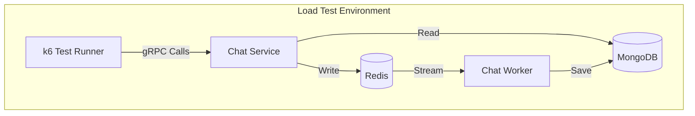
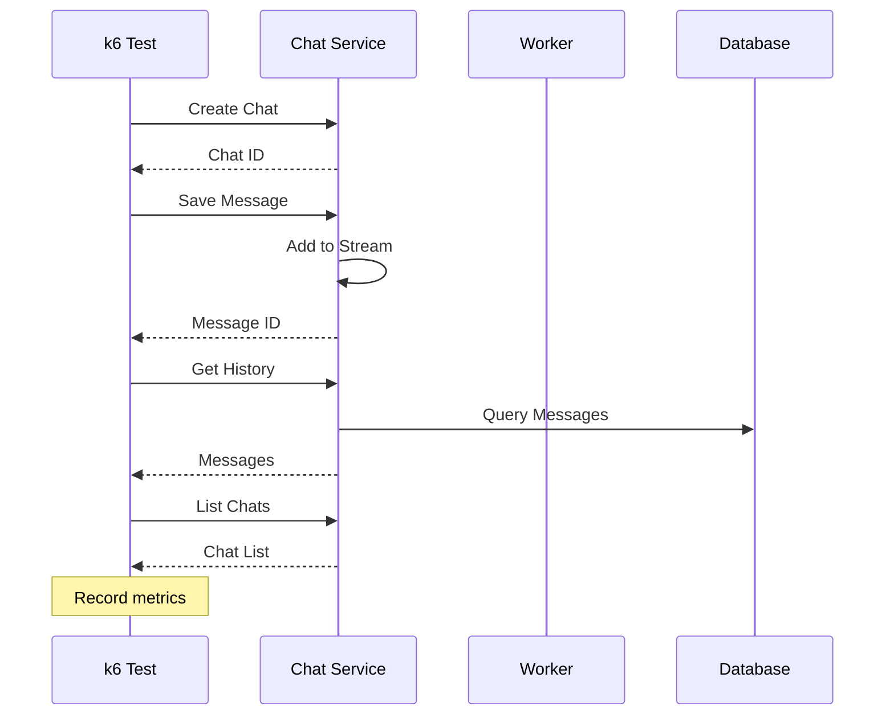

# Load Testing

This document explains how to run load tests for the Chats service. Load tests help you understand how the service performs under different levels of traffic.

## What is Load Testing?

Load testing simulates real-world traffic to:
- **Find performance limits** - How much traffic can the service handle?
- **Identify bottlenecks** - What slows down under pressure?
- **Verify reliability** - Does the service stay stable during high traffic?
- **Plan capacity** - How many users can the service support?

## Quick Start

### Run Your First Test

```bash
# Navigate to the chats service
cd services/chats

# Run a quick smoke test (1 user for 10 seconds)
make load-test SCENARIO=smoke VUS=1 DURATION=10s
```

### Run Different Test Types

```bash
# Smoke test - Quick sanity check (full lifecycle + delete verification)
make load-test SCENARIO=smoke VUS=1 DURATION=10s

# Load test - Realistic traffic (weighted read/write + lifecycle + pagination)
make load-test SCENARIO=load VUS=10 DURATION=2m RPS=50

# Stress test - Find the breaking point (writes + reads)
make load-test SCENARIO=stress VUS=50 DURATION=5m

# Soak test - Long-running stability (writes + rename + delete)
make load-test SCENARIO=soak VUS=5 DURATION=10m

# Lifecycle test - Dedicated CRUD: create -> burst -> rename -> paginate -> delete -> verify-gone
make load-test SCENARIO=lifecycle VUS=5 DURATION=2m

# Edge test - Negative cases only (InvalidArgument/NotFound/PermissionDenied), keeps SLOs pure
make load-test SCENARIO=edge VUS=2 DURATION=1m
```

### Stop Tests

```bash
# Stop all test containers
make load-down
```

## Observability (opt-in)

```bash
# Push traces/metrics/logs to New Relic EU as deployment.environment=loadtest
export NEW_RELIC_LICENSE_KEY="..."      # ingest key, never commit
make load-test SCENARIO=load VUS=10 DURATION=2m WITH_OBSERVABILITY=1
```

Adds `otel-collector-loadtest` on the load network (scrapes `chat-service:9091`
and `chat-worker:9099` plus `redis-exporter:9121` and `mongo-exporter:9216`,
collects per-container CPU/mem/net via `docker.sock` plus host CPU/mem,
exports OTLP to EU). `ENV_TYPE` stays `dev` — only the telemetry label
changes, so k6 traffic shows up in the `detectai-chats (loadtest)` dashboard
(6 pages: Overview, Service, Service Logs, Worker, Worker Logs, Infra) and
never pollutes prod boards. Without the flag (default `WITH_OBSERVABILITY=0`)
the run is unchanged and fully offline. Empty license key = collector
retries/drops, apps keep running.

Tip: infra panels need a run of a few minutes to fill — app scrapes and
container stats tick every 15s. Short smoke runs only populate the span/log
panels. The api reports `service.name=chat-service`, the worker
`service.name=chat-worker`, so every panel splits by role.

## Test Types

| Test | What It Does | When to Use |
|------|--------------|-------------|
| **Smoke** | Full lifecycle check with 1 user (create/get/rename/delete + NotFound verify) | Before deploying to production |
| **Load** | Realistic traffic with multiple users (weighted read/write, lifecycle, pagination) | Verifying performance requirements |
| **Stress** | Push the service to its limits (writes + reads) | Finding breaking points |
| **Soak** | Run for extended time (writes + rename + delete) | Catching memory leaks or slow issues |
| **Lifecycle** | Dedicated CRUD: create -> burst -> rename -> paginate -> delete -> verify-gone | Verifying delete/rename paths in CI |
| **Edge** | Negative cases only (auth, validation, NotFound); gated on `chat_negative_check_rate` | Verifying error contracts without polluting SLOs |

## Test Scenarios Explained

### Smoke Test

**Purpose:** Verify the service works correctly with minimal traffic.

**What it does:**
1. Creates a new chat
2. Fetches it with GetChat
3. Saves a message and verifies e2e visibility
4. Renames the chat
5. Retrieves chat history and lists user chats
6. Deletes the chat and verifies GetChat returns NotFound

**When to run:** Before every deployment

```bash
make load-test SCENARIO=smoke VUS=1 DURATION=10s
```

**Expected results:**
- 100% success rate
- All checks pass
- Response times under 100ms

### Load Test

**Purpose:** Verify the service handles realistic traffic.

**What it does:**
1. Ramps up to 10 virtual users
2. Maintains steady traffic for 2 minutes
3. Weighted mix (env-tunable): 70% read/write, 20% full lifecycle with rename/delete, 10% pagination/limit clamping
4. Covers all 7 RPCs: CreateChat, GetChat, SaveMessage, GetChatHistory, GetUserChats, RenameChat, DeleteChat
5. Large (~16KB) payloads sampled at ~15% of writes

Deletes are per-VU isolated chats, so no cross-VU interference. Set `SHARED_HOT_CHAT=1` to share the user namespace and stress the GetUserChats index path; set `HOT_CHAT_ID` + `HOT_CHAT_USER` to pin writes to one pre-seeded chat (deletes skipped in that mode).

```bash
make load-test SCENARIO=load VUS=10 DURATION=2m RPS=50
# Shared-user contention:
SHARED_HOT_CHAT=1 make load-test SCENARIO=load VUS=10 DURATION=2m
# Tune the mix:
MIX_READ_WRITE=0.5 MIX_LIFECYCLE=0.3 MIX_PAGINATION=0.2 make load-test SCENARIO=load
```

**Expected results:**
- 99%+ success rate
- 95% of requests under 100ms
- 99% of requests under 250ms

### Stress Test

**Purpose:** Find the service's breaking point.

**What it does:**
1. Gradually increases traffic to maximum
2. Maintains high traffic for several minutes
3. Creates chats and saves messages rapidly
4. Reads back each chat (GetChat + GetChatHistory) to cover the Mongo/Redis read path and worker lag

**When to run:** When planning for growth or finding limits

```bash
make load-test SCENARIO=stress VUS=50 DURATION=5m
```

**What to watch for:**
- Response times increasing
- Errors appearing
- Stream lag growing
- DLQ messages increasing

### Soak Test

**Purpose:** Catch long-running issues like memory leaks.

**What it does:**
1. Runs with moderate traffic for 10 minutes
2. Creates and retrieves messages continuously
3. Periodically renames chats (UpdateChatTitle + cache path)
4. Deletes ~70% of chats (DeleteChat + DeleteCache path), keeps the rest for retention coverage
5. Tests database and cache stability

**When to run:** Overnight or before major events

```bash
make load-test SCENARIO=soak VUS=5 DURATION=10m
```

**What to watch for:**
- Memory usage growing
- Response times degrading
- Database connections failing

### Lifecycle Test

**Purpose:** Verify the full CRUD contract including delete semantics.

**What it does:**
1. Creates a chat and bursts 5 messages
2. Renames and re-fetches it
3. Paginates history (page 1 + page 2)
4. Deletes it and verifies GetChat/GetChatHistory return NotFound
5. Verifies the chat is absent from GetUserChats

```bash
make load-test SCENARIO=lifecycle VUS=5 DURATION=2m
```

### Edge Test

**Purpose:** Verify error contracts (validation, auth, NotFound) without polluting happy-path SLOs.

**What it does:**
1. CreateChat validation: missing user, empty/oversized title, header/body mismatch
2. Authz: cross-user GetChat/history/rename/delete are PermissionDenied
3. SaveMessage validation: missing chat, blank/oversized content, bad role
4. NotFound: GetChat/history on missing IDs
5. One valid write to keep the happy path warm

Gated on `chat_negative_check_rate`, not `chat_rpc_success_rate`.

```bash
make load-test SCENARIO=edge VUS=2 DURATION=1m
```

## How Load Tests Work

### Architecture



The load test runs in an isolated environment with its own databases, so it doesn't affect your development or production systems.

### Test Flow



## Configuration

### Environment Variables

You can customize test behavior with environment variables:

| Variable | What It Does | Default |
|----------|--------------|---------|
| `VUS` | Number of virtual users | Depends on scenario |
| `DURATION` | How long to run | Depends on scenario |
| `RPS` | Requests per second (0 = unlimited) | 0 |
| `CHAT_SERVICE_TIMEOUT` | Connection timeout | 5s |
| `RPC_TIMEOUT_MS` | Per-request timeout | 2000ms |
| `MIX_READ_WRITE` / `MIX_LIFECYCLE` / `MIX_PAGINATION` | Load-scenario workload weights (normalized) | 0.7 / 0.2 / 0.1 |
| `SHARED_HOT_CHAT` | `1` → shared user namespace for GetUserChats contention (deletes stay per-chat safe) | 0 |
| `HOT_CHAT_ID` / `HOT_CHAT_USER` | Pin writes to one pre-seeded chat (deletes skipped in this mode) | empty |
| `WITH_OBSERVABILITY` | `0` | `1` → also start `otel-collector-loadtest` + datastore exporters, push to New Relic as `loadtest` |
| `OTEL_SERVICE_VERSION` | `dev` | `service.version` stamped on spans/logs (`SERVICE_VERSION` fallback) |

### Scenario Defaults

| Scenario | Virtual Users | Duration |
|----------|---------------|----------|
| `smoke` | 1 | 10 seconds |
| `load` | 10 | 2 minutes |
| `stress` | 50 | 5 minutes |
| `soak` | 5 | 10 minutes |
| `lifecycle` | 5 | 2 minutes |
| `edge` | 2 | 1 minute |

### Custom Settings

```bash
# Override default settings
make load-test SCENARIO=load VUS=20 DURATION=5m RPS=100

# Run with specific thresholds
THRESHOLD_SUCCESS_RATE=0.95 make load-test SCENARIO=load
```

## Interpreting Results

### Success Rate

| Rate | Meaning |
|------|---------|
| 100% | Perfect - all requests succeeded |
| 99%+ | Good - minor issues, acceptable for most cases |
| 95-99% | Warning - investigate failures |
| <95% | Critical - service has problems |

### Response Times

| Metric | Good | Warning | Critical |
|--------|------|---------|----------|
| p50 (median) | <50ms | 50-100ms | >100ms |
| p95 | <100ms | 100-200ms | >200ms |
| p99 | <250ms | 250-500ms | >500ms |

### Common Issues

**High response times:**
- Check database performance
- Verify cache is working
- Look at worker processing speed

**Failed requests:**
- Check service logs
- Verify database connectivity
- Look at stream errors

**Stream lag growing:**
- Worker can't keep up
- Database is slow
- Too many messages at once

## Running Tests

### Prerequisites

- Docker and Docker Compose
- Make (optional, for convenience commands)

### Step-by-Step

1. **Navigate to the chats service:**
   ```bash
   cd services/chats
   ```

2. **Run a smoke test first:**
   ```bash
   make load-test SCENARIO=smoke VUS=1 DURATION=10s
   ```

3. **If smoke passes, run load test:**
   ```bash
   make load-test SCENARIO=load VUS=10 DURATION=2m RPS=50
   ```

4. **Check the results:**
   - Look for success rate
   - Check response times
   - Verify all checks passed

5. **Clean up:**
   ```bash
   make load-down
   ```

### Without Make

```bash
# Run directly with Docker Compose
SCENARIO=smoke VUS=1 DURATION=10s \
  docker compose -f infra/compose.load.yml up \
  --build --abort-on-container-exit --exit-code-from k6

# Clean up
docker compose -f infra/compose.load.yml down -v --remove-orphans
```

## Troubleshooting

### "Connection refused"

- Wait for services to start (health checks take time)
- Check if Docker is running
- Verify no port conflicts

### "Tests are slow"

- Check Docker resources (CPU, memory)
- Verify network connectivity
- Look at container logs

### "High error rate"

- Check service logs for errors
- Verify database is healthy
- Look at stream lag metrics

### "Tests fail to start"

- Verify Docker Compose file exists
- Check for syntax errors
- Ensure sufficient disk space

## Related Documentation

- [Testing Overview](../../docs/testing/overview.md) - All testing types
- [Configuration](../../docs/getting-started/configuration.md) - Service settings
- [Observability](../../docs/operations/observability.md) - Monitor during tests
