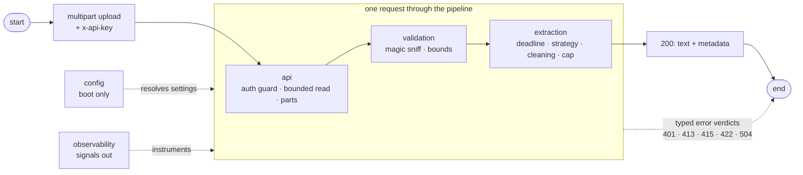

# Document Parser Documentation

Welcome to the document-parser documentation. This guide covers how the service takes a document upload and turns it into extracted text — and how to run, configure, test, and observe it.

**The service in one sentence:** a stateless FastAPI service that accepts a PDF, DOCX, or TXT upload and returns its text — nothing more. One request in, one answer out, no storage anywhere.

## New to the Document Parser?

Start here:

1. **[Quick Start](getting-started/quickstart.md)** — run the service locally and make your first request
2. **[Architecture](concepts/architecture.md)** — how one request flows through the components
3. **[HTTP API](reference/http-api.md)** — the contract every caller gets

## Documentation by Topic

### Getting Started

| Document | What You'll Learn | When to Read |
|----------|-------------------|--------------|
| [Quick Start](getting-started/quickstart.md) | Install, configure, run, first request | First run, new machine |
| [Configuration](getting-started/configuration.md) | Config planes, every env key, fail-fast rules | Changing any setting |

### Concepts

| Document | What You'll Learn | When to Read |
|----------|-------------------|--------------|
| [Architecture](concepts/architecture.md) | Component map, request lifecycle, sync runtime model | Understanding the system |
| [Validation](concepts/validation.md) | The admission gate: sniffing, container checks, bounds | Uploads get rejected |
| [Extraction](concepts/extraction.md) | Strategy pipeline, deadline, cleaning, truncation | Wrong/missing text, timeouts |
| [Observability](concepts/observability.md) | The OTel gate, signals, metric inventory | Dashboards or traces look odd |

### Guides

| Guide | What You'll Learn | When to Read |
|-------|-------------------|--------------|
| [Testing](guides/testing.md) | Unit, integration, and load testing with k6 | Verifying changes |
| [Secrets](guides/secrets.md) | How the API key is stored, resolved, and compared | Provisioning or rotating credentials |
| [Infrastructure](guides/infrastructure.md) | Provisioning AWS secrets, config parameters, and the runtime role — planes, state, teardown | First AWS apply, or something there broke |

### Reference

| Document | What You'll Learn | When to Read |
|----------|-------------------|--------------|
| [HTTP API](reference/http-api.md) | Endpoints, request/response shapes, every status code | Writing or debugging a caller |
| [Make Commands](reference/make.md) | Every make target with its purpose and deep-dive doc | Any command-line work |

## The Request Path at a Glance



Two of the five components never serve a request directly: **config** is resolved once at boot and **observability** only emits signals around the other three.

## Project Structure

```
services/document-parser/
├── app/                    the service
│   ├── main.py             lifespan: wires config, services, observability
│   ├── api/                extract route, key guard, bounded read
│   ├── validation/         admission gate: sniff + container + bounds
│   ├── extraction/         pipeline: strategies, deadline, cleaning, cap
│   ├── config/             config planes, typed settings, factories
│   └── observability/      OTel facade: traces, metrics, logs
├── infra/                  .env planes, compose files, secrets terraform
├── tools/secrets.py        the secrets pipeline driver
├── tests/                  unit + integration + load (k6)
├── specification/          design history for maintainers
└── docs/                   this documentation
```

## Quick Reference

```bash
make install && make env && make run   # local dev with reload
make build && PORT=8000 make up        # docker
make test                              # unit + integration
make load-fixtures && make load-test   # k6 load rig
```

`make help` prints the raw command index; [Make Commands](reference/make.md) is the annotated version.
