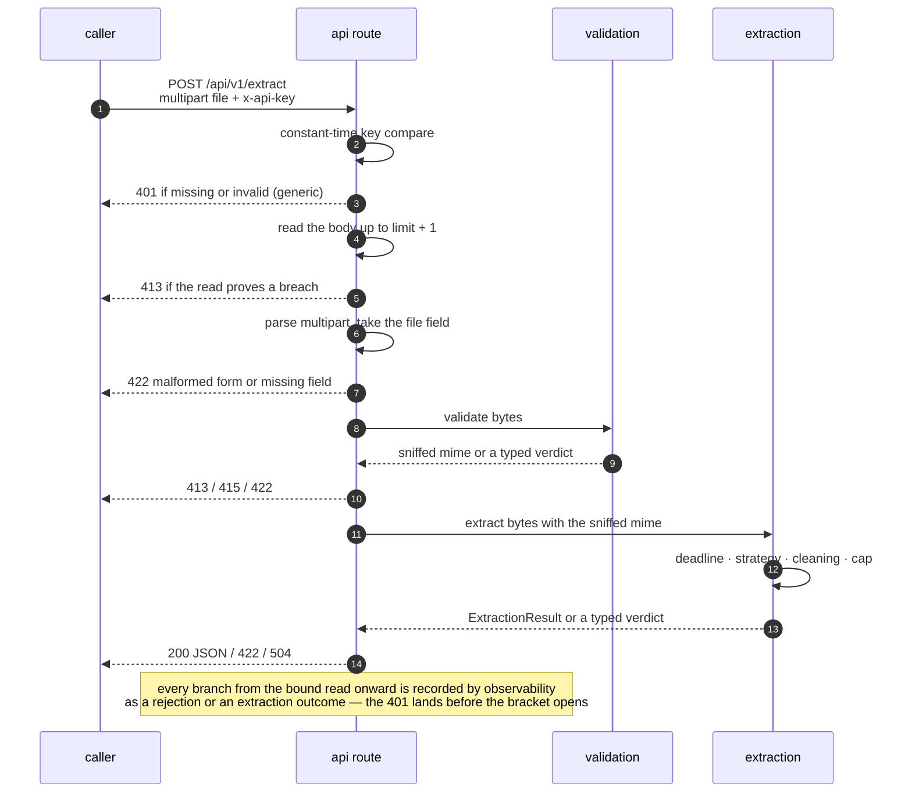
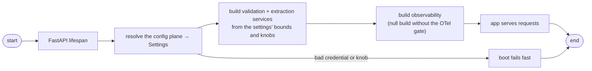

# Architecture

This document explains how one upload becomes extracted text. Read [Quick Start](../getting-started/quickstart.md) first if nothing is running yet.

## What this service is

A stateless text extractor: PDF, DOCX, or TXT goes in as a multipart upload, text comes out as JSON. There is no database, no queue, no cache — every request is self-contained, and one instance holds no state another needs. Concurrency comes from running more instances, not from threading inside one.

## The module map

```
app/
├── main.py            lifespan: resolve config, wire the services, start observability
├── api/               the extract route: key guard, bounded read, multipart parse
├── validation/        admission: is this a document type we accept, within bounds?
├── extraction/        the pipeline: strategies, deadline, cleaning, cap
├── config/            planes (dev env-over-file, prod AWS) and typed Settings
└── observability/     the OTel facade: traces, metrics, logs
```

The layering is strict and inward-facing: `api` orchestrates, `validation` and `extraction` do the two halves of the work, and `config`/`observability` exist to serve the first three. Nothing in the inner layers knows about HTTP.

## What happens on one request



The route itself never parses documents — it only bounds the input, hands bytes to the two inner layers, and translates typed verdicts into HTTP.

Questions the map answers, page by page:

- **Who may call?** → the [HTTP reference](../reference/http-api.md)
- **What gets in?** → [Validation](validation.md)
- **Where does text come from?** → [Extraction](extraction.md)
- **What does the boot read?** → [Configuration](../getting-started/configuration.md)
- **Where do signals go?** → [Observability](observability.md)

## The runtime model: synchronous, deliberately

There is **no worker pool and no executor anywhere**. Extraction runs as a direct call inside the request, on the event loop. If the service must handle more throughput, the answer is more instances — the code stays the simplest thing that works for one instance.

That is safe because of the **cooperative deadline**: the pipeline computes a `Deadline` once from `PROCESSING_BUDGET_SECONDS` on the monotonic clock and passes it down as a value. Strategies check it in their inner loops — between PDF pages, between DOCX members. Three consequences:

- a doomed parse stops ≈ at the budget instead of grinding a thousand-page document to the bitter end
- overshoot is bounded — the worst the pipeline can be late is exactly one page or one member element
- the deadline breach is the shaped `504` itself; no orphaned work ever finishes alone behind an abandoned request

The interior caps (1,000 pages, 30 MiB unpacked DOCX, the output char cap) guarantee termination regardless of the clock.

## Boot model



Nothing is re-resolved per request: both services and the settings hang off `app.state`, built once in the lifespan handler before the app serves anything.

## Canned probes

| Path | Healthy answer |
|------|----------------|
| `GET /api/v1/health` | 200 `{"status":"ok"}` |
| `GET /api/v1/ready` | 200 `{"status":"ready"}` |

Both are open endpoints and stay identical across runtimes, so callers can rely on them.
