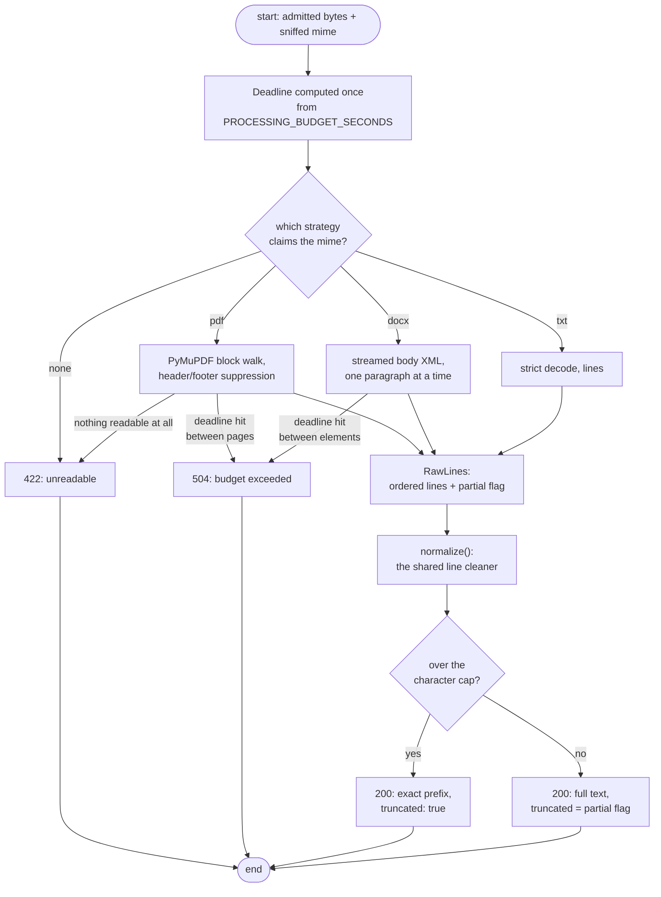
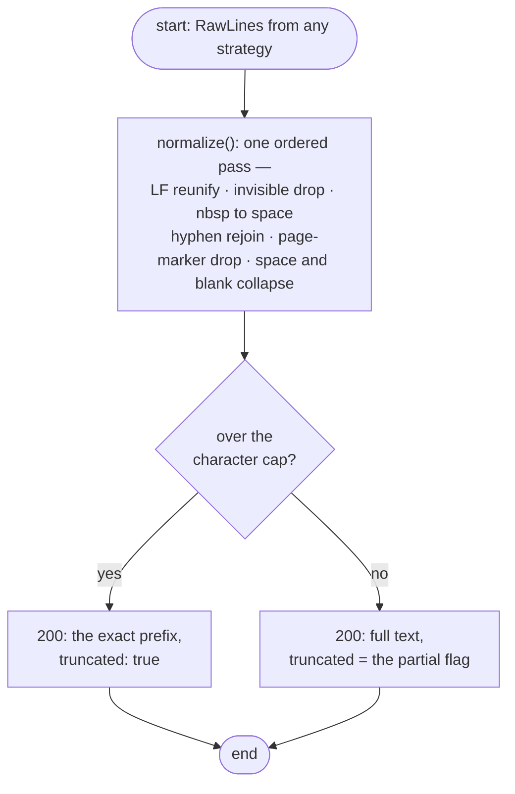
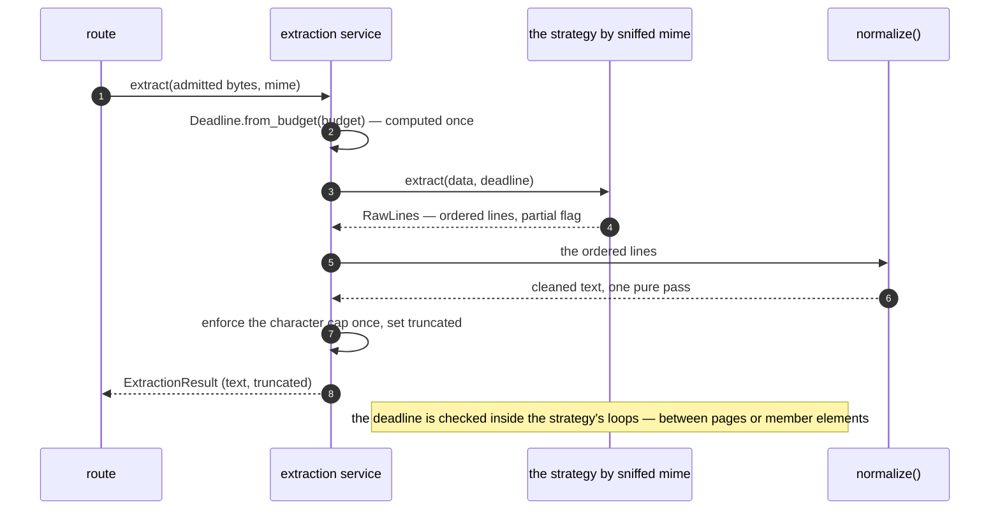
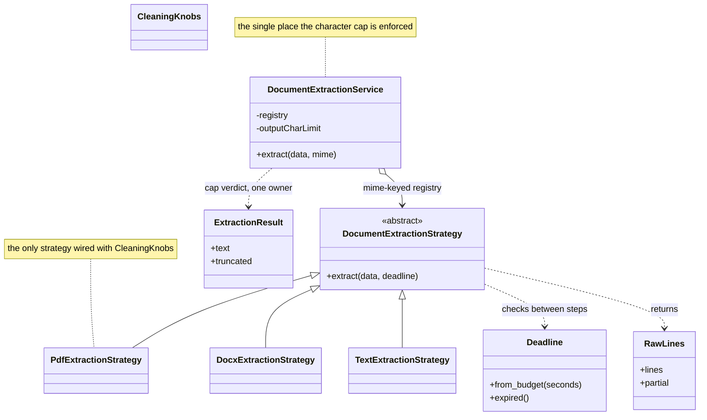
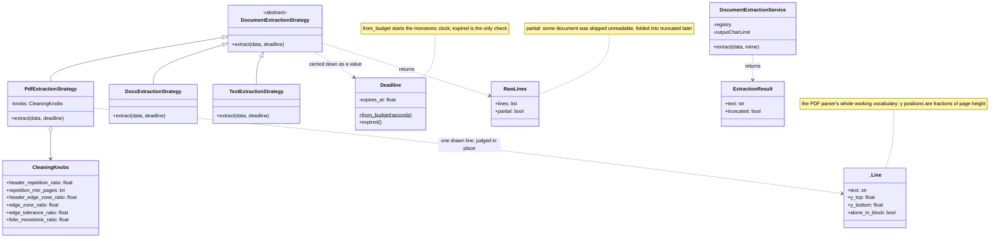
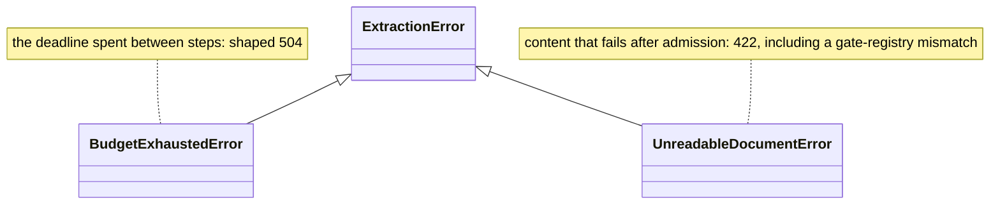

# Extraction

Extraction is the pipeline that turns admitted bytes into cleaned text. It has exactly one job per stage, done once: compute the deadline, hand off to one strategy by the sniffed MIME, clean the raw lines, apply the output cap.

## The pipeline

No strategy ever re-sniffs — dispatch keys on the sniffed MIME the admission gate already decided. The "none" branch is defense in depth: if the gate and the registry ever disagree, it fails closed as `UnreadableDocumentError` (422).

### The tail, apart

Everything after a strategy returns reads this small — cleaning and the cap in one picture.

## One extract call, as a conversation

Who holds the deadline, who owns the cap — in call order.

## The deadline

Computed **once** per request, on the monotonic clock, from `PROCESSING_BUDGET_SECONDS` (10 s by default) and carried down as a value. Strategies check it in their inner loops — between PDF pages, between DOCX members. TXT never checks (one decode is the whole format).

| Question | Answer |
|----------|--------|
| What happens on expiry? | `BudgetExhaustedError` → shaped `504` |
| Why not a hard abort mid-page? | Between-steps checks keep the overshoot ≤ one page or one member element |
| What guarantees termination at all? | The interior caps — 1,000 pages, 30 MiB unpacked XML, 1,000,000 output chars |

## The three strategies

| Strategy | How it reads | What it can add |
|----------|--------------|-----------------|
| **PDF** (`PyMuPDF`) | ordered text blocks with line coordinates, page by page | skips unreadable pages → `partial: true`; the edge-zone suppression below |
| **DOCX** | streams `word/document.xml` with `iterparse`, holding one paragraph at a time | keeps legacy field *results*, drops field *instructions* |
| **TXT** | one strict UTF-8 decode, split into lines | — |

### Reading order preserved, junk suppressed (PDF)

The PDF walker keeps every text block in reading order and records where each line sits on its page (as a fraction of page height). Two rules delete only what deserves deletion:

- **Rule (a) — running headers/footers:** the *same* text (after digit-normalization) appearing near the top or bottom edge on most pages within a tiny vertical drift — banners, corner boilerplate. Placeholder-only keys (`---`, `###`) are ignored so separator art never triggers it.
- **Rule (b) — folio/page numbers:** lines in the edge zone that are alone in their block, shaped like a page number (`- 7 -`, `7`, `vii`, `Page 7 of 30`), where the whole document's candidates read as a mostly-monotonic growing sequence. Position alone never deletes anything — shape, position, and ordering must all agree.

Both rules tune via the cleaning knobs listed in [Configuration](../getting-started/configuration.md); the defaults keep deletions conservative.

## Cleaning: the shared normalizer

`normalize()` is a pure function — strings in, string out — applied to every format identically, in this order:

1. reunify line endings to `\n` (CRLF, old Mac endings, Unicode separators)
2. delete control and invisible characters (zero-width, BOM, soft hyphens)
3. map non-breaking spaces to plain spaces
4. rejoin hyphenated line breaks (`exam-\nple` → `example`)
5. delete whole-line page markers (`Page 3 of 30`, `- 3 -`)
6. collapse space/tab runs, then collapse 3+ consecutive newlines into exactly one blank line

This is also why the load rig's fixture grammar (see [Testing](../guides/testing.md)) deliberately dodges every rule above: for those documents, extraction output equals the fitted text exactly — or the exact capped prefix.

## The cap and the `truncated` flag

One cap, one owner, one flag meaning. The service enforces `OUTPUT_CHAR_LIMIT` (1,000,000 chars) *once, after cleaning*, for all three formats — the old per-parser early-exits (and their TXT bypass) are gone.

| Situation | Response |
|-----------|----------|
| Full text below the cap | `text` complete, `truncated: false` (unless partial) |
| Text over the cap | exactly the first 1,000,000 chars, `truncated: true` — **not an error** |
| PDF with unreadable pages (but some text) | the readable text, `truncated: true` (partial folded in) |

`truncated` says one thing in both cases: *the returned text is not the complete extractable text*. Callers don't — and shouldn't — know why.

## The vocabulary

A handful of frozen dataclasses, one abstract seam, one registry owner. The shapes below stay deliberately small — the next view is the same set with every data member filled in.

## Up close — the strategies and the models they trade

The `_Line` four-tuple is rule (a)/(b)'s entire input: what a drawn line says, where it sat on the page, and whether it owned its block — nothing else about a page is kept. `normalize()` is deliberately absent from the shapes above: a plain function, string in / string out, with no state a class diagram could carry (the [cleaning section](#cleaning-the-shared-normalizer) walks its rules).

## Error classes

Two leaves, one base. Both stay generic on the wire — a 504 cannot say which page, a 422 cannot brand the content.

Admission failures never reach here; this family fires only for bytes the gate already admitted.

## Next Steps

- **[Observability](observability.md)** — how each of these outcomes becomes a metric
- **[HTTP reference](../reference/http-api.md)** — the response shapes the cap rule produces
