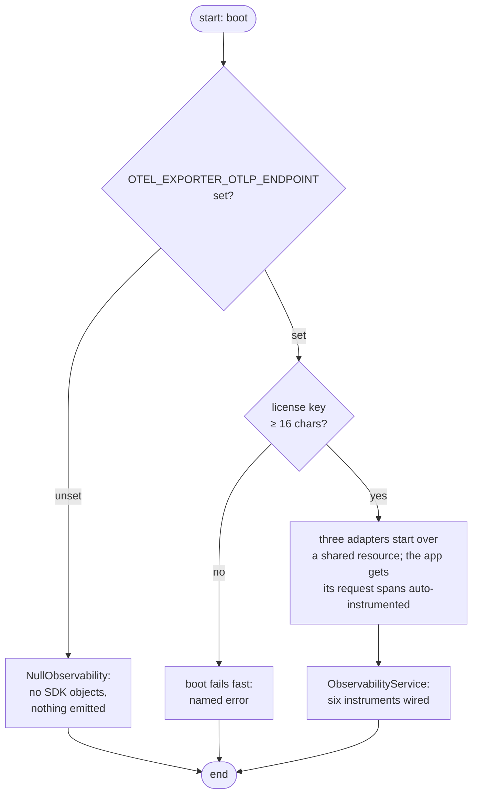
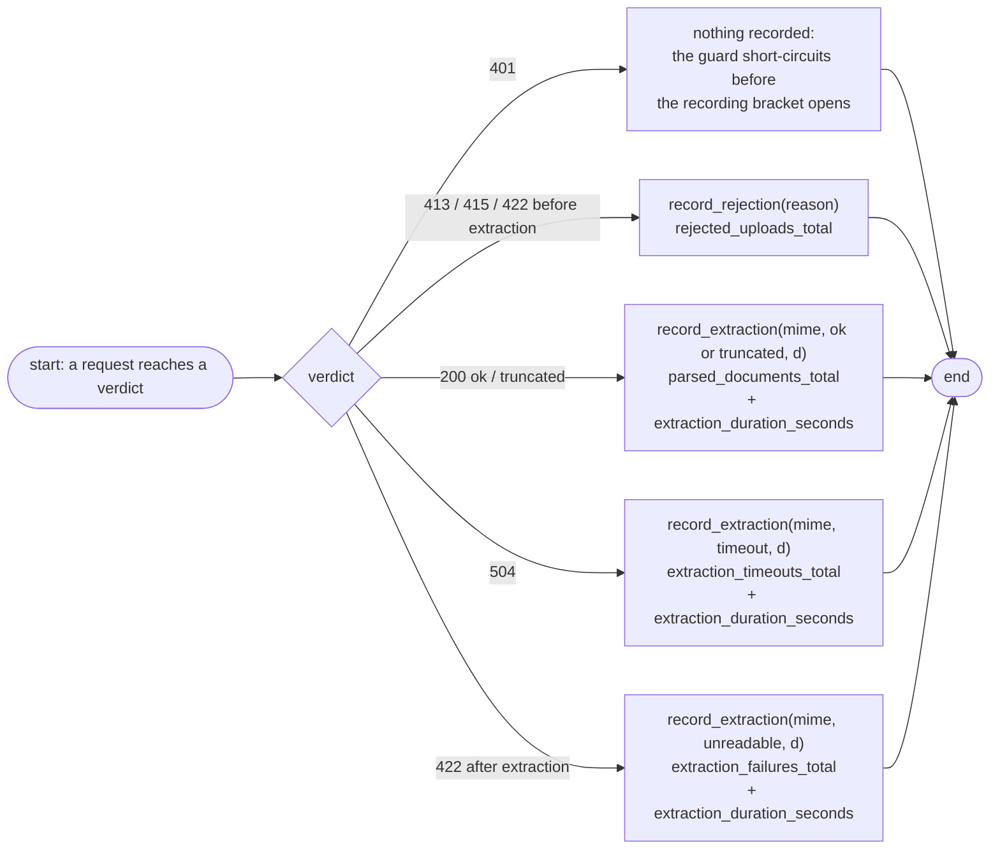
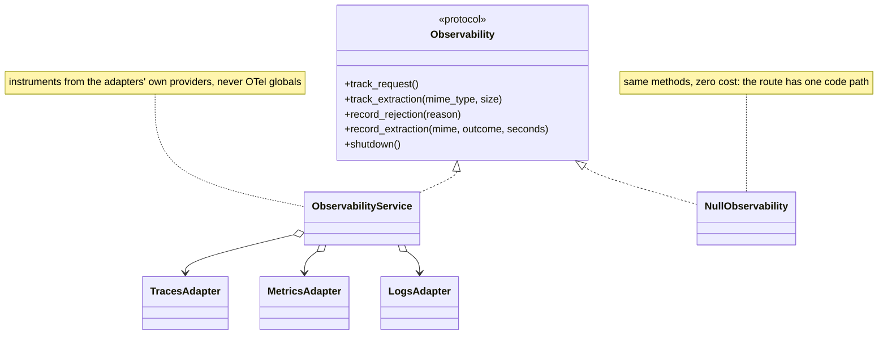
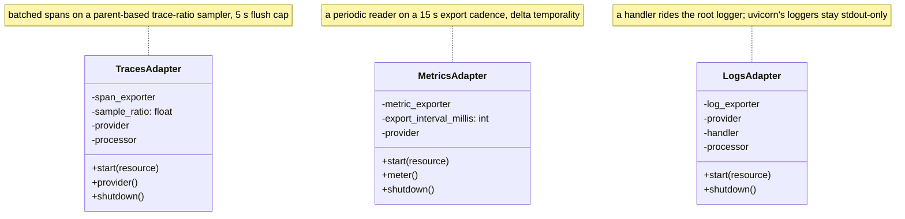
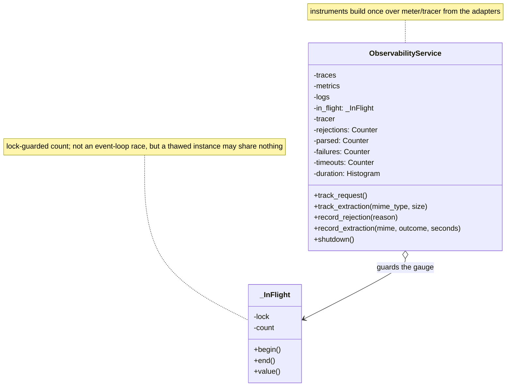

# Observability

The service exports logs, traces, and metrics — or nothing at all. There is no metrics endpoint and no partial state in between: the whole build is switched by one env var, `OTEL_EXPORTER_OTLP_ENDPOINT`.

## The gate

| Endpoint setting | What boots |
|------------------|------------|
| unset | `NullObservability` — zero SDK objects created, every call a no-op |
| set | the full OTel pipeline; requires `NEW_RELIC_LICENSE_KEY` (≥ 16 chars) or the boot fails |

Unset is a *legitimate* configuration, not a degraded one — a disabled boot costs nothing (no SDK objects exist) and the route keeps exactly one code path, because the null build implements the same interface as the wired one. The gate lives in `Settings`: a blank value is normalized to nothing, so one field is the single truth.

## The three signals

| Signal | What it carries | Where it goes |
|--------|-----------------|---------------|
| **Traces** | a span per request (auto-instrumented FastAPI) + a child `extraction` span with `mime_type` and `document_size_bytes` | OTLP/HTTP, gzip, batched (5 s flush window) |
| **Metrics** | the six instruments below | OTLP/HTTP, delta temporality for counters and histograms |
| **Logs** | the standard stdout log stream, ride-along | OTLP/HTTP alongside the rest |

All three adapters start over one shared *resource* (service name, version, deployment environment), so a dashboard can slice any signal by the same identity keys. Sampling is full-rate by default (`OTEL_TRACE_SAMPLE_RATIO: 1.0`). Providers are injected — the OTel global registry is never touched, so tests and parallel boots can't cross one another's wires.

## The metric inventory

Metric names are a contract — dashboards and alerts query them by name, so a rename is a migration, not an edit.

| Instrument | Type | Attributes | Counts |
|------------|------|------------|--------|
| `rejected_uploads_total` | Counter | `reason` | uploads declined before extraction |
| `parsed_documents_total` | Counter | `mime_type`, `status` | successes (`ok`, `truncated`) |
| `extraction_failures_total` | Counter | `mime_type`, `error_type` | admitted-but-unreadable documents |
| `extraction_timeouts_total` | Counter | `mime_type` | deadline breaches |
| `extraction_duration_seconds` | Histogram | `mime_type`, `status` | extraction cost in seconds |
| `in_flight_requests` | ObservableGauge | — | requests currently in the pipeline |

Timeouts are *not* also failures, so sums of the counters never double count.

## What each outcome records

The route hands the facade a typed verdict; the facade maps it to instruments:

Rejection reasons are exactly `too_large`, `unsupported_type`, `corrupt`, `malformed`; extraction outcomes are exactly `ok`, `truncated`, `timeout`, `unreadable`. Both vocabularies are Literals in the interface, so a new attribution value forces its way into the type system before it can reach a metric. The 401 is the one verdict with no metric: the key guard runs before the recording bracket opens, so denied credentials never enter the pipeline's numbers.

## The pieces

### Overview

Two realizations of one seam. The route calls the same five methods regardless of what was installed at boot.

### The adapters up close

Three adapters, one shape: an injected exporter, a provider built exactly once in `start()` against the shared resource, and a 5-second flush cap on the drain. A repeated `start()` — or a `provider()`/`meter()` read before the start — raises a plain `RuntimeError` at boot: a wiring bug fails loudly, same philosophy as config. All three exporters arrive injected, pre-aimed at the OTLP endpoint with license-keyed gzip headers — the adapters own provider lifecycle, not transport.

### The service and the null build, up close

The five frozen instrument names on this shape are the dashboard contract — the full inventory table sits above.

Two design choices worth knowing:

- **Context managers, not begin/end pairs.** A raise inside `track_request()`/`track_extraction()` still closes the bracket — the in-flight gauge can't leak.
- **`shutdown()` drains traces → metrics → logs**, each flush guarded and idempotent, so a failed flush cannot stop the next one.

## Next Steps

- **[Testing](../guides/testing.md)** — how the boot gate and the verdict recordings are tested against the real lifespan
- **[Configuration](../getting-started/configuration.md)** — the OTel key table
