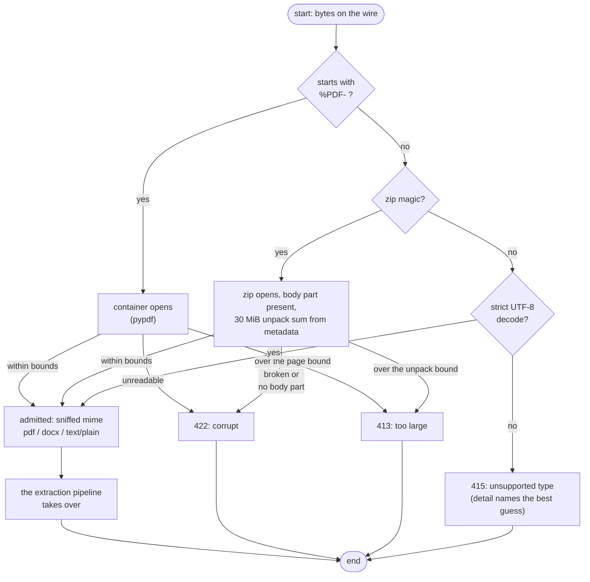
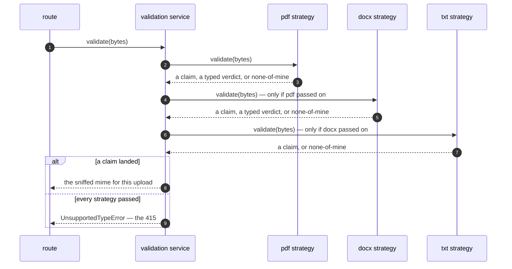
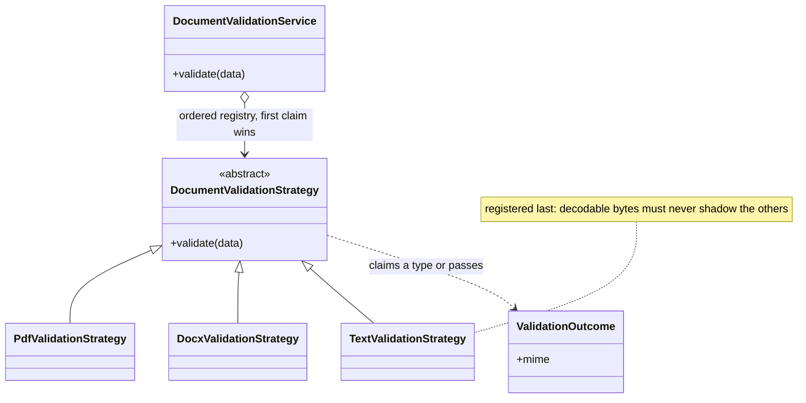
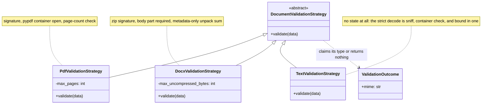
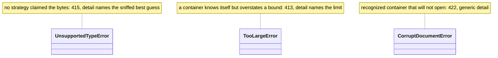

# Validation

This is the admission gate. Before a single content byte is *extracted*, it decides whether the bytes are a document type we accept — and within bounds. Admission is not correctness: it can say "this looks like a PDF within limits" without knowing whether the PDF contains text.

## The one rule: bytes vote, headers don't

The client cannot be trusted to declare content. The `Content-Type` header and the `filename` are metadata only — the first bytes of the body are the whole vote. Each strategy sniffs for a magic signature, then opens the container it recognized, then checks a per-type bound. The sniffed MIME becomes the response's `content_type` and the key that dispatches extraction — so the gate's answer and the pipeline's input are the same value.

## The layers

| Strategy | Layer 1 — sniff | Layer 2 — container | Layer 3 — bound |
|----------|-----------------|---------------------|-----------------|
| PDF | `%PDF-` signature | `pypdf` opens the container | ≤ 1,000 pages |
| DOCX | `PK…` zip header | zip opens, `word/document.xml` present | ≤ 30 MiB unpacked |
| TXT | strict UTF-8 decode | — (the decode is everything) | — (bounded by the upload limit) |

Notes worth having in your head:

- **TXT is last on purpose.** Nearly any text-based upload decodes as UTF-8, so the text strategy registers last — otherwise it would claim bytes the other formats should see first.
- **The DOCX bound is a zip-bomb guard** read entirely from member metadata, before a content byte is touched. Real DOCX files deflate ≈ 8–12×, so legitimate documents pass; bombs run 100×+ and die at the metadata read.
- A recognizable container that will not open is *corrupt* (422), not unsupported (415) — a car that looks like a car but does not open is broken, not another vehicle.

## The walk, once per upload

Every strategy returns *either* a claim *or* "not mine" — the first one that claims the bytes wins. When no strategy does, the gate refuses to guess which format it saw: `UnsupportedTypeError`, whose detail names the best-effort sniff from a magic table (PNG, GIF, legacy MS Word, gzip, …). That naming is diagnostic only — it never admits anything.

## The walk as a conversation

The same walk, told as ordered calls — this is the simplest way to read "ordered registry, first claim wins": an attempt happens only when every strategy before it passed on the bytes.

## The registry

One ordered tuple behind one interface: validation is "ask each strategy, first claim wins." Both this registry and the extraction registry downstream key off the mime it returns — which is why order and silence rules are behavioral, not cosmetic.

## The strategies up close

The strategies carry exactly one piece of state — the bound each was built with at boot. Nothing else is stored; every call judges the bytes in front of it.

## Error classes

Three typed verdicts, each refusing exactly one thing — the route's whole 413/415/422 surface comes from this trio.

| Typed error | Where it maps | Detail on the wire |
|-------------|---------------|--------------------|
| `UnsupportedTypeError` | 415 | names the sniffed best guess |
| `TooLargeError` | 413 | names the limit that was breached |
| `CorruptDocumentError` | 422 | the one generic detail — a corrupt file cannot be branded |

The two bounds on this page are env-configurable (`MAX_PDF_PAGES`, `DOCX_MAX_UNCOMPRESSED_BYTES`) and fail closed to their defaults — see [Configuration](../getting-started/configuration.md). The transport bound (3 MiB by default) is applied even earlier, by the endpoint's bounded read — see the [HTTP reference](../reference/http-api.md).

## Next Steps

- **[Extraction](extraction.md)** — what happens to admitted bytes
- **[Testing](../guides/testing.md)** — the load rig's generated invalid set exercises these verdicts file by file
