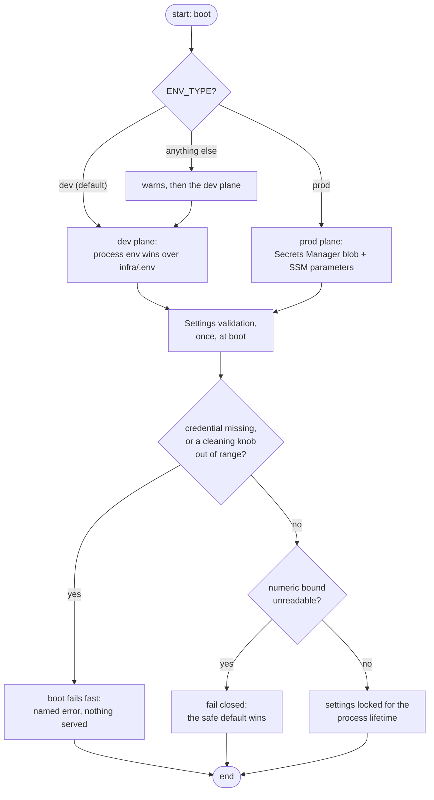
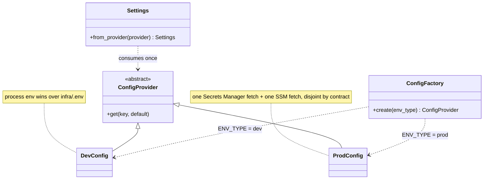
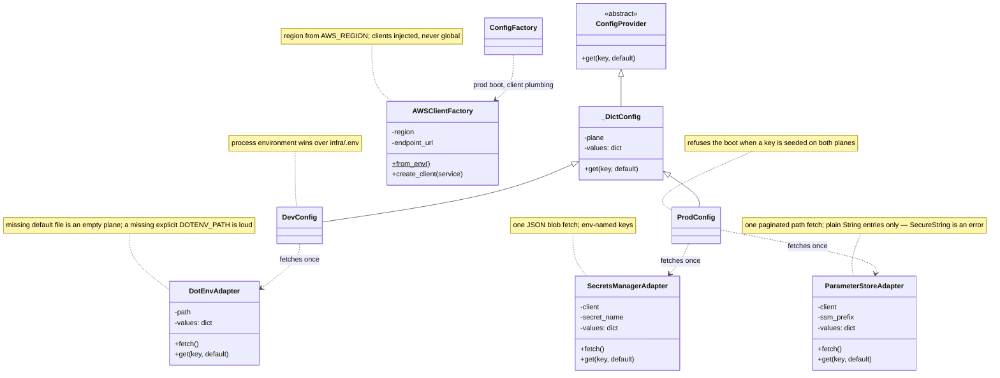
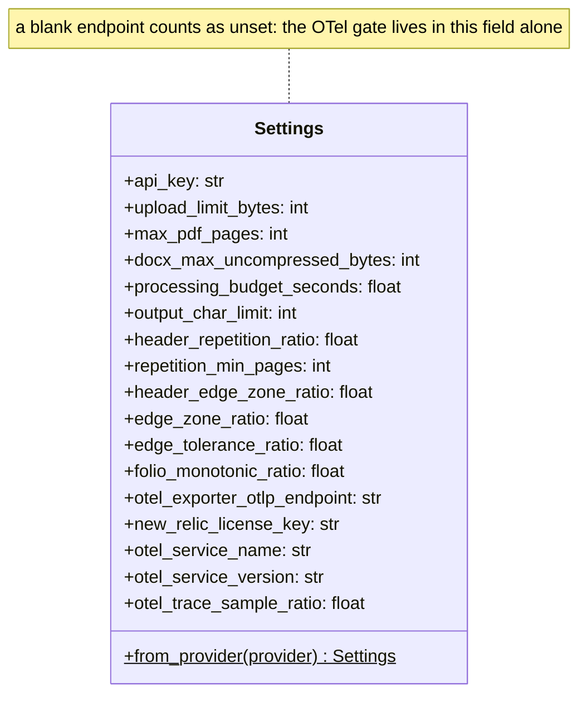
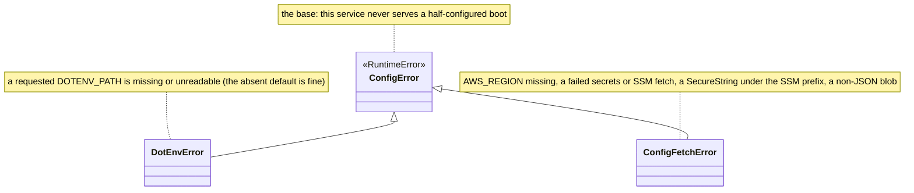

# Configuration

Every setting the service has is resolved **once at boot** from one place — a config plane — and is then frozen for the process lifetime. No request ever re-reads config, and no seeded change takes effect until a restart.

## The plane flick

One env var decides which plane the boot reads — a two-position flick. The flick is itself read only from the process environment — never from a file or AWS:

| `ENV_TYPE` | Plane |
|------------|-------|
| `dev` (default) | Developer plane |
| `prod` | Prod plane |
| anything else | Warns, boots the dev plane |

## Developer plane

`DevConfig` merges two sources, process environment winning over `infra/.env`:

- `infra/.env` — created by `make env` from the committed template; the docker compose stack feeds it to containers the same way
- the process environment — so a container or a test run needs no file at all

A missing file at the default location is fine (values then come from the environment); an explicitly requested-but-missing path (`DOTENV_PATH`) fails the boot loudly. Set `DOTENV_PATH` to point the reader at a different file.

## Prod plane

`ProdConfig` fetches two disjoint AWS sources once, at adapter construction:

- **Secrets Manager** — one JSON blob of env-named keys (secrets: the API key, license key)
- **SSM parameters** — plain settings under a reserved prefix

The two planes are disjoint by contract; a key found on both fails the boot with an operator-facing error. A key seeded after boot stays invisible until restart. Seeding and rotation are the [secrets guide's](../guides/secrets.md) `make secrets-*` flow.

## Every key

Field names are the env keys, uppercased. Unknown keys are ignored (consume-first), so typos in unused keys degrade harmlessly. Every key below carries a default — except the credential, whose absence stops the boot.

| Key | What it controls | Default | Bad value behavior |
|-----|------------------|---------|--------------------|
| `API_KEY` | the shared secret callers present as `x-api-key` | — | **boot fails** unless non-empty and ≥ 16 chars |
| `ENV_TYPE` | plane selection | `dev` | falls to dev with a warning |
| `UPLOAD_LIMIT_BYTES` | max request body (transport gate) | 3 MiB | falls back to default |
| `MAX_PDF_PAGES` | PDF page bound (admission) | 1,000 | falls back to default |
| `DOCX_MAX_UNCOMPRESSED_BYTES` | DOCX unpack bound (zip-bomb guard) | 30 MiB | falls back to default |
| `PROCESSING_BUDGET_SECONDS` | the cooperative deadline | 10 s | falls back to default |
| `OUTPUT_CHAR_LIMIT` | text cap before truncation | 1,000,000 | falls back to default |
| `HEADER_REPETITION_RATIO` | rule (a): share of pages a header must repeat on | 0.8 | **boot fails** |
| `REPETITION_MIN_PAGES` | rule (a): minimum pages for aggregate evidence | 4 | **boot fails** if < 2 |
| `HEADER_EDGE_ZONE_RATIO` | rule (a): top/bottom band to search | 0.20 | **boot fails** if ≥ 0.5 |
| `EDGE_ZONE_RATIO` | rule (b): top/bottom band for folio candidates | 0.10 | **boot fails** if ≥ 0.5 |
| `EDGE_TOLERANCE_RATIO` | rule (a): allowed drift of a header's vertical position | 0.02 | **boot fails** |
| `FOLIO_MONOTONIC_RATIO` | rule (b): share of candidates that must grow monotonically | 0.70 | **boot fails** |
| `OTEL_EXPORTER_OTLP_ENDPOINT` | the observability gate — see below | unset | unset is a legitimate disabled boot |
| `NEW_RELIC_LICENSE_KEY` | ingest license key for the OTLP endpoint | unset | **boot fails** if the endpoint is set without a ≥ 16-char key |
| `OTEL_SERVICE_NAME` | resource name attached to all signals | `document-parser` | — |
| `OTEL_SERVICE_VERSION` | resource version | unset | — |
| `OTEL_TRACE_SAMPLE_RATIO` | fraction of traces sampled, `(0, 1]` | 1.0 | **boot fails** |
| `PORT` | host port for docker compose | 8000 | compose-only helper |
| `DOTENV_PATH` | location of the dev `.env` file | `infra/.env` | adapter-only |
| `SECRET_RECOVERY_WINDOW` | real-AWS seeding only: days the secret survives a destroy, `0` skips the window | 30 | seeding stops with a named error before terraform (the emulator plane ignores this key) |

The split that matters: **numeric bounds fail closed** (an unreadable value falls back to the safe default, boot continues) — **credentials and cleaning knobs fail the boot** (a deletion-rule threshold must never silently loosen).

## How a boot resolves

## The pieces, small to large

### Overview

Two planes behind one interface answer `get`; the factory wires exactly one of them per boot; `Settings` consumes the plane once and becomes the app's whole configuration. The next three views drill into the same shapes.

### The adapters behind the planes

Every adapter follows one contract: fetch **once at construction**, cache the values in memory, hand out copies via `fetch()`/`get()`. Neither plane ever refetches. The AWS adapters receive injected clients — `AWSClientFactory` reads `AWS_REGION` (plus an optional emulator endpoint) and hands out boto3 clients; tests inject fakes instead, which is why `ConfigProvider` stays importable without AWS.

### Settings, field by field

Seventeen fields are the app's typed contract — the same list as the env-key table above, seen from the inside. Validation runs inside the same construction: the numeric bounds and budget coerce through before-validators and fail closed, the six cleaning knobs enforce their ranges as field validators, and the credential-plus-OTel gate lives in a model-level check.

## Error classes

Config owns the one vocabulary that can stop the boot before anything serves.

| Error | Raised when |
|-------|-------------|
| `DotEnvError` | an explicitly set `DOTENV_PATH` points at a missing or unreadable file |
| `ConfigFetchError` | `AWS_REGION` missing on a prod boot, a failed Secrets Manager/SSM fetch, a `SecureString` found under the SSM prefix, a non-JSON secrets blob |
| `ConfigError` (direct) | a key is seeded on **both** prod planes — the error names the duplicates |

## Next Steps

- **[Secrets guide](../guides/secrets.md)** — provisioning the credentials this page reads
- **[Quick Start](quickstart.md)** — get a working local boot first
