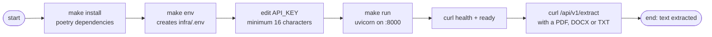

# Quick Start

Get the service running locally, then make your first extraction request. The whole loop is `make install` → `make env` → `make run`.

## Steps

1. **Install dependencies** (Poetry manages Python 3.14):

   ```sh
   make install
   ```

2. **Create the env file** — copies `infra/.env.example` to `infra/.env` if missing:

   ```sh
   make env
   ```

3. **Set a real API key** by editing `infra/.env` — the boot enforces one rule: the value must be at least 16 characters (yes, the example placeholder legalistically passes that floor, which is exactly why it pays to replace it before anything real listens):

   ```ini
   API_KEY=my-secret-key-16-chars-min
   ```

   The [secrets guide](../guides/secrets.md) covers where credentials live properly.

4. **Run the service:**

   ```sh
   make run
   ```

5. **Verify with the probes** (no key needed):

   ```sh
   curl http://localhost:8000/api/v1/health
   # {"status":"ok"}
   curl http://localhost:8000/api/v1/ready
   # {"status":"ready"}
   ```

6. **Extract something:**

   ```sh
   curl -X POST http://localhost:8000/api/v1/extract \
     -H "x-api-key: my-secret-key-16-chars-min" \
     -F "file=@./a-document.pdf"
   # 200: {"filename":"a-document.pdf","content_type":"application/pdf",
   #       "text_length":15234,"text":"…","truncated":false}
   ```

## The first-run path



## Docker instead

```sh
make build
PORT=8000 make up     # shell PORT wins over the env file's
curl http://localhost:8000/api/v1/health
make down
```

The compose stack reads `infra/.env` wholesale, so the same config drives both ways of running.

## Next Steps

- **[Configuration](configuration.md)** — what every key does and what happens when one is wrong
- **[Testing](../guides/testing.md)** — verify your setup with unit, integration, and load tests
- **[HTTP API](../reference/http-api.md)** — the full request/response contract

| Command | What it does |
|---------|--------------|
| `make help` | the full command index |
| `make test` | unit + integration suites |
| `make logs` | follow docker logs |
| `make down` | stop the docker stack |
