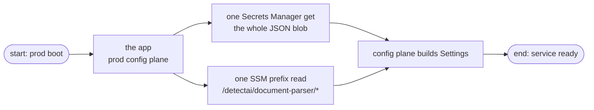
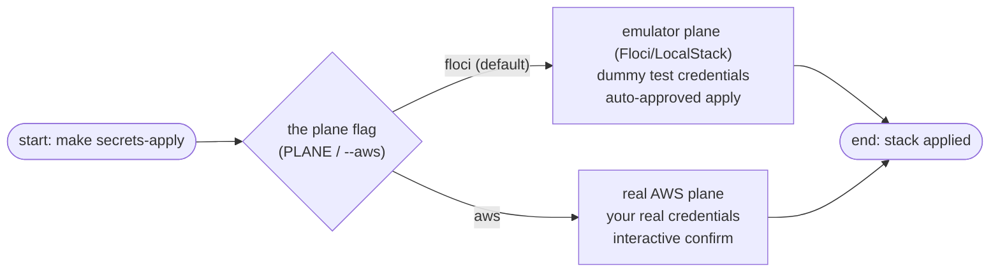
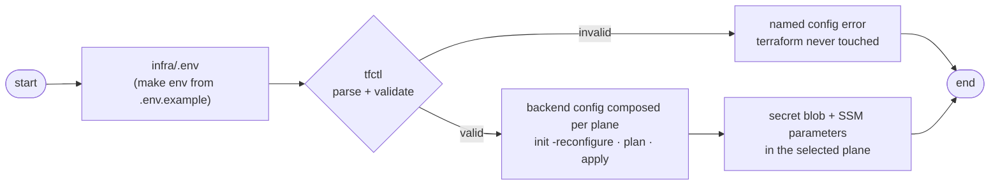

# Infrastructure

How this service's app-side AWS slice gets provisioned: the credential store and the non-secret config parameters — and no IAM of any kind. Driven by make targets at the service root; the engine behind them is [`tfctl`](../../../tools/tfctl/docs/README.md), whose one shared terraform stack lives in `tools/tfctl/app/kinds/secrets/stack/`. Read the [secrets guide](secrets.md) first if you are here for how the key is handled at runtime — this page is about provisioning it. The stack does not deploy the app: terraform manages only what the app *reads*.

## What the stack creates

| Resource | Name | Who reads it, when |
|----------|------|--------------------|
| Secrets Manager blob | `detectai/document-parser/secrets` | the prod config plane at boot — one fetch of a JSON blob whose keys are env names (`API_KEY`, license key) |
| SSM parameters | `/detectai/document-parser/<KEY>` | the prod config plane at boot — non-secret runtime config, seeded from the `.env` allowlist (the `ssm.keys` list in the service's `secrets.toml`) |

Because the blob is read whole at boot, adding a key later is a terraform-only change — no consumer-side schema migration. No S3 in the stack (the app is stateless, so the state bucket is deploy-tooling territory, not a stack resource) and no IAM: the app reads the blob and the prefix under whatever identity its environment carries — the stack's job is data, not permissions.



### The seeder identity

| Role | Created by | Can do |
|------|------------|--------|
| `detectai-document-parser-seeder` (seeder, out-of-stack) | any carrier verb, on demand | the single carrier for this service's AWS writes — state-bucket lifecycle, secret and SSM write/read (`seeder-policy`), trusting your identity with MFA |

- Trust: **your ambient caller, auto-detected** (`aws sts get-caller-identity` under personal credentials — an assumed-role session strips down to its base role).
- Carrier verbs assume the seeder role with your MFA code for a **12-hour session** — the STS role-session ceiling — and inject that temporary triplet as env credentials: they outrank any local profile, so nothing is written to `~/.aws`.
- The triplet is cached in gitignored `tools/tfctl/.session-cache/<service>.json` (`make secrets-session-clear` drops the service's entry, `tfctl session-clear-all` drops every one, and `tfctl session-refresh-all` mints every ready service's triplet in one run behind a single MFA code — `--force` re-mints, `--dry-run` just lists), so a plan → apply stretch prompts for the code once. The driver prints `carrier: role session (…, valid mm:ss)` on every run, and refuses to run when the ambient identity already *is* a seeder session (stale exported `AWS_*` triplets fail loudly instead of bypassing the role).
- An assumed-role caller cannot derive an MFA device — the verb dies and asks you to ride your IAM user credentials instead.
- Before every session resolve — cached or fresh — the role is created when missing — true right after a full wipe, or whenever the emulator restart lost it — and an existing one is reconciled: trust re-anchored to the caller, 12-hour cap raised, `seeder-policy` re-attached on drift. Convergence is what keeps a policy change from outliving a still-valid cached triplet; a converged role passes silently, and a cached session only skips the assume and its MFA prompt.
- The role teardown (`--drop-seeder`) is the one step outside the carrier session: a role cannot assume itself, so it runs on your personal credentials.

## Two planes

One stack, two destinations, flipped by the verb's plane flag (`--floci`, the default, or `--aws`):



| | Emulator (Floci/LocalStack) | Real AWS |
|--|-----------------------------|----------|
| Selected by | the default plane flag (`--floci`) | the explicit `--aws` flag |
| Credentials | dummy `test`/`test`, any profile stripped | ambient personal creds; verbs ride an MFA-gated seeder role session (env triplet) |
| State bucket | `detectai-document-parser-tfstate-000000000000` (derived; created on demand) | `detectai-document-parser-tfstate-<your account>` (derived) |
| Secret deletion | instant (0-day recovery window) | 30-day recovery window (`SECRET_RECOVERY_WINDOW` seeds 0 or 7–30 instead) |
| Apply | auto-approved | interactive confirm |

The provider block adapts itself (`providers.tf`): the emulator plane gets `test` credentials, `skip_*` flags, and endpoint overrides for `secretsmanager`, `ssm`, `iam`, `sts`; the real-AWS plane leaves all of that unset. The stack itself is addressed entirely by service-pinned names (`detectai/...`) — nothing in it reads an account id. One caveat: the emulator accepts every IAM call but **never enforces IAM policies** — a green apply there proves structure only; enforcement bites on real AWS.

## The provisioning pipeline

`infra/.env` → `tfctl` (parse → validate → `TF_VAR_*`) → terraform → the selected plane. Terraform never reads `.env`; the engine is the only bridge, and it prints secrets only as lengths and fingerprints, never values.



Validation repeats at three layers on purpose (defense-in-depth, not duplication): the engine checks human input before terraform runs, `tools/tfctl/app/kinds/secrets/stack/variables.tf` protects the stack, and `app/kinds/secrets/stack/modules/secrets-plane/variables.tf` protects the contract for any caller. There are no `backend.*.hcl` files — the engine composes the backend config (bucket, key, region, per-plane flags) into a temp file and feeds `init -reconfigure`; bare `terraform init` is never valid in `tools/tfctl/app/kinds/secrets/stack`.

## First-time setup

From the service root (`services/document-parser`):

```sh
make env                        # create infra/.env from the example; set a real API_KEY
make secrets-check              # validate .env, preview plane and vars (no terraform, no AWS)
make secrets-plan               # plan against the selected plane
make secrets-apply              # apply (auto on the emulator, confirm on real AWS)
```

No bootstrap step: the first carrier verb creates the state bucket
(`detectai-document-parser-tfstate-<account>`) and the seeder role when they are
missing, then assumes the role. On real AWS that first assume asks for your MFA
code and caches the 12-hour session; on the emulator it is prompt-free. One
versioned bucket per (service, account) keeps parallel testing from colliding
on one ledger.

## Verifying after apply

`make secrets-verify` reads the live plane directly — SSM parameters under the prefix (paginated), plus the secret's status and stored blob — and matches them against what `infra/.env` would seed: reality, not terraform's ledger. No value ever prints; rows carry lengths and short SHA-256 fingerprints only, and a fingerprint equal to the one computed from `.env` proves the stored value is the one you configured.

```text
ssm:     /detectai/document-parser/
  MAX_PDF_PAGES              String   len 4   fp 3f2b9a1d8c4e
  ...
secret:  detectai/document-parser/secrets
  API_KEY                             len 22  fp 9d8f3c1a2b4e
ok:      the seeded plane matches infra/.env
```

Anything on the plane that `.env` does not seed is flagged `extra` and listed as a note; anything expected but missing, fingerprint-different, or a secret scheduled for deletion is a `problem:` line and exits `1`. On real AWS it rides the same MFA-gated seeder session as the other carrier verbs.

## Teardown

| Command | Removes | Keeps |
|---------|---------|-------|
| `make secrets-clean` | the secret + versions, the SSM parameters (terraform destroy) | state bucket, ledger, seeder role |
| `make secrets-destroy` | everything above, **plus** every object version, the state bucket itself, and (`--drop-seeder`) the seeder role | nothing |
| `make secrets-drop-seeder` | the seeder policy and role only (your personal credentials — the role cannot delete itself) | state bucket, ledger, stack resources |

- `terraform destroy` never touches the state bucket — only `secrets-destroy` deletes it, and only after destroy succeeded. Teardown runs unattended: destroy auto-approves, and the purge prints its summary — warning when the bucket holds objects outside `document-parser/` (wiping a shared sandbox bucket takes sibling stacks' state with it) — before the run.
- Destroy schedules the secret into the recovery window (30 days, or whatever `SECRET_RECOVERY_WINDOW` seeded); `0` in `.env` means no window at all. Skipping an existing window needs `--force-delete`: `make secrets-clean FORCE_DELETE=1`, or directly, `poetry -C ../../tools/tfctl run tfctl --service document-parser destroy --force-delete`.
- After `secrets-clean`, re-applying is just `make secrets-apply` — init reuses the kept ledger, which now holds empty state.

## Good to know

- The state ledger is derived per (service, account), and the two planes hold separate state keys (`document-parser/floci/…` vs `document-parser/…`) — a change of region or account points terraform at a different, empty ledger; `plan` offers to recreate everything, and nothing migrates.
- The emulator's S3 and Secrets data is in-memory: a container restart can drop it. Any terraform verb recreates the bucket, so a bare `make secrets-apply` rebuilds the whole plane.
- Real AWS needs Terraform ≥ 1.10 for the `use_lockfile` backend flag.
- The state file stores `secret_string` in plaintext — keep the prod bucket versioned, encrypted, and access-restricted.
- The full command surface (including `--dry-run` previews) is `tfctl`; the make targets are the thin wrappers listed in [Make Commands](../reference/make.md).

## Testing

- `terraform test` (from `tools/tfctl/app/kinds/secrets/stack/`, mocked AWS provider, no emulator or real AWS) asserts the slug drives every name at the stack level: the secret contract name and the `/detectai/<slug>/` SSM prefix are outputs of the slug, seeded parameters land on the service prefix, and an unset SSM map seeds nothing.
- `make secrets-test` — pytest for the tfctl engine (the unit tier); the tier-by-tier story is [tfctl's testing guide](../../../tools/tfctl/docs/guides/testing.md).

## Next Steps

- **[Secrets](secrets.md)** — where the credential lives per plane and how the runtime resolves it
- **[Make Commands](../reference/make.md)** — every make target, annotated
- **[tfctl documentation](../../../tools/tfctl/docs/README.md)** — the engine behind all of this, from quick start to CLI reference
