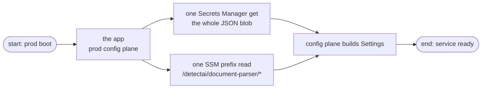
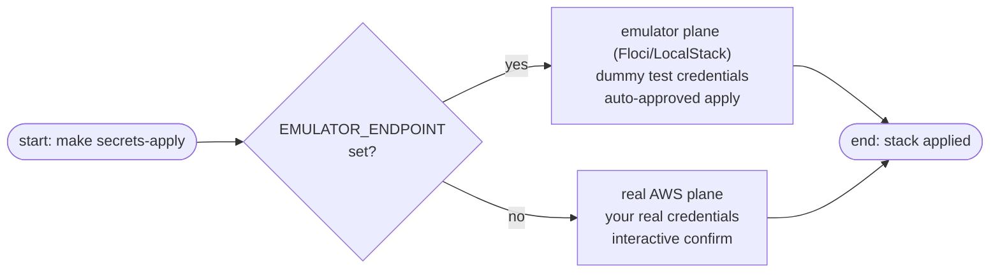
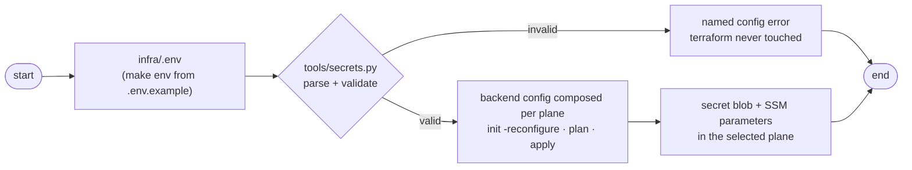

# Infrastructure

How this service's app-side AWS slice gets provisioned: the credential store and the non-secret config parameters — and no IAM of any kind. Driven by make targets at the service root; the terraform stack lives in `infra/terraform/`. Read the [secrets guide](secrets.md) first if you are here for how the key is handled at runtime — this page is about provisioning it.

The stack does not deploy the app. The app runs locally (`make run`) or through compose; terraform manages only what the app *reads*.

## What the stack creates

| Resource | Name | Who reads it, when |
|----------|------|--------------------|
| Secrets Manager blob | `detectai/document-parser/secrets` | the prod config plane at boot — one fetch of a JSON blob whose keys are env names (`API_KEY`, license key) |
| SSM parameters | `/detectai/document-parser/<KEY>` | the prod config plane at boot — non-secret runtime config, seeded from the `.env` allowlist (`SSM_SEED_KEYS` in `tools/secrets.py`) |

Because the blob is a JSON object read whole at boot, adding a key later is a terraform-only change — no consumer-side schema migration. There is no S3 in the stack: the app is stateless, so the state bucket is deploy-tooling territory, not a stack resource. And there is no IAM: the app reads the blob and the prefix under whatever identity its environment carries — the stack's job is data, not permissions.



### The seeder identity

| Role | Created by | Can do |
|------|------------|--------|
| `detectai-document-parser-seeder` (seeder, out-of-stack) | `make secrets-seeder-bootstrap`, one-time | the single carrier for this service's AWS writes — state-bucket lifecycle, secret and SSM write/read (`seeder-policy`), trusting your identity with MFA |

With the stack creating no IAM, the identity picture stays one-deep, and real AWS needs no manual setup: the seeder trusts **your ambient caller, auto-detected** (`aws sts get-caller-identity` under your personal credentials — an assumed-role session strips down to its base role), or a pinned `SEEDER_TRUST_USER_ARN` when you want to fix it. Every carrier verb then assumes the seeder role with your MFA code for a 12-hour session — the STS role-session ceiling — and injects that temporary triplet as env credentials — they outrank any local profile, so nothing is ever written to `~/.aws`. The triplet is cached in gitignored `infra/.aws-session.json` (`make secrets-session-clear` drops it), so a plan → apply stretch prompts for the code once. `secrets-seeder-bootstrap` and the role teardown are the exceptions: they run on your personal credentials, because a role cannot create or delete itself. The driver prints `carrier: role session (…, valid mm:ss)` on every run so a bypass is visible in the transcript. On a second laptop the same role is reused as-is — bootstrap is once per AWS account, not per machine.

## Two planes

One stack, two destinations, flipped by `EMULATOR_ENDPOINT` in `infra/.env`:



| | Emulator (Floci/LocalStack) | Real AWS |
|--|-----------------------------|----------|
| Selected by | `EMULATOR_ENDPOINT` set | line empty or removed |
| Credentials | dummy `test`/`test`, any profile stripped | ambient personal creds; verbs ride an MFA-gated seeder role session (env triplet) |
| State bucket | `TF_STATE_BUCKET`, or default `detectai-docparser-tfstate` when unset | `TF_STATE_BUCKET` (required) |
| Secret deletion | instant (0-day recovery window) | 30-day recovery window (`SECRET_RECOVERY_WINDOW` seeds 0 or 7–30 instead) |
| Apply | auto-approved | interactive confirm |

The provider block adapts itself (`providers.tf`): the emulator plane gets `test` credentials, `skip_*` flags, and endpoint overrides for `secretsmanager`, `ssm`, `iam`, `sts`; the real-AWS plane leaves all of that unset. The stack itself is addressed entirely by service-pinned names (`detectai/...`) — nothing in it is IAM, so no account-id plumbing exists; the seeder's CLI verbs derive the account from the detected or pinned trust principal.

One caveat: the emulator accepts every IAM call but **never enforces IAM policies**, so a green apply there proves structure only — enforcement bites on real AWS.

## The provisioning pipeline

`infra/.env` → `tools/secrets.py` (parse → validate → `TF_VAR_*`) → terraform → the selected plane. Terraform never reads `.env`; the Python tool is the only bridge. The driver prints secrets only as lengths, never values.



Validation repeats at three layers on purpose (defense-in-depth, not duplication): the tool checks human input before terraform runs, `infra/terraform/variables.tf` protects the stack, and `modules/document-parser/variables.tf` protects the contract for any caller.

There are no `backend.*.hcl` files. The tool composes the backend config (bucket, key, region, per-plane flags) into a temp file and feeds `init -reconfigure` — never run bare `terraform init`.

## First-time setup

From the service root (`services/document-parser`):

```sh
make env                        # create infra/.env from the example; set a real API_KEY
make secrets-check              # validate .env, preview plane and vars (no terraform, no AWS)
make secrets-seeder-bootstrap   # one-time: the out-of-stack seeder role (the state/secrets/config carrier)
make secrets-bootstrap-state    # create the state bucket for the selected plane (idempotent)
make secrets-plan               # plan against the plane .env selects
make secrets-apply              # apply (auto on the emulator, confirm on real AWS)
```

The seeder role must exist before the first carrier verb: on real AWS `secrets-bootstrap-state`, `plan`, and `apply` all assume it, so the first such verb asks for your MFA code and caches the session for the 12-hour window. On the emulator the order is only a formality (nothing prompts), but keeping it keeps both planes identical. The state bucket must exist before the first `init`. On the emulator an unset `TF_STATE_BUCKET` falls back to the fixed local default; on real AWS a bucket name is required — a sandbox bucket per engineer, versioned and encrypted (bootstrap enables versioning), so parallel testing never collides on one ledger.

## Teardown

| Command | Removes | Keeps |
|---------|---------|-------|
| `make secrets-clean` | the secret + versions, the SSM parameters (terraform destroy) | state bucket, ledger, seeder role |
| `make secrets-destroy` | everything above, **plus** every object version, the state bucket itself, and (`--drop-seeder`) the seeder role | nothing |
| `make secrets-drop-seeder` | the seeder policy and role only (your personal credentials — the role cannot delete itself) | state bucket, ledger, stack resources |

Two rules make these safe to reach for:

- **`terraform destroy` never touches the state bucket** — it is backend storage, not a stack resource. Only `secrets-destroy` deletes it, and only after destroy succeeded.
- **On real AWS, `secrets-destroy` asks for the typed bucket name** before destroying anything — a refusal cancels the run. It also warns when the bucket holds objects outside `document-parser/`, since wiping a shared sandbox bucket takes sibling stacks' state with it.

After `secrets-clean`, re-applying is just `make secrets-apply` again — init reuses the kept ledger, which now holds empty state. Destroying on real AWS schedules the secret into the 30-day recovery window; skipping it needs `--force-delete`, which has no make wrapper: `poetry run python tools/secrets.py destroy --force-delete`. `SECRET_RECOVERY_WINDOW` in `infra/.env` takes the other road: `0` seeds the blob without a window, so `terraform destroy` itself deletes immediately and leaves no reservation to wait out; `7–30` keeps an AWS window; unset keeps the 30-day default. The emulator plane always uses 0 and ignores the key.

## Good to know

- The state *key* is fixed per plane (`document-parser/terraform.tfstate` vs `document-parser/floci/terraform.tfstate`); the *bucket* is per engineer. Changing the bucket or region after a first apply points terraform at a new empty ledger — `plan` offers to create everything again, nothing migrates.
- The emulator's S3 and Secrets data is in-memory: a container restart can drop it. Recovery is cheap — any terraform verb recreates the bucket itself, so a bare `make secrets-apply` rebuilds the whole plane.
- The real-AWS plane needs Terraform ≥ 1.10 for the `use_lockfile` backend flag.
- The seeder session lives in `infra/.aws-session.json` (gitignored, owner-only). Delete it or run `make secrets-session-clear` whenever you want the next verb to prompt for a fresh MFA code; the tool also refuses to run when the ambient identity *is* a seeder session, so stale exported triplets fail loudly instead of bypassing the role.
- The state file stores `secret_string` in plaintext — keep the prod bucket versioned, encrypted, and access-restricted.
- The full command surface (including `--dry-run` previews) is `tools/secrets.py`; the make targets are the thin wrappers listed in [Make Commands](../reference/make.md).

## Testing

Two suites cover this area, and they are not the same thing:

- `terraform test` (run from `infra/terraform/`) — `tests/document-parser.tftest.hcl`, mocked AWS provider, no emulator or real AWS needed. Asserts the contract name is the output, the emulator plane keeps a 0-day recovery window, the prod plane keeps 30 days, and SSM seeding follows the `/detectai/document-parser/` prefix only (an unset map seeds nothing).
- `make secrets-test` — pytest of the pipeline driver itself (`tests/unit/config/test_secrets_tool.py`): the `.env` parse and validation layer.

## Next Steps

- **[Secrets](secrets.md)** — where the credential lives per plane and how the runtime resolves it
- **[Configuration](../getting-started/configuration.md)** — the config planes that consume these resources
- **[Make Commands](../reference/make.md)** — every make target, annotated
