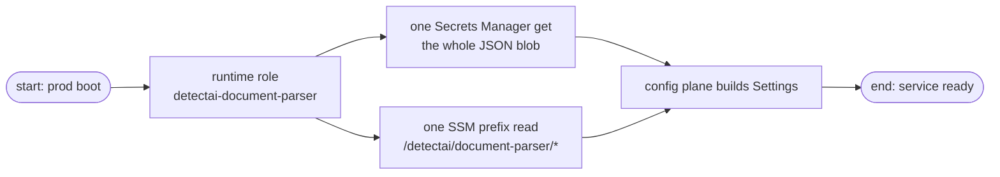
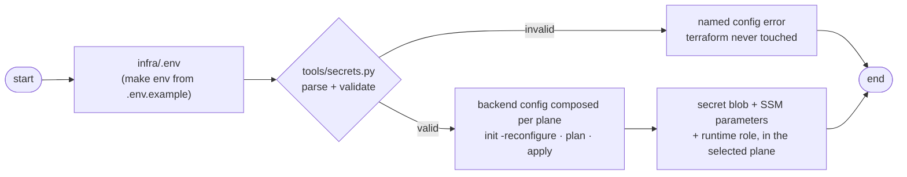

# Infrastructure

How this service's app-side AWS slice gets provisioned: the credential store, the non-secret config parameters, and the runtime role. Driven by make targets at the service root; the terraform stack lives in `infra/terraform/`. Read the [secrets guide](secrets.md) first if you are here for how the key is handled at runtime — this page is about provisioning it.

The stack does not deploy the app. The app runs locally (`make run`) or through compose; terraform manages only what the app *reads*.

## What the stack creates

| Resource | Name | Who reads it, when |
|----------|------|--------------------|
| Secrets Manager blob | `detectai/document-parser/secrets` | the prod config plane at boot — one fetch of a JSON blob whose keys are env names (`API_KEY`, license key) |
| SSM parameters | `/detectai/document-parser/<KEY>` | the prod config plane at boot — non-secret runtime config, seeded from the `.env` allowlist (`SSM_SEED_KEYS` in `tools/secrets.py`) |
| IAM runtime role | `detectai-document-parser` | the app's read identity: get the blob, read the config prefix — nothing else |

Because the blob is a JSON object read whole at boot, adding a key later is a terraform-only change — no consumer-side schema migration. There is no S3 in the stack: the app is stateless, so the state bucket is deploy-tooling territory, not a stack resource.



### Two identities

| Role | Created by | Can do |
|------|------------|--------|
| `detectai-document-parser` (runtime, in-stack) | `make secrets-apply`, on both planes | read the secret blob and the config prefix — nothing else |
| `detectai-document-parser-deploy` (deploy, out-of-stack) | `make secrets-iam-bootstrap`, one-time | terraform's own workload for this service only: state-bucket lifecycle, secret and SSM write/read, administering the runtime role |

The runtime role is in-stack with an inline policy, so the deploy role never needs managed-policy churn or `PassRole`. The deploy role is deliberately out-of-stack so terraform never manages its own identity — the first-ever apply still runs under your current credentials.

## Two planes

One stack, two destinations, flipped by `EMULATOR_ENDPOINT` in `infra/.env`:


| | Emulator (Floci/LocalStack) | Real AWS |
|--|-----------------------------|----------|
| Selected by | `EMULATOR_ENDPOINT` set | line empty or removed |
| Credentials | dummy `test`/`test` | real AWS keys |
| State bucket | `TF_STATE_BUCKET`, or default `detectai-docparser-tfstate` when unset | `TF_STATE_BUCKET` (required) |
| Secret deletion | instant (0-day recovery window) | 30-day recovery window |
| Apply | auto-approved | interactive confirm |

The provider block adapts itself (`providers.tf`): the emulator plane gets `test` credentials, `skip_*` flags, and endpoint overrides for `secretsmanager`, `ssm`, `iam`, `sts`; the real-AWS plane leaves all of that unset. IAM policy ARNs need a 12-digit account id — real AWS resolves it from your credentials; the emulator pins `000000000000` (override with `TF_VAR_aws_account_id`).

One caveat: the emulator accepts every IAM call but **never enforces IAM policies**, so a green apply there proves structure only — enforcement bites on real AWS.

## The provisioning pipeline

`infra/.env` → `tools/secrets.py` (parse → validate → `TF_VAR_*`) → terraform → the selected plane. Terraform never reads `.env`; the Python tool is the only bridge. The driver prints secrets only as lengths, never values.



Validation repeats at three layers on purpose (defense-in-depth, not duplication): the tool checks human input before terraform runs, `infra/terraform/variables.tf` protects the stack, and `modules/document-parser/variables.tf` protects the contract for any caller.

There are no `backend.*.hcl` files. The tool composes the backend config (bucket, key, region, per-plane flags) into a temp file and feeds `init -reconfigure` — never run bare `terraform init`.

## First-time setup

From the service root (`services/document-parser`):

```sh
make env                        # create infra/.env from the example; set a real API_KEY
make secrets-check              # validate .env, preview plane and vars (no terraform, no AWS)
make secrets-bootstrap-state    # create the state bucket for the selected plane (idempotent)
make secrets-plan               # plan against the plane .env selects
make secrets-apply              # apply (auto on the emulator, confirm on real AWS)
make secrets-iam-bootstrap      # one-time: the out-of-stack deploy role
```

The state bucket must exist before the first `init`. On the emulator an unset `TF_STATE_BUCKET` falls back to the fixed local default; on real AWS a bucket name is required — a sandbox bucket per engineer, versioned and encrypted (bootstrap enables versioning), so parallel testing never collides on one ledger.

## Teardown

| Command | Removes | Keeps |
|---------|---------|-------|
| `make secrets-clean` | the secret + versions, the SSM parameters, the runtime role (terraform destroy) | state bucket, ledger, deploy role |
| `make secrets-destroy` | everything above, **plus** every object version, the state bucket itself, and the deploy role | nothing |

Two rules make these safe to reach for:

- **`terraform destroy` never touches the state bucket** — it is backend storage, not a stack resource. Only `secrets-destroy` deletes it, and only after destroy succeeded.
- **On real AWS, `secrets-destroy` asks for the typed bucket name** before destroying anything — a refusal cancels the run. It also warns when the bucket holds objects outside `document-parser/`, since wiping a shared sandbox bucket takes sibling stacks' state with it.

After `secrets-clean`, re-applying is just `make secrets-apply` again — init reuses the kept ledger, which now holds empty state. Destroying on real AWS schedules the secret into the 30-day recovery window; skipping it needs `--force-delete`, which has no make wrapper: `poetry run python tools/secrets.py destroy --force-delete`.

## Good to know

- The state *key* is fixed per plane (`document-parser/terraform.tfstate` vs `document-parser/floci/terraform.tfstate`); the *bucket* is per engineer. Changing the bucket or region after a first apply points terraform at a new empty ledger — `plan` offers to create everything again, nothing migrates.
- The emulator's S3 and Secrets data is in-memory: a container restart can drop it. Recovery is cheap — any terraform verb recreates the bucket itself, so a bare `make secrets-apply` rebuilds the whole plane.
- The real-AWS plane needs Terraform ≥ 1.10 for the `use_lockfile` backend flag.
- The state file stores `secret_string` in plaintext — keep the prod bucket versioned, encrypted, and access-restricted.
- The full command surface (including `--dry-run` previews) is `tools/secrets.py`; the make targets are the thin wrappers listed in [Make Commands](../reference/make.md).

## Testing

Two suites cover this area, and they are not the same thing:

- `terraform test` (run from `infra/terraform/`) — `tests/document-parser.tftest.hcl`, mocked AWS provider, no emulator or real AWS needed. Asserts the contract name is the output, the emulator plane keeps a 0-day recovery window, the prod plane keeps 30 days, the runtime role keeps its service-scoped name, and SSM seeding follows the `/detectai/document-parser/` prefix only (an unset map seeds nothing).
- `make secrets-test` — pytest of the pipeline driver itself (`tests/unit/config/test_secrets_tool.py`): the `.env` parse and validation layer.

## Next Steps

- **[Secrets](secrets.md)** — where the credential lives per plane and how the runtime resolves it
- **[Configuration](../getting-started/configuration.md)** — the config planes that consume these resources
- **[Make Commands](../reference/make.md)** — every make target, annotated
