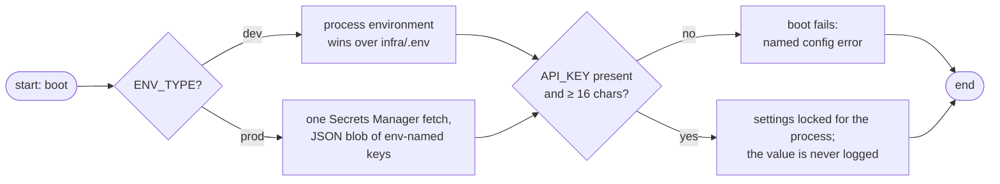
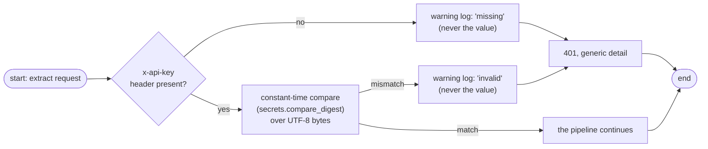

# Secrets

This service keeps secrets deliberately small: **one credential guards every extraction** — the shared `API_KEY` — plus the observability license key when telemetry is on. This page covers where each value lives per plane, how the runtime handles it, and how it is provisioned and rotated.

## Where each value lives

| Value | Dev plane | Prod plane | Load/e2e rig |
|-------|-----------|------------|--------------|
| `API_KEY` | process env, or `infra/.env` (env wins) | Secrets Manager blob (`API_KEY` inside the JSON secret) | `infra/.env.load` |
| `NEW_RELIC_LICENSE_KEY` | process env, or `infra/.env` | Secrets Manager blob | not needed |
| `API_URL` | — | — | `infra/.env.load` |

Files that hold real values (`infra/.env`, `infra/.env.load`) are gitignored; only their committed templates (`.env.example`, `.env.load.example`) ever enter the repository.

## How the key resolves at boot



Two things the resolution guarantees:

- **The boot validates the credential itself** — not just presence, but the 16-character floor. No request ever runs against a service whose credential was never checked.
- **The value is read once** and frozen for the process lifetime. Rotating the secret therefore needs a restart to take effect — see [rotation](#rotation) below.

## How the key is checked at runtime



The rules pinned by this one credential:

| Rule | Why |
|------|-----|
| `x-api-key` is the only carrier | one credential, one comparison path to test — no `Authorization: Bearer` second envelope |
| constant-time compare | timing cannot be used to extract the secret byte by byte |
| missing vs invalid are indistinguishable in the response | the caller learns nothing by trying variants |
| rejected attempts are logged at warning level without the attempted value | an incident shows *what happened*, never *what the attacker typed* |
| probes and health stay open | monitoring does not need (or hold) the secret |

## Provisioning the prod secret

The secret seed lives in `infra/.env` (copied from `.env.example`) and the pipeline is driven through make targets — the app never writes secrets anywhere:

```sh
make secrets-check      # validate infra/.env, preview the plane — no AWS
make secrets-bootstrap-state  # create the state bucket for the selected plane
make secrets-plan       # terraform plan of the secrets stack
make secrets-apply      # apply (auto on the emulator plane, confirm on real AWS)
make secrets-seeder-bootstrap  # one-time: the out-of-stack seeder role (the write carrier)
```

Those verbs, the planes behind them, state handling, and teardown are the [infrastructure guide's](infrastructure.md) subject — here we only needed the destination.

The payload seeded by that flow is a JSON object whose keys are the env names — `API_KEY` and `NEW_RELIC_LICENSE_KEY` are simply entries in it. The prod config plane resolves the *whole* blob at once at boot, and (see [configuration](../getting-started/configuration.md)) treats secrets and SSM parameters as disjoint planes: a key seeded into both is an operator error the boot refuses to paper over.

### Rotation

1. Update the value in the plane it lives in (`make secrets-apply` for prod; edit the file for dev).
2. Restart the service. Config is resolved **once** per boot, so a rotated key goes live exactly when a new instance starts — and never mid-flight.

## Hygiene checklist

- [ ] Real values only in gitignored files — never in templates, no matter how harmless they look
- [ ] `API_KEY` is ≥ 16 characters (the boot enforces it; make it long anyway)
- [ ] Nothing echoes the credential into logs — the application layer already never does; keep your own tooling equally quiet
- [ ] Do not add a second credential carrier ("the same key in an Authorization header too") — each extra envelope multiplies the comparison surface for no benefit
- [ ] Rotate with *only* the documented apply + restart flow, so every component reads the same version

## Next Steps

- **[Configuration](../getting-started/configuration.md)** — the credential's validation table and plane rules
- **[Quick Start](../getting-started/quickstart.md)** — setting a local key in the first-run flow
