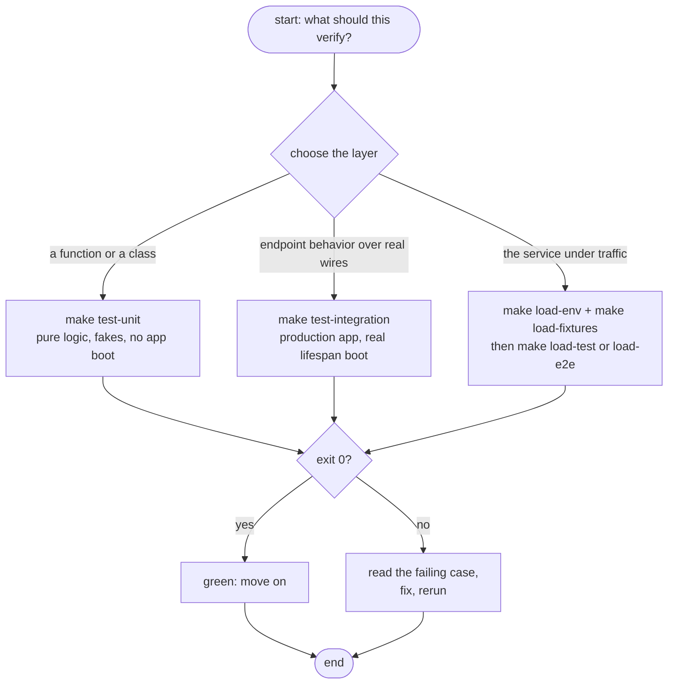
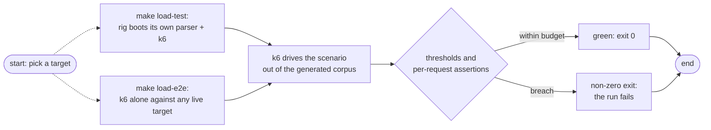

# Testing

Three layers, each answering a different question. The rule that keeps them honest: **unit tests hold pure logic with fakes; integration tests drive the production app with the real boot** — the two trees are a hard boundary, no shortcuts in either direction.

| Question | Layer | Command |
|----------|-------|---------|
| Does this function do the right math? | unit | `make test-unit` |
| What does a caller actually receive? | integration | `make test-integration` |
| How does the service behave under traffic? | load | `make load-test` / `make load-e2e` |

`make test` runs unit + integration together. Green means exit 0; test frameworks and k6 alike propagate failures to the shell.



## Unit — fast and faked

One folder per component, pure logic only. The suite pins the semantics integration builds on: the constant-time compare, every config plane merge rule, the fail-closed bound coercion, the cleaning normalizer rule by rule, the deadline math, and the metric facade's instrument mapping.

| Folder | Covers |
|--------|--------|
| `tests/unit/api/` | the key guard: comparison semantics, the generic 401, no echo of attempts |
| `tests/unit/validation/` | strategy claims and declines, the diagnosis sniffer, registry order |
| `tests/unit/extraction/` | cleaning rules, deadline + cap ownership, per-strategy behavior |
| `tests/unit/config/` | dotenv/env merges, plane factory, settings validation, the secrets CLI |
| `tests/unit/observability/` | adapters, resource, the null-vs-wired build, instrument mapping |

## Integration — the real app over real wires

The client runs the production app's **real lifespan boot** — same config resolution, same wiring, same routing as anything serving traffic. One conftest pins the boot (`ENV_TYPE=dev`, a known `API_KEY`, no OTel endpoint) before the app spins up, so every boot is deterministic regardless of the host's own exports.

| Suite | What it pins |
|-------|--------------|
| `config/test_emulator_plane` | the prod plane resolved through the actual boot path against the local AWS emulator (skips politely when it isn't up) |
| `extract/test_gate` | what a caller gets for every credential outcome — 401s, generic detail, nothing leaked |
| `extract/test_input` | the full-path matrix: bounded read, multipart forms, sniffed-vs-declared types, each verdict's exact wire shape |
| `extract/test_document_bounds` | admission verdicts end to end with shrunken bounds — 413 names its limit, 422 stays generic |
| `extract/test_lifecycle` | budget and cap through the route: 200 inside, 504 over, the flag flipped in 200 bodies |
| `extract/test_observability_boot` | the gate on the real lifespan: endpoint unset → the null object installed |
| `extract/test_verdict_recordings` | every verdict recorded through the seam against a recording stub — and the 401 recording nothing |

## Load + e2e — traffic, not tests

k6 suites under `tests/load/`. One file — `infra/.env.load` (copy the template `.env.load.example`) — configures *everything*; there are no CLI overrides, so one edit re-arms both the parser and k6 together.

```sh
make load-env        # create infra/.env.load from the example
make load-fixtures   # generate the corpus once (gitignored)
make load-test       # container rig: parser + k6 on an isolated network
make load-e2e        # k6 only, against whatever API_URL names
make load-down       # tear the rig down
```



### Two scenarios

| Scenario | Shape | Pass criteria |
|----------|-------|---------------|
| `smoke` | 1 VU, 1 iteration: probes, one 200 per format, then the full rejection matrix | every request asserts its exact answer |
| `load` | `ramping-arrival-rate` shaped by `STAGES` (ramp, spike, or `4h:2` soak — data, not code) | `p95 < 1500 ms`, `p99 < 3000 ms`, success ≥ 99% |

The smoke matrix maps the guards one to one: missing and wrong key (401), oversized body (413), multipart with no `file` field (422), then every file under `assets/invalid/` at the status the generator pinned for it. A readiness `503` during load is recorded as **backpressure, not a failure**.

### The generated corpus

Nothing is handwritten. `make load-fixtures` builds `tests/load/assets/` — real docx/pdf/txt from a deterministic (RNG-free) grammar — and self-checks every file through the real pipeline before k6 ever runs: the **manifest always describes what the service actually does**, and generation fails loudly on any drift.

| Tier | Size | Default wire answer |
|------|------|---------------------|
| `short` | ~4 KiB | 200 |
| `mid` | ~512 KiB | 200 |
| `long` | ~2.9 MiB | 200, `truncated: true`, exactly 1,000,000 chars |
| `oversize` | ~8 MiB | 413 (valid content; re-boot with a raised limit to flip it to 200) |

Plus an `invalid/` set of nine files (imposter PNG-as-PDF, latin-1 text, corrupt/severed docx, scanned textless pdf, …) pinned to either 415 or 422 — admission-declined uploads answer 415 with the sniffed truth, anything admitted-but-unextractable answers the generic 422.

Regenerate whenever fixture design or service knobs change (`make load-fixtures`); the binaries are never committed.

### The knobs

Each knob lives in `infra/.env.load` with a built-in default: `SCENARIO`, `STAGES`, `MAX_VUS`, `API_URL`/`API_KEY`, and the `DOCPARSER_LOAD_*` keys for HTTP budget, corpus mix, and the smoke matrix's oversized body. The parser's own knobs arrive through the same file, which is how the different-limit boots work — raise `UPLOAD_LIMIT_BYTES` and both the parser cap and the smoke matrix's 413 case move together. Threshold trio (`DOCPARSER_LOAD_P95_MS`, `P99_MS`, `MIN_SUCCESS_RATE`) is likewise data.

## Next Steps

- **[HTTP reference](../reference/http-api.md)** — every status the suites assert, in one table
- **[Configuration](../getting-started/configuration.md)** — the keys the different-limit boots move
