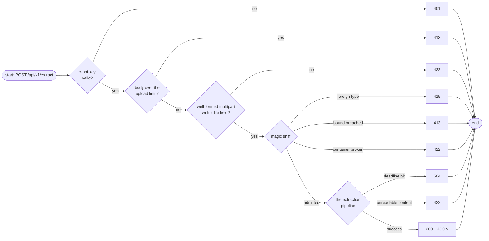

# HTTP API

The wire contract for every caller. Errors follow the FastAPI convention — always a JSON body like `{"detail": "…"}`. There is no metrics endpoint by design; observability travels through the OTel pipeline ([Observability](../concepts/observability.md)).

## Endpoints

| Method + Path | Auth | Purpose |
|---------------|------|---------|
| `POST /api/v1/extract` | required | Multipart upload → extracted text |
| `GET /api/v1/health` | open | Liveness probe |
| `GET /api/v1/ready` | open | Readiness probe |

The `/api/v1` prefix is versioning headroom; 404/405 behave as the framework defaults them to.

## POST /api/v1/extract — request

Multipart form with a single `file` field:

```sh
curl -X POST http://localhost:8000/api/v1/extract \
  -H "x-api-key: my-secret-key-16-chars-min" \
  -F "file=@./a-document.pdf"
```

| Input fact | Rule |
|------------|------|
| Credential | `x-api-key` header — the only carrier; no `Authorization: Bearer` |
| Body limit | the body is read up to **limit + 1** bytes (3 MiB by default); anything more is a 413 without anything further being buffered |
| `filename` | metadata only — echoed back, defaults to `"unknown"`; the pipeline never uses it |
| Declared `Content-Type` | metadata only — **the sniffed MIME wins** and is what the response reports |

## Response — 200

```json
{
  "filename": "a-document.pdf",
  "content_type": "application/pdf",
  "text_length": 15234,
  "text": "…",
  "truncated": false
}
```

| Field | Meaning |
|-------|---------|
| `filename` | as sent by the caller, or `"unknown"` |
| `content_type` | the **sniffed** MIME type — the value the admission gate decided on |
| `text_length` | number of Unicode characters in `text` |
| `text` | the extracted (and cleaned) text |
| `truncated` | `true` when the returned text is **not the complete extractable text** — output cap hit, or a PDF that yielded only some of its pages; one flag, one meaning |

## The decision map



## Status codes

| Code | When | Body detail |
|------|------|-------------|
| 200 | Extraction succeeded | the JSON object above |
| 401 | API key missing or invalid | generic — the two cases are indistinguishable |
| 413 | Body larger than the upload limit | names the limit |
| 415 | Sniffed MIME not in the allow-list | names the sniffed MIME |
| 422 | Corrupt or undecodable document; malformed multipart | the one generic `corrupt or unsupported upload` detail |
| 504 | Processing exceeded the budget | generic — the wire cannot say which page |
| 500 | Unexpected error | the framework default |

429 (admission control) intentionally does not appear: explicit 429/503 shedding is out of scope for this service.

## Probes

| Path | 200 body |
|------|----------|
| `/api/v1/health` | `{"status": "ok"}` |
| `/api/v1/ready` | `{"status": "ready"}` |

## Error examples

```sh
# wrong key → 401 {"detail":"invalid or missing API key"}
# oversize body → 413 {"detail":"the request body exceeds the 3145728-byte upload limit"}
# a PNG posing as PDF → 415 {"detail":"unsupported document type: image/png"}
# corrupt docx → 422 {"detail":"corrupt or unsupported upload"}
# slow document → 504 {"detail":"the processing budget was exceeded"}
```

Errors are refused in request order — credential first, size next, format last — so a single request never gets two rejections to disentangle.

## Next Steps

- **[Validation](../concepts/validation.md)** — why 415 and 422 differ, layer by layer
- **[Extraction](../concepts/extraction.md)** — where `truncated` comes from
