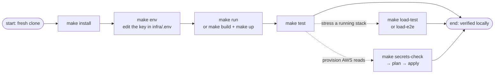

# Make Commands

Every verb of this service is a make target run from `services/document-parser`; `make help` prints the raw index, and this page is that index plus a purpose and a deep-dive doc for each row. Targets live in five files under `mk/`, and the sections below follow the same order as a working day — set up, run, verify, then the deeper orbits.

## The lifecycle at a glance

Details: [Quick Start](../getting-started/quickstart.md) walks the main line step by step.

## Local — `mk/local.mk`

| Target | What it does | Reach for it when |
|--------|--------------|-------------------|
| `make run` | uvicorn with `--reload` on port 8000 | everyday development; code changes hot-reload |
| `make install` | `poetry install` | fresh clone, or after pulling dependency changes |
| `make lock` | regenerates `poetry.lock` | after editing `pyproject.toml` |
| `make env` | copies `.env.example` → `infra/.env` **if missing** | first run; it never overwrites an existing file |
| `make clean` | drops pytest/ruff caches and app bytecode | odd failures with nothing obviously changed |

## Docker — `mk/docker.mk`

| Target | What it does | Reach for it when |
|--------|--------------|-------------------|
| `make build` | builds the image (`detectai-document-parser`) | before `up`, or to test the Dockerfile |
| `make up` | compose up detached, building; `PORT=8000 make up` wins over the env file | same behavior as `make run`, minus hot reload |
| `make down` | compose down | when done with the stack |
| `make logs` | compose logs `-f` | a running stack misbehaves |
| `make ps` | compose `ps` | is it even up? |

The compose stack reads `infra/.env` wholesale, so both ways of running answer the same config.

## Tests — `mk/tests.mk`

| Target | What it does | Reach for it when |
|--------|--------------|-------------------|
| `make test` | unit + integration in one go | before pushing anything |
| `make test-unit` | pure logic only, no app boot (`tests/unit`) | iterating on a single validation or cleaning rule |
| `make test-integration` | the production app with a real lifespan boot (`tests/integration`) | wires or config resolution changed |
| `make load-fixtures` | generates the load corpus once (`tests/load/assets/`, gitignored) | before the first load run on a fresh tree |

## Load and e2e — `mk/load.mk`

One `infra/.env.load` configures everything, `SCENARIO` included (`smoke` or `load`) — there are no CLI overrides, so: edit the file, rerun.

| Target | What it does | Reach for it when |
|--------|--------------|-------------------|
| `make load-env` | creates `.env.load` from the template if missing | first run; the file is then the single lever for every knob |
| `make load-test` | container rig: parser + k6 on an isolated network, k6's exit code survives the teardown | throughput, on your own private rig |
| `make load-e2e` | k6 alone, against whatever the file's `API_URL` names | a specific target — local, docker, or prod |
| `make load-down` | removes the rig and any e2e leftovers | cleaning up after either run |

## Secrets and AWS — `mk/secrets.mk`

| Target | What it does | Reach for it when |
|--------|--------------|-------------------|
| `make secrets-check` | validates `infra/.env` and previews the plane and vars — no terraform, no AWS | before anything else, always |
| `make secrets-bootstrap-state` | creates the state bucket for the plane `.env` selects (idempotent) | first apply, or after an emulator restart ate the bucket |
| `make secrets-plan` | terraform plan against the selected plane | reading what would change |
| `make secrets-apply` | terraform apply — auto-approved on the emulator, interactive confirm on real AWS | making it real |
| `make secrets-iam-bootstrap` | creates/updates the out-of-stack deploy role | one-time, or to recreate it after a full wipe |
| `make secrets-clean` | terraform destroy; keeps the state bucket and ledger | wiping resources, keeping your place |
| `make secrets-destroy` | full teardown: destroy, then the bucket purge, then the deploy role | leaving no trace |
| `make secrets-test` | pytest for the pipeline driver `tools/secrets.py` | the parse/validation layer changed |

The order, the two planes, state handling, and the teardown rules are the [infrastructure guide](../guides/infrastructure.md)'s subject — this page only lists the levers.

## Targets make calls for you

`load-check` (rejects an unknown `SCENARIO` or a missing corpus before compose runs) fires as an order-only prerequisite of `load-test` and `load-e2e`; `load-down-remote` is the child cleanup verb `load-down` delegates to first. Neither needs to be invoked by hand — they are listed so the index matches `mk/` completely.

## Next Steps

- **[Quick Start](../getting-started/quickstart.md)** — the main line, step by step
- **[Testing](../guides/testing.md)** — what `test`/`test-unit`/`test-integration` run and why
- **[Infrastructure](../guides/infrastructure.md)** — behind the secrets targets
