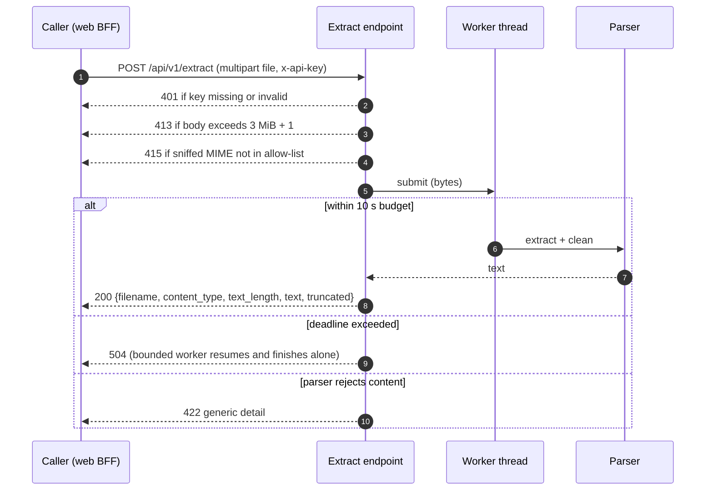

# HTTP Design

The wire contract for the document-parser service. Requirements live in [requirements.md](requirements.md) — this document specifies exactly how they are served.

## Compatibility statement

The contract is byte-for-byte identical to the pre-refactor service, with exactly three deliberate changes: authenticated `POST /api/v1/extract` can now return **401**, the `truncated` flag has one unified meaning, and the default upload bound moves **10 MiB → 3 MiB** (`UPLOAD_LIMIT_BYTES` stays configurable — the why lives in [requirements.md](requirements.md)). Consumers need no schema changes; callers uploading larger bodies now answer 413 named at the new limit.

## Endpoints

| Method + Path | Auth | Purpose |
|---------------|------|---------|
| `POST /api/v1/extract` | required | Multipart upload → extracted text |
| `GET /api/v1/health` | open | Liveness probe |
| `GET /api/v1/ready` | open | Readiness probe — signals shedding when saturated |

The `/api/v1` prefix stays — future versioning without breaking callers. Error codes follow the FastAPI convention: `{"detail": "…"}`. There is **no metrics endpoint** — the service is observed exclusively through the OTel pipeline (see [observability.md](observability.md)).

### Request lifecycle



### Deployment front door

API Gateway → Lambda (container image via the Lambda Web Adapter). The door shapes three numbers of this contract:

- The 6 MB synchronous invocation payload (request **and** response) shapes both ends: the default upload bound is 3 MiB, and the 1M-char output cap keeps the worst-case response (~3–4 MB of UTF-8) inside the same ceiling — JSON responses are not base64-inflated.
- API Gateway buffers the full request body before invoking, so the bounded read's "bulk never buffered" property holds inside the service only. Accepted: at 3 MiB the platform-side buffering is bounded.
- Timeout stack: function timeout 12 s > in-code budget 10 s; the API Gateway integration timeout sits above both. The innermost shaped response always wins — a platform timeout is an opaque 502, never the spec-shaped 504.

## POST /api/v1/extract

### Request

- Multipart form, single field `file`.
- `filename` is metadata only — echoed in the response (defaults to `"unknown"`). The pipeline does not use it; sniffed MIME wins over any declared type.
- Enforcement: the body is read up to **3 MiB + 1 byte**; anything larger is rejected with 413 without full buffering.

### Response — 200

```json
{
  "filename": "sample.pdf",
  "content_type": "application/pdf",
  "text_length": 15234,
  "text": "…",
  "truncated": false
}
```

| Field | Meaning |
|-------|---------|
| `filename` | As sent by the caller, or `"unknown"` |
| `content_type` | The **sniffed** MIME type (authoritative, not the declared one) |
| `text_length` | Number of Unicode characters in `text` (`len(text)`) |
| `text` | Extracted text |
| `truncated` | `true` when the returned text is **not the complete extractable text** — output cap hit, or a PDF that yielded only some of its pages. One rule replaces the old inconsistent semantics (PDF set it for unreadable pages; DOCX clipped silently with `truncated: false`) |

### Status codes

| Code | When | Body detail |
|------|------|-------------|
| 200 | Extraction succeeded | — |
| 401 | API key missing or invalid (generic message; the two cases are indistinguishable); the credential travels as the `x-api-key` header only, so no `WWW-Authenticate` challenge is sent | generic |
| 413 | Body larger than 3 MiB | includes the limit |
| 415 | Sniffed MIME not in the allow-list | names the MIME |
| 422 | Corrupt or undecodable document — including FastAPI's default malformed-multipart rejection | generic (a corrupt file cannot be branded) |
| 429 | Explicitly out of scope — admission control is deferred | — |
| 504 | Processing exceeded the 10 s budget | generic |
| 500 | Unexpected error | framework default |

405/404 and other framework defaults are untouched.

## Liveness and readiness

| Path | 200 body | 503 body |
|------|----------|----------|
| `/api/v1/health` | `{"status": "ok"}` | `{"status": "unavailable"}` |
| `/api/v1/ready` | `{"status": "ready"}` | `{"status": "not_ready"}` |

Readiness sheds traffic by reflecting worker pool saturation (NFR-6 in [requirements.md](requirements.md)); the explicit-admission alternative stays out of scope.

## Resolved decisions and rationale

1. **Contract kept identical** — every deviation costs changes in `apps/web`, the k6 assertions, and docs for zero benefit; 401 and the unified `truncated` flag are the only wire-visible differences.
2. **`text_length` is characters** — code points, matching `len(text)`; byte counts belong to metrics, not the contract.
3. **One `truncated` rule** — any lost text (cap or partial pages) means `true`; "partial PDF" and "cap-clipped" are not distinguishable to callers and need not be.
4. **Sniffed MIME over declared type** — the client cannot be trusted to declare content; the magic-byte sniff is the single source of truth (also the basis of the 415 path).
5. **One carrier for the credential** — `x-api-key` only. `Authorization: Bearer` processing existed to match another service; for this one it is the same credential in a second envelope with a second comparison path to test. The [requirements.md](requirements.md) authentication table carries the full decision.
6. **Output cap is uniform and never an error** — 1,000,000 characters, enforced once in the pipeline after cleaning, for all three types. The old service enforced it as a per-parser early-exit in PDF and DOCX loops only — **TXT bypassed it entirely** (a 10 MiB upload could return ~10M chars with `truncated: false`). The rebuild makes the guarantee single-owner; parsers may still early-exit where cheap, but the contract lives in one place. Cap-clip sets `truncated: true` alongside partial PDF pages per the unified flag rule above; `text_length` remains characters. Like the other caps it is env-configurable and fails closed.
7. **Upload bound 3 MiB default** — the Lambda invocation ceiling (6 MB) with base64 inflation decides it; the runtime survey lives in [requirements.md](requirements.md)'s Deployment target section.
8. **Timeout stack layering** — function timeout (12 s) above the in-code budget (10 s), API Gateway integration timeout above both, so the service's shaped 504 beats every platform kill: a platform timeout is an opaque 502, never the spec-shaped body.
